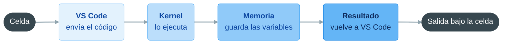

# Entorno, tipos de datos y operadores

**Bloque 3 -- Python para Data Analytics | Sesión 1 de 19**

[← Volver al índice del curso](../../README.md#bloque-3--python-para-data-analytics)

---

## 1. Introducción

En el bloque 2 hemos calculado todas las cifras de Casa Olivo con SQL: le decíamos a la base de datos **qué** queríamos y ella se encargaba de **cómo** obtenerlo. SQL es insustituible para consultar datos que ya están en una base de datos, pero el trabajo de un analista no empieza ni acaba ahí. Los datos llegan también en archivos de Excel con celdas combinadas, en CSV mal formados o desde la API de una aplicación. Hay que limpiarlos, cruzarlos con otras fuentes, calcular estadísticas, dibujar gráficos y automatizar el informe que cada lunes se hacía a mano. Para todo eso, la herramienta más extendida es **Python**.

Python es un lenguaje de programación de propósito general, y es el más usado en análisis de datos y en ciencia de datos. A diferencia de SQL, es **imperativo**: además de decir qué queremos, le indicamos paso a paso cómo conseguirlo. Eso exige aprender algo más de sintaxis, pero a cambio nos da control total sobre el proceso.

El bloque es el más largo del curso, con 19 sesiones en siete partes:

**3.1 Sintaxis y estructuras de datos.** Esta sesión (el entorno de trabajo, los tipos de datos y los operadores), la 3.1.2 (textos, listas, tuplas, diccionarios y conjuntos) y la 3.1.3 (condiciones, bucles y comprehensions).

**3.2 Funciones y objetos.** Cómo empaquetar el código para reutilizarlo y cómo se organiza en objetos.

**3.3 NumPy y Pandas.** Las dos librerías con las que se trabaja con datos tabulares en Python: carga, limpieza y transformación.

**3.4 Agregación y combinación.** El equivalente en pandas de `GROUP BY`, los JOINs y las tablas dinámicas.

**3.5 Python, SQL y ETL.** Python conectado a PostgreSQL y un proceso de extracción, transformación y carga completo.

**3.6 Visualización.** Gráficos con matplotlib y seaborn, y cómo elegir el adecuado.

**3.7 Estadística aplicada.** Distribuciones, correlación, muestreo, inferencia y test A/B.

Las tres primeras partes son las más "de programación". No pretenden convertirnos en desarrolladores de software, sino darnos la base suficiente para que el código de pandas de la parte 3.3 no sea una caja negra.

### Objetivos de la sesión
- Entender qué aporta Python al trabajo de un analista y en qué se diferencia de SQL.
- Trabajar con notebooks de Jupyter en VS Code: celdas de código y de texto, kernel y orden de ejecución.
- Crear variables y conocer los tipos de datos básicos: `int`, `float`, `str`, `bool` y `None`.
- Convertir valores de un tipo a otro y entender por qué los decimales de un ordenador no siempre son exactos.
- Calcular con los operadores aritméticos, de comparación y lógicos.
- Mostrar resultados con `print` y con *f-strings*.

### Prerequisitos
- Sesión 0.1.5 completada: Python instalado y el entorno virtual `.venv` del portfolio creado con las librerías del curso, incluida `jupyter`.
- Bloque 2 completado: sabemos qué es un tipo de datos, qué significa `NULL` y cómo se combinan condiciones con `AND` y `OR`.

---

## 2. El caso del bloque: Pedalia

**Pedalia** es el servicio de bicicleta compartida de una ciudad española de tamaño medio. Lo gestiona una empresa concesionaria por encargo del ayuntamiento y funciona así:

- Las bicicletas se recogen y se dejan en **estaciones** repartidas por la ciudad. Cada estación tiene un número fijo de **anclajes**: su capacidad.
- Hay dos tipos de bicicleta: **mecánica** y **eléctrica**, con motor de asistencia al pedaleo.
- Hay dos tipos de usuario: los **abonados**, que pagan una cuota anual, y los **ocasionales**, que pagan cada viaje con la aplicación.
- Un **viaje** empieza al desenganchar una bici de una estación y termina al engancharla en otra (o en la misma).

Las tarifas, que usaremos en todo el bloque, son estas:

| Concepto | Abonado | Ocasional |
|---|--:|--:|
| Cuota | 45 € al año | — |
| Viaje, primeros 30 minutos | incluido | 1,50 € |
| Cada 30 minutos adicionales o fracción | 0,50 € | 1,00 € |
| Suplemento por bici eléctrica | 0,40 € por viaje | 0,40 € por viaje |

Un ejemplo: un viaje de 47 minutos son 30 minutos incluidos más 17 adicionales, que cuentan como **un** bloque de 30 minutos. A un ocasional le cuesta 1,50 + 1,00 = 2,50 €, y 2,90 € si la bici es eléctrica.

### El encargo

**Marta Ibáñez**, responsable de operaciones de Pedalia, tiene que presentar al ayuntamiento el balance del año y una propuesta para el siguiente. Nos pide ayuda con tres preguntas:

1. **¿Cómo se usa el servicio?** Cuándo, dónde y quién: horas punta, estaciones más activas, abonados frente a ocasionales y la influencia del tiempo.
2. **¿Dónde falla la red?** Estaciones que se quedan sin bicis o sin anclajes libres, y cuánto trabajo de redistribución exige.
3. **¿Funcionan las tarifas y la bici eléctrica?** Quién paga qué, qué viajes generan ingresos y si compensa ampliar la flota eléctrica.

### Los datos

Los registros completos del sistema (estaciones, viajes, usuarios y la meteorología de cada día) los recibiremos en la parte 3.3, cuando sepamos usar pandas. En las partes 3.1 y 3.2 trabajaremos con **datos pequeños escritos a mano**: unas pocas estaciones y una docena de viajes. Es como hacer las cuentas en una servilleta antes de abrir la hoja de cálculo: con pocos datos podemos comprobar cada resultado de cabeza y concentrarnos en aprender el lenguaje.

---

## 3. Python y el entorno de trabajo

### Python frente a SQL

| | SQL | Python |
|---|---|---|
| Estilo | **Declarativo**: describimos el resultado | **Imperativo**: escribimos los pasos |
| Dónde viven los datos | En la base de datos | En la memoria del ordenador, mientras el programa está en marcha |
| Para qué es mejor | Consultar, filtrar, agrupar y cruzar tablas grandes | Todo lo demás: leer cualquier formato, limpiar, calcular estadísticas, dibujar gráficos, automatizar, modelos de *machine learning* |
| En el curso | Bloque 2 | Bloques 3 y 4 |

No compiten: en un proyecto real se usan juntos. Lo habitual es pedir a la base de datos, con SQL, solo los datos que necesitamos, y seguir trabajando con ellos en Python. Lo haremos en la parte 3.5.

### Script o notebook

El código de Python se puede escribir de dos formas:

- **Script** (`.py`): un archivo de texto con instrucciones que se ejecutan todas seguidas, de arriba abajo. Es lo que hicimos en la sesión 0.1.5 con `verificar_entorno.py`. Es la forma adecuada para un proceso que se ejecuta solo, por ejemplo cada noche.
- **Notebook** (`.ipynb`): un documento dividido en **celdas** que se ejecutan una a una, y que guarda junto a cada celda su resultado. Mezcla código, resultados, tablas, gráficos y texto explicativo en Markdown. Es la forma habitual de **explorar** datos y de **contar** un análisis.

En las partes 3.1 a 3.4 trabajaremos con notebooks de **Jupyter**, el formato estándar, abiertos en VS Code.

### Cómo funciona un notebook

Un notebook tiene dos tipos de celda:

- **Celdas de código.** Se ejecutan con `Shift + Enter` (ejecuta y pasa a la siguiente) o `Ctrl + Enter` (ejecuta y se queda). Debajo aparece su resultado, y a la izquierda un número entre corchetes, `[1]`, `[2]`..., que indica **en qué orden** se ha ejecutado cada celda.
- **Celdas de Markdown.** Texto con formato (sesión 0.1.4) para poner títulos, explicar lo que hacemos y anotar conclusiones.

Detrás del notebook hay un **kernel**: un proceso de Python en marcha que ejecuta las celdas y **recuerda** todo lo que se ha calculado hasta ese momento. Si en una celda creamos una variable, las celdas que ejecutemos después pueden usarla. Si cerramos VS Code o **reiniciamos el kernel**, esa memoria se borra y hay que volver a ejecutar las celdas.

Una celda de código muestra automáticamente el valor de su **última línea**, si es una expresión. Para mostrar cualquier otra cosa, o varias, usamos la función `print`:

```python
24 - 9
```

```
15
```

```python
print("Plaza Mayor")
print(24 - 9)
```

```
Plaza Mayor
15
```

### La frase clave

> Un notebook no se ejecuta de arriba abajo: se ejecuta en el orden en que pulsamos las celdas. Lo que cuenta es lo que el kernel recuerda, no lo que vemos en pantalla. Antes de dar un análisis por terminado, reiniciamos el kernel y lo ejecutamos todo de nuevo.

---

## 4. Variables

Una **variable** es un nombre que damos a un valor para poder usarlo después. Se crea con el signo `=`, que en Python significa **asignar**, no "es igual a":

```python
capacidad = 24
bicis = 9
anclajes_libres = capacidad - bicis
anclajes_libres
```

```
15
```

Se lee de derecha a izquierda: se calcula lo que hay a la derecha del `=` y el resultado se guarda con el nombre de la izquierda. Por eso es válido escribir `bicis = bicis + 1`: toma el valor actual de `bicis`, le suma uno y lo guarda con el mismo nombre.

En Python **no se declara el tipo** de una variable: lo deduce del valor que le damos, y una misma variable puede guardar después un valor de otro tipo. En SQL, en cambio, cada columna declaraba su tipo en el `CREATE TABLE` (sesión 2.1.1).

Las reglas para los nombres:

- Pueden llevar letras, números y guiones bajos, pero no pueden empezar por un número ni llevar espacios: `bicis_disponibles` sí, `bicis disponibles` y `2bicis` no.
- **Distinguen mayúsculas de minúsculas**: `bicis` y `Bicis` son dos variables distintas.
- No pueden coincidir con las palabras reservadas del lenguaje, como `if`, `for`, `in`, `and` o `True`.
- La convención en Python, que seguiremos en el curso, es escribirlos en minúsculas con guiones bajos (`snake_case`) y elegir nombres que expliquen qué contienen: `ocupacion` mejor que `x`. Python admite tildes en los nombres, pero se evitan por costumbre.

Igual que en SQL, lo que va detrás de `#` es un **comentario** hasta el final de la línea:

```python
cuota_abono = 45     # euros al año
```

---

## 5. Tipos de datos básicos

Todo valor en Python tiene un **tipo**, que determina qué podemos hacer con él. La función `type` nos lo dice:

```python
type(24)
```

```
int
```

Los cinco tipos básicos:

| Tipo | Qué guarda | Ejemplo en Pedalia | Equivalente en PostgreSQL |
|---|---|---|---|
| `int` | Números enteros | `capacidad = 24` | `INTEGER` |
| `float` | Números con decimales | `precio = 1.50` | `DOUBLE PRECISION` |
| `str` | Texto (*string*) | `estacion = "Plaza Mayor"` | `VARCHAR`, `TEXT` |
| `bool` | Verdadero o falso | `es_electrica = True` | `BOOLEAN` |
| `NoneType` | La ausencia de valor: solo admite `None` | `valoracion = None` | `NULL` |

Algunos detalles de cada uno:

- **Los decimales se escriben con punto**, nunca con coma: `1.50`. La coma tiene otro significado en Python, y escribir `precio = 1,50` no da error pero no hace lo que esperamos (sección 11).
- **Los textos van entre comillas**, simples o dobles: `"Plaza Mayor"` y `'Plaza Mayor'` son lo mismo. A diferencia de SQL, en Python las dos comillas valen igual. Usaremos dobles.
- **`True` y `False` se escriben con mayúscula inicial.** `true` daría un error.
- **`None` es el `NULL` de Python**: un dato que no existe. Por ejemplo, la valoración de un viaje cuando el usuario no la ha puntuado. Se pregunta por él con `is None`, igual que en SQL se usaba `IS NULL`.

```python
valoracion = None
valoracion is None
```

```
True
```

### Los decimales no siempre son exactos

En la sesión 2.1.1 vimos que para el dinero se usa `NUMERIC` y no los tipos de coma flotante, porque estos guardan **aproximaciones**. El `float` de Python es de coma flotante, y se nota:

```python
0.1 + 0.2
```

```
0.30000000000000004
```

No es un error de Python: el ordenador guarda los números en binario, y 0,1 en binario tiene infinitas cifras, como 1/3 en decimal (0,3333...). Al guardarlo se redondea, y al sumar dos redondeos aparece una diferencia minúscula. Para un análisis de datos no importa, porque es del orden de una milbillonésima. Pero tiene dos consecuencias prácticas:

- **No comparamos decimales con `==`** sin redondear antes: `0.1 + 0.2 == 0.3` es `False`, y `round(0.1 + 0.2, 2) == 0.3` es `True`.
- **Al mostrar importes, los redondeamos** a dos decimales (sección 7).

### Convertir de un tipo a otro

Las funciones `int`, `float`, `str` y `bool` convierten un valor al tipo de su nombre. Las usaremos constantemente, porque **los datos que se leen de un archivo llegan como texto**, igual que en un CSV todo era texto (sesión 1.1.1):

```python
capacidad_texto = "18"
int(capacidad_texto) + 2
```

```
20
```

| Conversión | Resultado | Comentario |
|---|---|---|
| `int("18")` | `18` | De texto a entero. |
| `float("2.5")` | `2.5` | De texto a decimal. |
| `str(24)` | `'24'` | De número a texto. Las comillas indican que el resultado es un `str`. |
| `int(3.9)` | `3` | **Trunca**: quita los decimales, no redondea. Para redondear, `round(3.9)`. |
| `float("2,5")` | `ValueError` | La coma decimal no se entiende. Lo resolveremos en la 3.1.2. |
| `int("3.9")` | `ValueError` | Un texto con decimales no se convierte directamente en entero. |

`bool` también convierte: el cero, el texto vacío `""` y `None` se consideran **falsos**; cualquier otro número o texto, **verdadero**. Ojo: `bool("0")` es `True`, porque `"0"` es un texto que no está vacío.

---

## 6. Operadores

### Aritméticos

| Operador | Operación | Ejemplo | Resultado |
|---|---|---|---|
| `+` | Suma | `9 + 3` | `12` |
| `-` | Resta | `24 - 9` | `15` |
| `*` | Multiplicación | `3 * 52` | `156` |
| `/` | División | `9 / 24` | `0.375` |
| `//` | División entera | `75 // 60` | `1` |
| `%` | Resto de la división entera (*módulo*) | `75 % 60` | `15` |
| `**` | Potencia | `2 ** 10` | `1024` |

La división `/` **siempre devuelve un `float`**, aunque el resultado sea exacto: `10 / 2` es `5.0`. La división entera `//` y el resto `%` van juntos y son más útiles de lo que parece. Con ellos pasamos 75 minutos a horas y minutos:

```python
duracion = 75
horas = duracion // 60
minutos = duracion % 60
print(horas, "h", minutos, "min")
```

```
1 h 15 min
```

`print` admite varios valores separados por comas y los muestra separados por un espacio.

El orden de las operaciones es el de las matemáticas: primero `**`, después `*`, `/`, `//` y `%`, y por último `+` y `-`. Ante la duda, paréntesis.

Para actualizar una variable a partir de su propio valor hay una forma abreviada:

```python
bicis = 9
bicis += 3        # equivale a bicis = bicis + 3
bicis
```

```
12
```

Existen igualmente `-=`, `*=` y `/=`.

### Funciones integradas para números

Python trae algunas funciones listas para usar con números: `round(valor, decimales)`, `abs(valor)` (valor absoluto), `max(a, b, ...)` y `min(a, b, ...)`. Con `max` resolvemos un caso típico de las tarifas: los minutos que exceden de los 30 incluidos, que nunca pueden ser negativos.

```python
minutos_viaje = 47
exceso = max(0, minutos_viaje - 30)
exceso
```

```
17
```

### De comparación

Comparan dos valores y devuelven un `bool`:

| Operador | Significa | En SQL |
|---|---|---|
| `==` | igual | `=` |
| `!=` | distinto | `<>` |
| `>`, `<` | mayor, menor | igual |
| `>=`, `<=` | mayor o igual, menor o igual | igual |

La diferencia más importante con SQL: **la igualdad se escribe con dos signos `==`**, porque uno solo `=` es la asignación.

```python
ocupacion = 9 / 24
ocupacion < 0.2
```

```
False
```

Como en SQL, la comparación de textos distingue mayúsculas, minúsculas y tildes: `"abonado" == "Abonado"` es `False`.

Python permite **encadenar** comparaciones, como en matemáticas: `0.2 <= ocupacion <= 0.8` comprueba que la ocupación esté entre los dos valores, igual que el `BETWEEN` de SQL.

### Lógicos

`and`, `or` y `not` combinan condiciones, igual que `AND`, `OR` y `NOT` en SQL, y con la misma precedencia: `not` primero, después `and`, después `or`. La regla de la sesión 2.1.1 sigue valiendo: si mezclamos `and` y `or`, paréntesis.

```python
bicis = 2
capacidad = 18
es_hora_punta = True

necesita_camion = (bicis / capacidad < 0.2) and es_hora_punta
necesita_camion
```

```
True
```

### La frase clave

> Un `=` guarda, dos `==` comparan. La `/` siempre devuelve decimales; `//` y `%` dan el cociente y el resto. Y un decimal de ordenador es una aproximación: se redondea antes de comparar y antes de mostrar.

---

## 7. Mostrar resultados: print y f-strings

Para mostrar un resultado con texto alrededor, la forma más cómoda es una ***f-string***: un texto con una `f` delante de las comillas, en el que lo que va entre llaves `{}` se sustituye por su valor.

```python
estacion = "Plaza Mayor"
bicis = 9
capacidad = 24
print(f"{estacion}: {bicis} de {capacidad} anclajes ocupados")
```

```
Plaza Mayor: 9 de 24 anclajes ocupados
```

Dentro de las llaves puede ir cualquier expresión, y detrás de dos puntos, un **formato**:

| Formato | Ejemplo | Resultado |
|---|---|---|
| `:.2f` | `f"{2.9:.2f}"` | `2.90` (dos decimales) |
| `:.1%` | `f"{9 / 24:.1%}"` | `37.5%` (porcentaje con un decimal: multiplica por 100) |
| `:,` | `f"{45000:,}"` | `45,000` (separador de miles) |
| `:,.2f` | `f"{1234.5:,.2f}"` | `1,234.50` |

Python usa la notación anglosajona: punto decimal y coma de miles. Para mostrar cifras en formato español hay que hacer una pequeña sustitución de caracteres, que veremos en la 3.1.2. Mientras tanto, en los notebooks del curso trabajaremos con la notación de Python y escribiremos las conclusiones en español.

Las f-strings evitan un error muy frecuente. Con `+` se pueden unir textos (`"Plaza" + " Mayor"`), pero no un texto y un número:

```python
print("Capacidad: " + capacidad)
```

```
TypeError: can only concatenate str (not "int") to str
```

Habría que convertir antes el número con `str(capacidad)`. Con una f-string la conversión es automática.

---

## 8. Práctica: el primer notebook de Pedalia

Vamos a hacer en un notebook las primeras cuentas del encargo: cómo está la red en un momento dado, cuánto cuesta un viaje y cuándo compensa el abono.

```mermaid
flowchart LR
    A(["Inicio"]) --> B("<b>Crear el notebook</b><br/>practicas/bloque-03")
    B --> C("<b>Elegir el kernel</b><br/>.venv")
    C --> D("<b>Calcular</b><br/>estaciones y tarifas")
    D --> E("<b>Anotar</b><br/>conclusiones")
    E --> F("<b>Reiniciar y</b><br/><b>ejecutar todo</b>")
    F --> G(["Notebook listo"])

    classDef pill fill:#37474f,stroke:#37474f,color:#ffffff
    classDef s1 fill:#e3f2fd,stroke:#90caf9,color:#0d47a1
    classDef s2 fill:#bbdefb,stroke:#64b5f6,color:#0d47a1
    classDef s3 fill:#90caf9,stroke:#42a5f5,color:#0d47a1
    classDef s4 fill:#64b5f6,stroke:#1e88e5,color:#0d2a5c
    classDef s5 fill:#42a5f5,stroke:#1e88e5,color:#0d2a5c
    class A,G pill
    class B s1
    class C s2
    class D s3
    class E s4
    class F s5
    linkStyle default stroke:#90a4ae,stroke-width:2px
```



### Paso 1: crear el notebook

Abrimos el portfolio en VS Code y creamos la carpeta `practicas/bloque-03/`. Dentro, clic derecho → **New File...** → `3.1.1-primeros-calculos.ipynb`. VS Code lo abre como notebook.

Arriba a la derecha pulsamos **Select Kernel** → *Python Environments* → `.venv`. Es el entorno que creamos en la sesión 0.1.5; si elegimos otro Python, las librerías del curso no estarán disponibles.

### Paso 2: la cabecera

La primera celda será de Markdown (botón **+ Markdown**). Ejecutarla (`Shift + Enter`) la convierte en texto con formato:

```markdown
# Pedalia · 3.1.1 · Primeros cálculos

Autor: <nombre> · <fecha>

Primeras cuentas sobre el servicio: estado de dos estaciones, precio de un viaje
y punto a partir del cual compensa el abono anual.
```

### Paso 3: el estado de dos estaciones

A las 8:00 de un martes, la estación **Plaza Mayor** tiene 9 bicis en sus 24 anclajes y la estación **Hospital General**, 2 bicis en 18 anclajes. Pedalia considera que una estación está **casi vacía** si su ocupación baja del 20 %. En una celda de código:

```python
# Plaza Mayor
capacidad_plaza = 24
bicis_plaza = 9
ocupacion_plaza = bicis_plaza / capacidad_plaza

# Hospital General
capacidad_hospital = 18
bicis_hospital = 2
ocupacion_hospital = bicis_hospital / capacidad_hospital

print(f"Plaza Mayor:      {ocupacion_plaza:.1%}, casi vacía: {ocupacion_plaza < 0.2}")
print(f"Hospital General: {ocupacion_hospital:.1%}, casi vacía: {ocupacion_hospital < 0.2}")
```

```
Plaza Mayor:      37.5%, casi vacía: False
Hospital General: 11.1%, casi vacía: True
```

Fijémonos en los nombres de las variables: como solo sabemos guardar un valor en cada una, para dos estaciones necesitamos seis variables. Con seis estaciones serían dieciocho. En la 3.1.2 veremos las estructuras que resuelven esto.

### Paso 4: el precio de un viaje

Un usuario ocasional hace un viaje de 47 minutos en bici eléctrica. En una celda nueva calculamos el precio siguiendo la tabla de tarifas. Para contar los bloques de 30 minutos "o fracción" usamos un truco con la división entera: sumar 29 antes de dividir hace que cualquier resto cuente como un bloque más.

```python
minutos_viaje = 47
exceso = max(0, minutos_viaje - 30)      # minutos por encima de los 30 incluidos
bloques_extra = (exceso + 29) // 30      # bloques de 30 minutos o fracción

precio_ocasional = 1.50 + bloques_extra * 1.00 + 0.40
precio_abonado = bloques_extra * 0.50 + 0.40

print(f"Exceso: {exceso} min, bloques adicionales: {bloques_extra}")
print(f"Ocasional: {precio_ocasional:.2f} €")
print(f"Abonado:   {precio_abonado:.2f} €")
```

```
Exceso: 17 min, bloques adicionales: 1
Ocasional: 2.90 €
Abonado:   0.90 €
```

Comprobamos el truco con los casos límite: con 0 minutos de exceso, `29 // 30` da 0 bloques; con 1 minuto, `30 // 30` da 1; con 30 minutos, `59 // 30` da 1; con 31, `60 // 30` da 2. Funciona. En la 3.1.3 lo escribiremos de una forma más legible, con una condición.

### Paso 5: ¿cuándo compensa el abono?

Un ocasional paga 1,50 € por cada viaje corto; un abonado paga 45 € al año y sus viajes cortos son gratis. ¿A partir de cuántos viajes al año sale a cuenta el abono?

```python
cuota_abono = 45
precio_viaje_corto = 1.50

viajes_para_compensar = cuota_abono / precio_viaje_corto
viajes_por_semana = viajes_para_compensar / 52

print(f"El abono compensa a partir de {viajes_para_compensar:.0f} viajes al año")
print(f"Eso son {viajes_por_semana:.2f} viajes por semana")
```

```
El abono compensa a partir de 30 viajes al año
Eso son 0.58 viajes por semana
```

Y para quien usa la bici para ir y volver del trabajo, tres días a la semana:

```python
viajes_al_anio = 2 * 3 * 52
coste_por_viaje = cuota_abono / viajes_al_anio
print(f"{viajes_al_anio} viajes al año, {coste_por_viaje:.2f} € por viaje")
```

```
312 viajes al año, 0.14 € por viaje
```

### Paso 6: conclusiones y ejecución completa

Al final del notebook añadimos una celda de Markdown con lo que hemos aprendido de los datos:

```markdown
## Primeras observaciones

- A las 8:00, Hospital General está casi vacía (11,1 %): quien llegue a coger una
  bici puede no encontrarla. Es el tipo de problema de la pregunta 2 del encargo.
- El abono compensa a partir de 30 viajes al año, menos de uno por semana. Para
  quien va al trabajo en bici, cada viaje sale a 0,14 €.
- Un viaje largo en eléctrica cuesta 2,90 € a un ocasional y 0,90 € a un abonado.
  Los ocasionales podrían ser una fuente de ingresos importante (pregunta 3).
```

Por último, en la barra superior del notebook pulsamos **Restart** (reiniciar el kernel) y después **Run All** (ejecutar todo). Si todas las celdas se ejecutan sin error y con los números de ejecución en orden, `[1]`, `[2]`, `[3]`..., el notebook es **reproducible**: cualquiera que lo abra obtendrá los mismos resultados. Guardamos con `Ctrl + S`.

### Comparar con la solución

Cuando terminemos, comparamos nuestro notebook con la solución de referencia: [Pedalia_3.1.1_resuelto.ipynb](Pedalia_3.1.1_resuelto.ipynb). Es el notebook de esta práctica, ya ejecutado: las salidas de cada celda tienen que coincidir con las nuestras.

---

## 9. Ejercicios

Los ejercicios están listos para resolver en el cuaderno [3.1.1 - Ejercicios.ipynb](3.1.1%20-%20Ejercicios.ipynb): lo copiamos a `practicas/bloque-03/` y resolvemos cada ejercicio en su celda. Debajo de cada uno, plegado, está el resultado esperado.

**Ejercicio 1: otra estación.** La estación **Campus Universitario** tiene 17 bicis en sus 20 anclajes. Calcula sus anclajes libres y su ocupación, y comprueba si está **casi llena**, que en Pedalia significa una ocupación superior al 80 %.

<details>
<summary>Ver la solución</summary>

```python
capacidad_campus = 20
bicis_campus = 17
libres_campus = capacidad_campus - bicis_campus
ocupacion_campus = bicis_campus / capacidad_campus

print(f"Anclajes libres: {libres_campus}")
print(f"Ocupación: {ocupacion_campus:.1%}, casi llena: {ocupacion_campus > 0.8}")
```

```
Anclajes libres: 3
Ocupación: 85.0%, casi llena: True
```

Es el problema contrario al de Hospital General: quien llegue en bici a la universidad puede no encontrar dónde dejarla.

</details>

**Ejercicio 2: un paseo largo.** Un ocasional hace un paseo de 64 minutos en bici eléctrica. ¿Cuánto paga? ¿Y si fuera abonado?

<details>
<summary>Ver la solución</summary>

```python
minutos_viaje = 64
exceso = max(0, minutos_viaje - 30)
bloques_extra = (exceso + 29) // 30

precio_ocasional = 1.50 + bloques_extra * 1.00 + 0.40
precio_abonado = bloques_extra * 0.50 + 0.40
print(f"{bloques_extra} bloques · ocasional {precio_ocasional:.2f} € · abonado {precio_abonado:.2f} €")
```

```
2 bloques · ocasional 3.90 € · abonado 1.40 €
```

34 minutos de exceso son un bloque completo y una fracción del segundo: dos bloques adicionales.

</details>

**Ejercicio 3: predice el resultado.** Sin ejecutarlas, ¿qué devuelve cada una de estas expresiones? Después compruébalo.

```python
type("18")
"18" + "2"
int("18") + 2
10 / 2
10 // 4
10 % 4
2 ** 3
bool("0")
```

<details>
<summary>Ver la solución</summary>

| Expresión | Resultado | Por qué |
|---|---|---|
| `type("18")` | `str` | Entre comillas es un texto, aunque parezca un número. |
| `"18" + "2"` | `'182'` | Con textos, `+` concatena. |
| `int("18") + 2` | `20` | Primero se convierte a entero y después se suma. |
| `10 / 2` | `5.0` | La división `/` siempre devuelve un `float`. |
| `10 // 4` | `2` | Cociente entero. |
| `10 % 4` | `2` | Resto: 10 = 2 × 4 + 2. |
| `2 ** 3` | `8` | Potencia. |
| `bool("0")` | `True` | Es un texto no vacío. |

</details>

**Ejercicio 4: encuentra los errores.** Cada uno de estos fragmentos tiene un error. En tres de ellos Python avisa; en uno no avisa, pero el resultado es incorrecto. Encuéntralos y corrígelos.

```python
# a)
capacidad = 24
print("Capacidad: " + capacidad)

# b)
precio = 1,50
precio * 2

# c)
Bicis = 9
bicis + 1

# d)
total = 0.1 + 0.2
total == 0.3
```

<details>
<summary>Ver la solución</summary>

- **a)** `TypeError: can only concatenate str (not "int") to str`. No se puede unir un texto y un número con `+`. Se corrige con una f-string: `print(f"Capacidad: {capacidad}")`.
- **b)** Es el que no avisa. Con la coma, Python no crea el número 1,5, sino **dos** valores, `1` y `50`, agrupados en una *tupla* (sesión 3.1.2). `precio * 2` devuelve `(1, 50, 1, 50)`. Se escribe `precio = 1.50`.
- **c)** `NameError: name 'bicis' is not defined`. La variable se creó como `Bicis`, con mayúscula. Python puede añadir una sugerencia: *Did you mean: 'Bicis'?*
- **d)** Devuelve `False`, aunque matemáticamente sea cierto, porque `total` vale `0.30000000000000004`. Se compara redondeando: `round(total, 2) == 0.3`.

</details>

**Ejercicio 5: de la pregunta al cálculo.** Una abonada hace cuatro viajes por semana durante todo el año, todos de menos de 30 minutos en bici mecánica. ¿Cuánto le cuesta cada viaje? ¿Cuánto pagaría en un año si no tuviera abono? ¿Cuánto se ahorra?

<details>
<summary>Ver la solución</summary>

```python
viajes = 4 * 52
coste_por_viaje = 45 / viajes
coste_sin_abono = viajes * 1.50
ahorro = coste_sin_abono - 45

print(f"{viajes} viajes · {coste_por_viaje:.2f} € por viaje")
print(f"Sin abono: {coste_sin_abono:.2f} € · ahorro: {ahorro:.2f} €")
```

```
208 viajes · 0.22 € por viaje
Sin abono: 312.00 € · ahorro: 267.00 €
```

</details>

---

## 10. Lo que hay por debajo: el kernel y las variables

### Qué pasa al ejecutar una celda

Cuando pulsamos `Shift + Enter`, VS Code envía el texto de la celda al **kernel**, que es un programa de Python independiente, en marcha en segundo plano. El kernel traduce el código a instrucciones más simples, las ejecuta, guarda en su memoria las variables que se hayan creado o cambiado y devuelve el resultado a VS Code, que lo muestra bajo la celda.



La memoria del kernel es independiente de lo que hay escrito en el notebook. Si borramos una celda que creaba una variable, la variable **sigue existiendo** hasta que reiniciemos el kernel. Si editamos una celda y no la volvemos a ejecutar, el kernel sigue usando el valor antiguo. Por eso un notebook puede funcionar mientras trabajamos en él y fallar al día siguiente, al abrirlo con el kernel vacío. La única comprobación fiable es la de la práctica: reiniciar y ejecutar todo.

### Una variable es una etiqueta

En Python, una variable no es una "caja" que contiene un valor, sino una **etiqueta** pegada a un valor que vive en la memoria. Cuando escribimos `bicis = 9`, Python crea el valor `9` (un objeto de tipo `int`) y le pega la etiqueta `bicis`. Si después escribimos `bicis = "nueve"`, la etiqueta se despega del 9 y se pega a un texto. Por eso decimos que en Python **el tipo es del valor, no de la variable**: se llama *tipado dinámico*.

Esta idea parece un tecnicismo, pero en la 3.1.2 explicará un comportamiento de las listas que sorprende a todo el que empieza.

### Los enteros no tienen límite

Un `INTEGER` de PostgreSQL llega hasta algo más de 2.000 millones. Un `int` de Python no tiene límite, salvo la memoria del ordenador:

```python
2 ** 100
```

```
1267650600228229401496703205376
```

Los `float`, en cambio, sí tienen un límite de precisión: unas 15 o 16 cifras significativas. Es otra forma de ver por qué `0.1 + 0.2` no da exactamente `0.3`.

---

## 11. Errores comunes y troubleshooting

**1. "NameError: name '...' is not defined".** La variable no existe en la memoria del kernel. Las causas habituales: no hemos ejecutado la celda que la crea, hemos reiniciado el kernel, o hay una diferencia de mayúsculas o una errata en el nombre. Ejecutamos las celdas anteriores en orden, o directamente **Run All**.

**2. "TypeError: can only concatenate str (not "int") to str".** Estamos uniendo un texto y un número con `+`. Usamos una f-string o convertimos con `str()`.

**3. "TypeError: unsupported operand type(s) for +: 'int' and 'str'".** El caso contrario: queremos sumar un número y un texto que parece un número, por ejemplo uno leído de un archivo. Convertimos antes con `int()` o `float()`.

**4. "ValueError: could not convert string to float: '2,5'".** El texto usa coma decimal. Hay que sustituirla por un punto antes de convertir (3.1.2).

**5. "Un número con decimales se ha convertido en algo raro".** Hemos escrito el decimal con coma: `precio = 1,50` crea la tupla `(1, 50)`. Siempre punto decimal.

**6. "SyntaxError" o "unterminated string literal".** Falta cerrar unas comillas o un paréntesis. Python señala la línea con el problema; a veces el error real está justo al final de la línea anterior.

**7. "IndentationError: unexpected indent".** Hay espacios al principio de una línea que no deberían estar. En Python los espacios iniciales tienen significado (3.1.3), así que una línea suelta debe empezar en la primera columna.

**8. "ModuleNotFoundError: No module named 'pandas'" o VS Code pide instalar `ipykernel`.** El notebook usa un kernel que no es el del entorno `.venv`. Pulsamos el nombre del kernel, arriba a la derecha, y elegimos `.venv`.

**9. "`round(2.5)` devuelve 2".** No es un error: Python redondea los empates al número **par** más cercano (`round(3.5)` da 4). Se explica en *Para profundizar*.

**10. "La celda se queda con un asterisco `[*]` y no termina".** El kernel está ocupado con algo que tarda mucho o que no termina nunca. Pulsamos **Interrupt** en la barra superior y, si no responde, **Restart**.

---

## 12. Conclusión

En esta sesión hemos empezado el bloque de Python con el caso de **Pedalia**, el servicio de bicicleta compartida que nos acompañará en todo el bloque, y con su encargo: entender cómo se usa el servicio, dónde falla la red y si funcionan las tarifas. Hemos visto qué aporta Python frente a SQL y hemos aprendido a trabajar con notebooks de Jupyter en VS Code, conscientes de que lo que cuenta es la memoria del kernel y no el orden de las celdas en pantalla. Con variables, los cinco tipos básicos (`int`, `float`, `str`, `bool` y `None`), las conversiones entre ellos y los operadores aritméticos, de comparación y lógicos, hemos calculado la ocupación de dos estaciones, el precio de un viaje según las tarifas y el punto a partir del cual compensa el abono, y hemos mostrado los resultados con f-strings. El resultado es `practicas/bloque-03/3.1.1-primeros-calculos.ipynb`, un notebook reproducible con sus primeras observaciones. También hemos visto su límite: con una variable por dato, seis estaciones exigirían dieciocho variables. En la 3.1.2 aprenderemos a guardar muchos datos juntos en textos, listas, tuplas, diccionarios y conjuntos.

---

## 13. Para profundizar

### Un poco de historia: de un proyecto de Navidad al lenguaje de los datos

**1989: un pasatiempo.** En diciembre de 1989, **Guido van Rossum**, programador del CWI, el centro nacional de investigación en matemáticas e informática de los Países Bajos, empezó a escribir un intérprete para un lenguaje nuevo durante las vacaciones de Navidad. Se inspiró en **ABC**, un lenguaje didáctico en cuyo desarrollo había trabajado en el CWI, y del que heredó, entre otras cosas, la idea de usar la sangría para estructurar el código. El nombre no viene de la serpiente, sino del grupo de humor británico **Monty Python**, del que Van Rossum era seguidor.

**1991: la primera versión.** En febrero de 1991 publicó la versión 0.9.0. Desde el principio tenía funciones, módulos, excepciones y los tipos `str`, `list` y `dict` que veremos en la 3.1.2. La idea de fondo era que el código se lee muchas más veces de las que se escribe, y que por eso debe parecerse a un texto claro.

**2000-2008: de Python 2 a Python 3.** Python 2.0 (2000) añadió las *list comprehensions* de la 3.1.3. En 2008 llegó **Python 3**, una versión que corregía errores de diseño a costa de no ser compatible con la anterior: por ejemplo, convirtió `print` en una función y cambió la división `/` para que siempre devolviera decimales (en Python 2, `9 / 24` daba `0`). La migración fue larguísima: Python 2 dejó de recibir soporte el 1 de enero de 2020. Si en internet encontramos código con `print "hola"`, sin paréntesis, es Python 2.

**2006-2014: Python se convierte en el lenguaje de los datos.** Python no se diseñó para analizar datos, pero una serie de librerías lo llevaron ahí. **NumPy** (2006, de Travis Oliphant) unificó dos librerías anteriores de cálculo numérico. **pandas** nació en 2008 en un fondo de inversión, de la mano de **Wes McKinney**, que necesitaba en Python algo parecido a las tablas de R y de Excel, y se publicó como código abierto en 2009. **IPython** (2001, de Fernando Pérez) dio a Python una consola interactiva para científicos, y en 2014 su formato de notebook se separó en el proyecto **Jupyter**, cuyo nombre junta Julia, Python y R, los tres lenguajes que soportaba al principio.

**Hoy.** Desde 2021, Python encabeza el índice TIOBE de popularidad de lenguajes de programación. En 2018 Van Rossum dejó su papel de "dictador benevolente vitalicio" del lenguaje, y desde 2019 lo dirige un consejo de cinco personas elegidas por la comunidad. Cada octubre sale una versión nueva.

| Año | Hito |
|---|---|
| 1989 | Guido van Rossum empieza a escribir Python en el CWI |
| 1991 | Primera versión pública (0.9.0) |
| 2000 | Python 2.0: llegan las *list comprehensions* |
| 2001 | Nacen la Python Software Foundation e IPython |
| 2006 | NumPy 1.0 |
| 2008 | Python 3.0; Wes McKinney empieza pandas |
| 2014 | Nace el proyecto Jupyter |
| 2020 | Fin del soporte de Python 2 |
| 2021 | Python, primero en el índice TIOBE |

### El Zen de Python

Escribiendo `import this` en una celda, Python muestra el **Zen de Python**, diecinueve aforismos de Tim Peters que resumen la filosofía del lenguaje. Algunos de ellos: *Beautiful is better than ugly* ("Bonito es mejor que feo"), *Readability counts* ("La legibilidad cuenta") y *There should be one -- and preferably only one -- obvious way to do it* ("Debería haber una, y preferiblemente solo una, manera obvia de hacerlo").

### PEP 8: la guía de estilo

Las convenciones de esta sesión (nombres en `snake_case`, espacios alrededor de `=` y de los operadores) vienen de la **PEP 8**, la guía de estilo oficial de Python. Las PEP (*Python Enhancement Proposals*) son los documentos en los que se proponen y se discuten los cambios del lenguaje. Merece la pena leer la PEP 8 una vez: casi todo el código de Python que encontremos sigue sus reglas, y VS Code puede marcar automáticamente lo que no las cumple.

### Por qué round(2.5) devuelve 2

En el colegio aprendimos a redondear los empates hacia arriba: 2,5 → 3. Python redondea los empates al **par más cercano**: `round(2.5)` es `2` y `round(3.5)` es `4`. Se llama **redondeo del banquero** y es el que recomienda el estándar IEEE 754 de coma flotante: si siempre redondeamos los empates hacia arriba, al sumar muchos valores redondeados el total sale sistemáticamente inflado; alternando hacia arriba y hacia abajo, los errores se compensan. Además, como muchos decimales no se guardan exactos, a veces un aparente empate no lo es: `round(2.675, 2)` da `2.67`, porque 2,675 se guarda como 2,67499999...

### Decimal: decimales exactos

Para cálculos de contabilidad, en los que un céntimo de diferencia importa, Python tiene el módulo `decimal`, equivalente al `NUMERIC` de PostgreSQL:

```python
from decimal import Decimal
Decimal("0.1") + Decimal("0.2")
```

```
Decimal('0.3')
```

En análisis de datos casi nunca hace falta: los `float` son más rápidos, y basta con redondear al mostrar los resultados. Veremos cómo se importan los módulos en la 3.2.2.

### El modo interactivo

Si en la terminal escribimos `python`, sin nada más, se abre el **modo interactivo** (el *REPL*, de *Read-Eval-Print Loop*), con el símbolo `>>>`. Funciona como una celda de notebook infinita: cada línea se ejecuta al pulsar Enter y su resultado se muestra al momento. Es útil para comprobar algo rápido sin crear un archivo. Se sale con `exit()`.

---

## 14. Recursos

- **Tutorial oficial de Python, en español:** <https://docs.python.org/es/3/tutorial/>
- **Documentación de Python: tipos integrados** (números, textos, booleanos): <https://docs.python.org/3/library/stdtypes.html>
- **Documentación de Python: aritmética de coma flotante, problemas y limitaciones:** <https://docs.python.org/3/tutorial/floatingpoint.html>
- **Documentación de Python: formato de las f-strings** (mini-lenguaje de formato): <https://docs.python.org/3/library/string.html#format-specification-mini-language>
- **Jupyter Notebooks en VS Code:** <https://code.visualstudio.com/docs/datascience/jupyter-notebooks>
- **PEP 8, guía de estilo de Python:** <https://peps.python.org/pep-0008/>
- **PEP 20, el Zen de Python:** <https://peps.python.org/pep-0020/>

---

*Guía del alumno · Sesión 1 · Bloque 3 - Python para Data Analytics · Pedalia*
