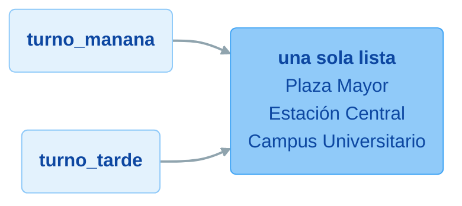

# Strings, listas, tuplas, diccionarios y sets

**Bloque 3 -- Python para Data Analytics | Sesión 2 de 19**

[← Volver al índice del curso](../../README.md#bloque-3--python-para-data-analytics)

---

## 1. Introducción

En la 3.1.1 calculamos la ocupación de dos estaciones de Pedalia y necesitamos seis variables: `capacidad_plaza`, `bicis_plaza`, `ocupacion_plaza`, y otras tres para Hospital General. Con las seis estaciones de la red serían dieciocho, y con las doce duraciones de viaje que veremos hoy, doce más. Así no se puede trabajar.

Python resuelve esto con las **estructuras de datos**: tipos que guardan **muchos valores bajo un solo nombre**. Hoy vemos las cuatro que trae el lenguaje (listas, tuplas, diccionarios y conjuntos) y, antes, profundizamos en los textos (*strings*), que también son una secuencia de valores: de caracteres. Son las piezas con las que está construido todo lo demás. Un DataFrame de pandas, por ejemplo, se crea muy a menudo a partir de una lista de diccionarios, y las operaciones de conjuntos son las mismas `UNION`, `INTERSECT` y `EXCEPT` de la sesión 2.1.3.

### Objetivos de la sesión
- Seleccionar partes de un texto con índices y *slicing*, y limpiarlo con los métodos de `str`.
- Partir un texto en trozos con `split` y unirlos con `join`, y mostrar cifras en formato español.
- Crear y modificar listas, y resumirlas con `len`, `sum`, `min`, `max` y `sorted`.
- Usar tuplas para registros que no deben cambiar y desempaquetarlas.
- Guardar registros en diccionarios y representar una tabla como una lista de diccionarios.
- Comparar grupos con las operaciones de conjuntos.
- Elegir la estructura adecuada para cada tipo de dato.

### Prerequisitos
- Sesión 3.1.1 completada: el notebook `practicas/bloque-03/3.1.1-primeros-calculos.ipynb` y el caso de Pedalia, con su tabla de tarifas.

---

## 2. Strings: el texto como secuencia

### Índices

Un *string* es una **secuencia de caracteres**, y cada carácter ocupa una posición numerada, su **índice**. En Python, como en casi todos los lenguajes de programación, **los índices empiezan en 0**. También se puede contar desde el final con índices negativos: `-1` es el último carácter.

```
 P   a   r   q   u   e       d   e   l       R   í   o
 0   1   2   3   4   5   6   7   8   9  10  11  12  13
-14 -13 -12 -11 -10 -9  -8  -7  -6  -5  -4  -3  -2  -1
```

```python
estacion = "Parque del Río"
print(len(estacion))      # número de caracteres, espacios incluidos
print(estacion[0])
print(estacion[-1])
```

```
14
P
o
```

### Slicing: trozos de un texto

Con `[inicio:fin]` obtenemos un trozo, una ***slice***. Incluye la posición `inicio` y **excluye** la posición `fin`. Si omitimos el inicio, empieza desde el principio; si omitimos el fin, llega hasta el final.

```python
estacion[0:6]      # 'Parque'
estacion[:6]       # lo mismo
estacion[-3:]      # 'Río'
```

El *slicing* es muy útil con textos de formato fijo. El sistema de Pedalia registra el inicio de cada viaje como un texto con la fecha y la hora:

```python
inicio = "2025-06-14 08:32:10"
fecha = inicio[:10]
hora = int(inicio[11:13])
print(fecha, hora)
```

```
2025-06-14 8
```

En la parte 3.3 trabajaremos las fechas con un tipo propio, más cómodo, pero la idea es la misma.

### Métodos de los strings

Un **método** es una función que pertenece a un tipo de datos y se escribe detrás del valor con un punto: `estacion.upper()`. Los strings tienen muchos; estos son los más usados para limpiar datos:

| Método | Qué hace | Ejemplo | Resultado |
|---|---|---|---|
| `upper()`, `lower()` | Todo en mayúsculas o minúsculas | `"Río".upper()` | `'RÍO'` |
| `title()` | Mayúscula inicial en cada palabra | `"plaza mayor".title()` | `'Plaza Mayor'` |
| `strip()` | Quita los espacios del principio y del final | `"  Norte ".strip()` | `'Norte'` |
| `replace(a, b)` | Sustituye `a` por `b` | `"2,5".replace(",", ".")` | `'2.5'` |
| `startswith(x)`, `endswith(x)` | ¿Empieza o termina por `x`? | `"E-1042".startswith("E")` | `True` |
| `split(sep)` | Parte el texto por `sep` y devuelve una lista | `"a;b".split(";")` | `['a', 'b']` |
| `sep.join(lista)` | Une una lista de textos con `sep` | `" / ".join(["a", "b"])` | `'a / b'` |

Y el operador `in`, que comprueba si un texto contiene otro: `"del" in estacion` es `True`.

Los métodos se pueden **encadenar**: cada uno se aplica al resultado del anterior. Es la forma habitual de limpiar un texto que llega con espacios y mayúsculas mezcladas, como los nombres de estación que escriben a mano los operarios en los partes de incidencias:

```python
"  plaza MAYOR ".strip().title()
```

```
'Plaza Mayor'
```

Ojo con `title()`, que pone en mayúscula **todas** las palabras: `"parque del río".title()` da `'Parque Del Río'`. Para respetar las preposiciones en minúscula necesitaremos una regla propia, que podremos escribir en la 3.1.3.

### split y join: de una línea de texto a sus campos

El sistema de Pedalia puede exportar sus estaciones en un archivo de texto, una estación por línea y los campos separados por punto y coma, como un CSV (sesión 1.1.1). Con `split` separamos los campos:

```python
linea = "5;Hospital General;Norte;18;2"
partes = linea.split(";")
partes
```

```
['5', 'Hospital General', 'Norte', '18', '2']
```

El resultado es una **lista** (sección 3) de cinco textos. Los números siguen siendo texto, así que hay que convertirlos para operar con ellos: `int(partes[3])` es `18`. Es exactamente lo que hace por dentro cualquier programa que lee un CSV, y lo que hará pandas por nosotros en la parte 3.3.

### Cifras en formato español

En la 3.1.1 dejamos pendiente cómo mostrar las cifras con coma decimal. Con `replace` sobre el texto que produce una f-string:

```python
precio = 2.9
f"{precio:.2f}".replace(".", ",") + " €"
```

```
'2,90 €'
```

Con separador de miles hay que intercambiar los dos signos, y para no mezclarlos se usa un carácter intermedio:

```python
importe = 1234.5
f"{importe:,.2f}".replace(",", "_").replace(".", ",").replace("_", ".")
```

```
'1.234,50'
```

Y el camino contrario, leer un decimal escrito con coma, que en la 3.1.1 daba `ValueError`: `float("2,5".replace(",", "."))` devuelve `2.5`.

### Los strings no se pueden modificar

Un string es **inmutable**: una vez creado no se puede cambiar. Por eso los métodos no modifican el texto original, sino que **devuelven uno nuevo**:

```python
nombre = "plaza mayor"
nombre.title()       # devuelve 'Plaza Mayor'...
nombre               # ...pero nombre sigue siendo 'plaza mayor'
```

```
'plaza mayor'
```

Para quedarnos con el resultado hay que guardarlo: `nombre = nombre.title()`. Y cambiar un carácter por su índice da error: `nombre[0] = "P"` produce `TypeError: 'str' object does not support item assignment`.

---

## 3. Listas

Una **lista** es una secuencia **ordenada** de valores, escrita entre corchetes y separados por comas. Puede contener valores de cualquier tipo, repetidos, y se puede **modificar**. Estas son las duraciones, en minutos, de los doce viajes que salieron de las seis estaciones del centro la mañana del mismo martes de la 3.1.1:

```python
minutos = [14, 9, 38, 22, 31, 6, 75, 17, 12, 11, 64, 19]
```

### Acceder a los elementos

Los índices y el *slicing* funcionan igual que en los strings:

```python
print(len(minutos))       # 12
print(minutos[0])         # 14, el primer viaje
print(minutos[-1])        # 19, el último
print(minutos[2:5])       # [38, 22, 31], del tercero al quinto
```

### Resumir una lista

Python trae funciones que resumen una lista de números, como las funciones de agregación de SQL:

```python
print(sum(minutos))                    # 318
print(min(minutos), max(minutos))      # 6 75
print(sum(minutos) / len(minutos))     # 26.5, la media
```

| Python | SQL |
|---|---|
| `len(lista)` | `COUNT(*)` |
| `sum(lista)` | `SUM(columna)` |
| `min(lista)`, `max(lista)` | `MIN(columna)`, `MAX(columna)` |
| `sum(lista) / len(lista)` | `AVG(columna)` |

### Ordenar

`sorted` devuelve una **lista nueva** ordenada, sin tocar la original. Con `reverse=True`, de mayor a menor:

```python
print(sorted(minutos))
print(sorted(minutos, reverse=True)[:3])     # los tres viajes más largos
```

```
[6, 9, 11, 12, 14, 17, 19, 22, 31, 38, 64, 75]
[75, 64, 38]
```

Con la lista ordenada podemos calcular la **mediana**, el valor que queda en el centro. Con doce valores, el centro está entre el sexto y el séptimo (índices 5 y 6), y la mediana es su media:

```python
ordenados = sorted(minutos)
mediana = (ordenados[5] + ordenados[6]) / 2
mediana
```

```
18.0
```

La media es 26,5 minutos, pero la mitad de los viajes duran 18 minutos o menos. Los dos viajes de más de una hora tiran de la media hacia arriba. Es la diferencia entre media y mediana que vimos en el bloque 1 y que estudiaremos a fondo en la parte 3.7.

### Modificar una lista

A diferencia de los strings, las listas son **mutables**: sus métodos las modifican directamente.

```python
ruta = ["Plaza Mayor", "Estación Central", "Campus Universitario"]

ruta.append("Parque del Río")          # añade al final
ruta.insert(1, "Mercado Central")      # inserta en la posición 1
ruta.remove("Estación Central")        # quita el primer elemento con ese valor
ultima = ruta.pop()                    # quita el último y lo devuelve
ruta[0] = "Plaza del Ayuntamiento"     # cambia un elemento por su índice

print(ruta)
print(ultima)
```

```
['Plaza del Ayuntamiento', 'Mercado Central', 'Campus Universitario']
Parque del Río
```

Otras operaciones útiles: `valor in lista` (¿está?), `lista.index(valor)` (¿en qué posición?), `lista.count(valor)` (¿cuántas veces?) y `lista.sort()`, que ordena **la propia lista** en lugar de devolver una nueva como `sorted`.

Un detalle importante: los métodos que modifican la lista, como `append` o `sort`, **no devuelven nada** (devuelven `None`). Escribir `minutos = minutos.append(41)` añade el 41... y después sustituye la lista entera por `None`.

---

## 4. Tuplas

Una **tupla** es como una lista, pero **inmutable**: una vez creada no se puede cambiar. Se escribe entre paréntesis:

```python
viaje = (1, "Plaza Mayor", "Campus Universitario", 14, "abonado", "mecánica")
viaje[3]
```

```
14
```

¿Para qué sirve una lista que no se puede modificar? Para guardar **registros**: un conjunto de datos que van juntos y que no tiene sentido cambiar por separado, como un viaje ya realizado o unas coordenadas. Que no se pueda modificar es una garantía: `viaje[3] = 15` da `TypeError: 'tuple' object does not support item assignment`.

Las tuplas tienen un uso muy cómodo, el **desempaquetado**: asignar cada elemento a una variable en una sola línea.

```python
viaje_id, origen, destino, duracion, tipo_usuario, bici = viaje
print(f"Viaje {viaje_id}: {origen} → {destino}, {duracion} min")
```

```
Viaje 1: Plaza Mayor → Campus Universitario, 14 min
```

Algunas funciones de Python devuelven tuplas para entregar varios resultados a la vez. Por ejemplo, `divmod` devuelve el cociente y el resto de una división entera, lo que en la 3.1.1 calculamos con `//` y `%`:

```python
horas, mins = divmod(75, 60)
print(horas, mins)
```

```
1 15
```

Este es el error del ejercicio 4b de la 3.1.1: `precio = 1,50` crea la tupla `(1, 50)`. Los paréntesis son opcionales; lo que crea una tupla son las comas.

---

## 5. Diccionarios

### Pares clave-valor

Una lista identifica cada elemento por su **posición**. Pero para describir una estación no queremos recordar que la capacidad está en la posición 3: queremos pedirla por su **nombre**. Para eso está el **diccionario**: una colección de pares **clave: valor**, escrita entre llaves.

```python
estacion = {
    "id": 5,
    "nombre": "Hospital General",
    "barrio": "Norte",
    "capacidad": 18,
    "bicis": 2,
}
estacion["nombre"]
```

```
'Hospital General'
```

Las claves suelen ser textos y no se pueden repetir; los valores pueden ser de cualquier tipo. Un diccionario es la forma natural de guardar un **registro**, una fila de una tabla: las claves son los nombres de las columnas.

```python
ocupacion = estacion["bicis"] / estacion["capacidad"]
print(f"{estacion['nombre']}: {ocupacion:.1%}")
```

```
Hospital General: 11.1%
```

Dentro de una f-string con comillas dobles, la clave va con comillas simples: `estacion['nombre']`. Con comillas dobles, las versiones de Python anteriores a la 3.12 creerían que la f-string termina ahí y darían un error; las actuales lo admiten, pero con simples se lee mejor.

### Claves que no existen

Si pedimos una clave que no está, Python da un error:

```python
estacion["anclajes_rotos"]
```

```
KeyError: 'anclajes_rotos'
```

Cuando una clave puede faltar, usamos el método `get`, que devuelve `None` (o el valor que le indiquemos) en lugar de fallar:

```python
estacion.get("anclajes_rotos", 0)
```

```
0
```

Para comprobar si una clave existe: `"bicis" in estacion` es `True`. Ojo: `in` busca entre las **claves**, no entre los valores.

### Modificar un diccionario

Los diccionarios son mutables. Con la misma sintaxis se cambia un valor existente o se añade una clave nueva:

```python
estacion["bicis"] += 7          # llega el camión de redistribución con 7 bicis
estacion["electricas"] = 3      # nueva clave: cuántas de ellas son eléctricas
print(estacion["bicis"], len(estacion))
```

```
9 6
```

`del estacion["electricas"]` borraría una clave. Y tres métodos devuelven sus partes: `keys()` las claves, `values()` los valores e `items()` los pares clave-valor. Los usaremos con los bucles de la 3.1.3.

### Diccionarios anidados

Los valores de un diccionario pueden ser, a su vez, listas o diccionarios. La tabla de tarifas de Pedalia se representa bien así:

```python
tarifas = {
    "abonado":   {"base": 0.00, "bloque_extra": 0.50},
    "ocasional": {"base": 1.50, "bloque_extra": 1.00},
}
SUPLEMENTO_ELECTRICA = 0.40

tarifas["ocasional"]["bloque_extra"]
```

```
1.0
```

El primer corchete elige el tipo de usuario y el segundo, el concepto. El nombre en mayúsculas `SUPLEMENTO_ELECTRICA` es una convención de Python para las **constantes**: valores que se fijan al principio y no deben cambiar durante el análisis. Python no impide cambiarlas; las mayúsculas son un aviso para quien lee el código.

### Una tabla: lista de diccionarios

Si un diccionario es una fila, **una lista de diccionarios es una tabla**. Esta es la red de estaciones del centro de Pedalia a las 8:00 de ese martes:

```python
red = [
    {"id": 1, "nombre": "Plaza Mayor",          "barrio": "Centro",      "capacidad": 24, "bicis": 9},
    {"id": 2, "nombre": "Estación Central",     "barrio": "Estación",    "capacidad": 30, "bicis": 4},
    {"id": 3, "nombre": "Campus Universitario", "barrio": "Universidad", "capacidad": 20, "bicis": 17},
    {"id": 4, "nombre": "Parque del Río",       "barrio": "Ribera",      "capacidad": 16, "bicis": 12},
    {"id": 5, "nombre": "Hospital General",     "barrio": "Norte",       "capacidad": 18, "bicis": 2},
    {"id": 6, "nombre": "Mercado Central",      "barrio": "Centro",      "capacidad": 20, "bicis": 11},
]
```

Los espacios que alinean las columnas no son obligatorios, pero hacen que el código se lea como una tabla:

| id | nombre | barrio | capacidad | bicis |
|--:|---|---|--:|--:|
| 1 | Plaza Mayor | Centro | 24 | 9 |
| 2 | Estación Central | Estación | 30 | 4 |
| 3 | Campus Universitario | Universidad | 20 | 17 |
| 4 | Parque del Río | Ribera | 16 | 12 |
| 5 | Hospital General | Norte | 18 | 2 |
| 6 | Mercado Central | Centro | 20 | 11 |

Para llegar a un dato, primero elegimos la fila por su posición y después la columna por su clave:

```python
red[2]["nombre"], red[2]["bicis"] / red[2]["capacidad"]
```

```
('Campus Universitario', 0.85)
```

Dos expresiones separadas por una coma en la última línea de una celda forman una tupla: es una forma rápida de ver varios valores a la vez.

Esta estructura, una lista de diccionarios con las mismas claves, es la que usaremos para hacer los primeros análisis en la 3.1.3 y es una de las formas habituales de crear un DataFrame de pandas en la 3.3.1. Lo que todavía no sabemos hacer es recorrer las seis filas para, por ejemplo, sumar la capacidad de toda la red: eso necesita un bucle.

---

## 6. Sets: conjuntos

Un **set** es una colección **sin orden y sin repetidos**. Se escribe entre llaves, como un diccionario pero sin pares clave-valor, o se crea con `set()` a partir de una lista, que pierde así sus duplicados.

Estas son las estaciones de **origen** de los doce viajes, separadas según el tipo de usuario:

```python
origenes_abonados = ["Plaza Mayor", "Estación Central", "Hospital General", "Mercado Central",
                     "Estación Central", "Campus Universitario", "Plaza Mayor", "Mercado Central"]
origenes_ocasionales = ["Campus Universitario", "Parque del Río", "Plaza Mayor", "Parque del Río"]

abonados = set(origenes_abonados)
ocasionales = set(origenes_ocasionales)
print(len(origenes_abonados), len(abonados))
```

```
8 5
```

Ocho viajes de abonados, que salieron de cinco estaciones distintas. Los sets admiten las operaciones de la teoría de conjuntos, las mismas que vimos en SQL en la sesión 2.1.3:

| Operación | Python | Resultado | SQL |
|---|---|---|---|
| Unión: en alguno de los dos | `abonados \| ocasionales` | las 6 estaciones | `UNION` |
| Intersección: en los dos | `abonados & ocasionales` | Campus Universitario, Plaza Mayor | `INTERSECT` |
| Diferencia: en el primero y no en el segundo | `ocasionales - abonados` | Parque del Río | `EXCEPT` |
| Diferencia | `abonados - ocasionales` | Estación Central, Hospital General, Mercado Central | `EXCEPT` |

Una lectura: **Parque del Río solo tiene salidas de ocasionales**. Es una zona de paseo, no de desplazamientos diarios. Y tres estaciones, las de la estación de tren, el hospital y el mercado, solo tienen salidas de abonados: son trayectos de trabajo. Con doce viajes no podemos sacar conclusiones, pero es una hipótesis que comprobaremos con los datos completos.

Un set **no tiene orden**, así que no admite índices (`abonados[0]` da error) y, al mostrarlo, sus elementos pueden aparecer en cualquier orden, que además puede cambiar de una ejecución a otra. Para presentarlo, lo convertimos en una lista ordenada con `sorted`:

```python
sorted(abonados & ocasionales)
```

```
['Campus Universitario', 'Plaza Mayor']
```

Los sets también son la forma más rápida de comprobar si un valor está en una colección grande (`"Plaza Mayor" in abonados`) y se modifican con `add` y `remove`. Un detalle: `{}` crea un **diccionario** vacío; un set vacío se crea con `set()`.

---

## 7. Qué estructura elegir

| Estructura | Se escribe | Orden | Modificable | Repetidos | Se accede por | Para qué la usamos |
|---|---|---|---|---|---|---|
| `str` | `"..."` | Sí | No | Sí | Posición | Textos |
| `list` | `[...]` | Sí | Sí | Sí | Posición | Colecciones de valores del mismo tipo: duraciones, nombres |
| `tuple` | `(...)` | Sí | No | Sí | Posición | Registros fijos y resultados múltiples |
| `dict` | `{clave: valor}` | Sí, el de inserción | Sí | Claves no | Clave | Registros con campos con nombre; tablas de búsqueda |
| `set` | `{...}` | No | Sí | No | — | Valores únicos y comparar grupos |

### La frase clave

> Una lista guarda cosas en orden, un diccionario las guarda con nombre y un set guarda cada cosa una sola vez. Una fila es un diccionario; una tabla, una lista de diccionarios.

---

## 8. Práctica: la ficha de la red

Vamos a construir en un notebook la "ficha" de la red del centro: leer estaciones desde texto, guardarlas en estructuras y responder a las primeras preguntas sobre los viajes.

### Paso 1: el notebook

En `practicas/bloque-03/` creamos `3.1.2-estructuras.ipynb`, elegimos el kernel `.venv` y escribimos la cabecera en Markdown, como en la 3.1.1:

```markdown
# Pedalia · 3.1.2 · La ficha de la red

Autor: <nombre> · <fecha>

Estaciones y viajes del centro la mañana de un martes.
```

### Paso 2: leer una estación desde texto

Un operario nos pasa la línea de una estación copiada de la exportación del sistema, con el nombre mal escrito:

```python
linea = "5;  hospital GENERAL ;Norte;18;2"
partes = linea.split(";")
partes
```

```
['5', '  hospital GENERAL ', 'Norte', '18', '2']
```

La convertimos en un diccionario, limpiando el nombre y convirtiendo los números:

```python
estacion = {
    "id": int(partes[0]),
    "nombre": partes[1].strip().title(),
    "barrio": partes[2],
    "capacidad": int(partes[3]),
    "bicis": int(partes[4]),
}
estacion
```

```
{'id': 5,
 'nombre': 'Hospital General',
 'barrio': 'Norte',
 'capacidad': 18,
 'bicis': 2}
```

Jupyter muestra el diccionario en varias líneas porque no cabe en una. Es el mismo diccionario.

### Paso 3: la red completa

Copiamos en una celda la lista `red` de la sección 5 y comprobamos que está bien:

```python
print(len(red), "estaciones")
print("Primera:", red[0]["nombre"])
print("Última:", red[-1]["nombre"])
print("Barrios:", sorted({red[0]["barrio"], red[1]["barrio"], red[2]["barrio"],
                          red[3]["barrio"], red[4]["barrio"], red[5]["barrio"]}))
```

```
6 estaciones
Primera: Plaza Mayor
Última: Mercado Central
Barrios: ['Centro', 'Estación', 'Norte', 'Ribera', 'Universidad']
```

Para obtener los barrios sin repetir hemos tenido que escribir los seis a mano dentro de un set. Funciona con seis estaciones; con las de toda la ciudad, no.

### Paso 4: los viajes

Copiamos la lista `minutos` de la sección 3 y calculamos el resumen:

```python
ordenados = sorted(minutos)
media = sum(minutos) / len(minutos)
mediana = (ordenados[5] + ordenados[6]) / 2

print(f"Viajes: {len(minutos)}")
print(f"Duración total: {sum(minutos)} min")
print(f"Media: {media:.1f} min · mediana: {mediana:.1f} min")
print(f"Más corto: {min(minutos)} min · más largo: {max(minutos)} min")
print(f"Los tres más largos: {ordenados[-3:]}")
```

```
Viajes: 12
Duración total: 318 min
Media: 26.5 min · mediana: 18.0 min
Más corto: 6 min · más largo: 75 min
Los tres más largos: [38, 64, 75]
```

### Paso 5: abonados y ocasionales

Copiamos las dos listas de orígenes de la sección 6 y comparamos los grupos:

```python
abonados = set(origenes_abonados)
ocasionales = set(origenes_ocasionales)

print("En los dos grupos:     ", sorted(abonados & ocasionales))
print("Solo abonados:         ", sorted(abonados - ocasionales))
print("Solo ocasionales:      ", sorted(ocasionales - abonados))
print("Estaciones con salidas:", len(abonados | ocasionales))
```

```
En los dos grupos:      ['Campus Universitario', 'Plaza Mayor']
Solo abonados:          ['Estación Central', 'Hospital General', 'Mercado Central']
Solo ocasionales:       ['Parque del Río']
Estaciones con salidas: 6
```

### Paso 6: conclusiones

Cerramos con una celda de Markdown y, como siempre, **Restart** y **Run All** antes de guardar:

```markdown
## Primeras observaciones

- La mitad de los viajes duran 18 minutos o menos, pero la media es de 26,5:
  dos viajes de más de una hora (64 y 75 minutos) la desplazan hacia arriba.
- Parque del Río solo tiene salidas de ocasionales, y las estaciones de la
  estación de tren, el hospital y el mercado, solo de abonados. Hipótesis:
  los ocasionales pasean y los abonados van a trabajar. A comprobar con los
  datos completos.
- Para responder a "¿cuánto ingresa cada tipo de usuario?" necesitamos aplicar
  la tarifa a cada viaje, uno por uno: hace falta un bucle (3.1.3).
```

### Comparar con la solución

Cuando terminemos, comparamos nuestro notebook con la solución de referencia: [Pedalia_3.1.2_resuelto.ipynb](Pedalia_3.1.2_resuelto.ipynb). Es el notebook de esta práctica, ya ejecutado: las salidas de cada celda tienen que coincidir con las nuestras.

---

## 9. Ejercicios

Los ejercicios están listos para resolver en el cuaderno [3.1.2 - Ejercicios.ipynb](3.1.2%20-%20Ejercicios.ipynb): lo copiamos a `practicas/bloque-03/`, ejecutamos la celda de datos de partida, con la lista `red` y la estación de la práctica, y resolvemos cada ejercicio en su celda. Debajo de cada uno, plegado, está el resultado esperado.

**Ejercicio 1: el código de la bici.** Cada bicicleta de Pedalia tiene un código como `"E-1042"`: la letra indica el tipo (`E` eléctrica, `M` mecánica) y el número, la bici. Extrae de `"E-1042"` el tipo como texto y el número como entero, y comprueba si es eléctrica con un método de string.

<details>
<summary>Ver la solución</summary>

```python
bici = "E-1042"
tipo = bici[0]
numero = int(bici[2:])
print(tipo, numero, bici.startswith("E"))
```

```
E 1042 True
```

`bici[2:]` toma desde la posición 2 hasta el final: se salta la letra y el guion.

</details>

**Ejercicio 2: formato español.** Muestra el ingreso de un día, `18734.6` euros, con el formato `18.734,60 €`.

<details>
<summary>Ver la solución</summary>

```python
ingreso = 18734.6
texto = f"{ingreso:,.2f}".replace(",", "_").replace(".", ",").replace("_", ".")
print(texto + " €")
```

```
18.734,60 €
```

En la 3.2.1 lo convertiremos en una función para no repetir esta línea cada vez.

</details>

**Ejercicio 3: el camión de redistribución.** El camión lleva 12 bicis a la estación **Estación Central** (`red[1]`). Actualiza su número de bicis en la lista `red` y calcula su nueva ocupación.

<details>
<summary>Ver la solución</summary>

```python
red[1]["bicis"] += 12
ocupacion = red[1]["bicis"] / red[1]["capacidad"]
print(red[1]["bicis"], f"{ocupacion:.1%}")
```

```
16 53.3%
```

Ojo: la lista `red` ha cambiado en la memoria del kernel. Si después ejecutamos otras celdas que la usan, verán 16 bicis en Estación Central, no 4. Para volver al estado original, ejecutamos de nuevo la celda que crea `red`.

</details>

**Ejercicio 4: usuarios de la bici eléctrica.** Estos son los identificadores de los abonados que han viajado esta semana y los de los usuarios que han usado una bici eléctrica:

```python
abonados_activos = {"U017", "U023", "U031", "U044", "U058"}
usuarios_electrica = {"U023", "U044", "U052", "U060", "U071"}
```

¿Qué abonados han usado la eléctrica? ¿Cuáles de los que han usado la eléctrica no son abonados? ¿Cuántos usuarios distintos hay en total?

<details>
<summary>Ver la solución</summary>

```python
print(sorted(abonados_activos & usuarios_electrica))
print(sorted(usuarios_electrica - abonados_activos))
print(len(abonados_activos | usuarios_electrica))
```

```
['U023', 'U044']
['U052', 'U060', 'U071']
8
```

</details>

**Ejercicio 5: encuentra los errores.** Cada fragmento tiene un error. Encuéntralo y corrígelo.

```python
# a)
estacion["Nombre"]

# b)
minutos = minutos.append(41)
len(minutos)

# c)
visitadas = {}
visitadas.add("Plaza Mayor")

# d)
"Plaza Mayor".upper

# e)
red[6]["nombre"]
```

<details>
<summary>Ver la solución</summary>

- **a)** `KeyError: 'Nombre'`. Las claves distinguen mayúsculas: es `estacion["nombre"]`.
- **b)** `append` modifica la lista y devuelve `None`, así que `minutos` pasa a valer `None` y `len(minutos)` da `TypeError: object of type 'NoneType' has no len()`. Se escribe solo `minutos.append(41)`. Para recuperar la lista hay que volver a crearla.
- **c)** `AttributeError: 'dict' object has no attribute 'add'`. `{}` es un diccionario vacío. Un set vacío se crea con `visitadas = set()`.
- **d)** Faltan los paréntesis. Sin ellos no se llama al método: Jupyter muestra `<function str.upper()>`: el método en sí, sin ejecutar. Es `"Plaza Mayor".upper()`.
- **e)** `IndexError: list index out of range`. La lista tiene seis elementos, con índices de 0 a 5. La última estación es `red[5]` o `red[-1]`.

</details>

---

## 10. Lo que hay por debajo: mutables, inmutables y referencias

En la 3.1.1 vimos que una variable es una **etiqueta** pegada a un valor. Con los tipos inmutables (números, strings, tuplas) da igual pensarlo así o como una caja. Con los mutables (listas, diccionarios, sets) no da igual:

```python
turno_manana = ["Plaza Mayor", "Estación Central"]
turno_tarde = turno_manana
turno_tarde.append("Campus Universitario")
print(turno_manana)
```

```
['Plaza Mayor', 'Estación Central', 'Campus Universitario']
```

Hemos añadido una estación al turno de tarde... y ha aparecido también en el de mañana. `turno_tarde = turno_manana` no copia la lista: pega una **segunda etiqueta a la misma lista**. Hay una sola lista con dos nombres, y lo que se haga a través de uno se ve a través del otro.



Para tener dos listas independientes hay que **copiarla**: `turno_tarde = turno_manana.copy()`. Los diccionarios y los sets también tienen `copy()`.

Con un string no pasa: como los métodos de un string no lo modifican, sino que crean uno nuevo, es imposible que un cambio hecho con un nombre se vea a través de otro.

Esta distinción explica también qué puede ser **clave de un diccionario** o elemento de un set: solo valores inmutables, como números, strings o tuplas. Python localiza las claves con una función *hash* (la misma idea que el identificador de un commit de Git, sesión 0.1.2), y si una clave pudiera cambiar después de guardarla, su hash cambiaría y no se volvería a encontrar. Por eso `{["Plaza Mayor"]: 1}` da `TypeError: unhashable type: 'list'`. Gracias al hash, buscar una clave en un diccionario o un valor en un set es casi instantáneo aunque tenga millones de elementos, mientras que `in` sobre una lista la recorre elemento a elemento.

---

## 11. Errores comunes y troubleshooting

**1. "IndexError: list index out of range".** Hemos pedido una posición que no existe. Recordemos que los índices van de `0` a `len(lista) - 1`.

**2. "KeyError: '...'".** La clave no existe en el diccionario. Revisamos mayúsculas, tildes y espacios, o usamos `get` si la clave puede faltar.

**3. "TypeError: 'str' object does not support item assignment" (o `'tuple'`).** Intentamos cambiar un elemento de un tipo inmutable. Con un string, creamos uno nuevo (`replace`, slicing); con una tupla, usamos una lista si necesitamos modificarla.

**4. "AttributeError: 'list' object has no attribute '...'".** Ese método no existe para ese tipo: por ejemplo, `lista.add()` (es `append`) o `texto.append()` (los strings no tienen `append`). Escribiendo el valor seguido de un punto, VS Code sugiere los métodos disponibles.

**5. "Mi variable vale `None` de repente".** La hemos reasignado con el resultado de un método que modifica en el sitio, como `lista = lista.sort()`. Usamos `lista.sort()` a secas o `lista = sorted(lista)`.

**6. "He limpiado el texto y sigue igual".** Los métodos de los strings devuelven un texto nuevo: hay que guardarlo, `nombre = nombre.strip()`.

**7. "He cambiado una lista y ha cambiado otra".** Las dos variables apuntan a la misma lista. Usamos `.copy()` (sección 10).

**8. "El set sale en otro orden cada vez".** Es normal: los sets no tienen orden. Para presentarlos, `sorted(mi_set)`.

**9. "TypeError: unhashable type: 'list'".** Hemos usado una lista como clave de un diccionario o como elemento de un set. Usamos una tupla.

---

## 12. Conclusión

En esta sesión hemos aprendido a guardar muchos datos bajo un solo nombre. Con los strings hemos seleccionado trozos de un texto por su posición, lo hemos limpiado encadenando métodos, lo hemos partido en campos con `split` y hemos mostrado cifras en formato español. Con las listas hemos guardado las duraciones de doce viajes y las hemos resumido con `len`, `sum`, `min`, `max` y `sorted`, hasta calcular a mano una mediana; con las tuplas, registros fijos que se desempaquetan en variables; con los diccionarios, cada estación como una fila con campos con nombre, y la red entera como una lista de diccionarios, que es una tabla; y con los sets hemos comparado las estaciones de abonados y ocasionales con las mismas operaciones de conjuntos que usamos en SQL. El resultado es `practicas/bloque-03/3.1.2-estructuras.ipynb`, con la ficha de la red, el resumen de los viajes y una primera hipótesis sobre quién usa cada estación. También hemos chocado con el límite de esta sesión: para calcular algo **para cada** estación o **para cada** viaje hemos tenido que escribir cada caso a mano. En la 3.1.3 aprenderemos a recorrer las estructuras con bucles y a tomar decisiones con condiciones, y calcularemos los ingresos de cada tipo de usuario.

---

## 13. Para profundizar

### Más slicing: el paso

El slicing admite un tercer número, el **paso**: `[inicio:fin:paso]`. `minutos[::2]` toma uno de cada dos elementos y `minutos[::-1]` devuelve la lista al revés. Funciona igual con strings: `"Río"[::-1]` es `'oíR'`.

### Ordenar textos con tildes

`sorted` ordena los textos por el código Unicode de cada carácter, que pone **todas las mayúsculas antes que las minúsculas** y las **letras con tilde después de la `z`**. Por eso `sorted(["avenida", "Zoco", "Ábside"])` devuelve `['Zoco', 'avenida', 'Ábside']`. Para un orden alfabético "humano" hay que normalizar antes los textos (pasarlos a minúsculas y quitar las tildes) o usar el módulo `locale`. En los análisis del curso casi nunca importa, porque ordenaremos por cifras, no por nombres.

### Los diccionarios recuerdan el orden

Desde Python 3.7, un diccionario conserva el **orden en que se insertaron** sus claves: al recorrerlo o mostrarlo, aparecen en ese orden. En código antiguo (o en explicaciones antiguas de internet) se dice que los diccionarios no tienen orden: era cierto antes de 2018.

### Unpacking extendido

El desempaquetado admite un asterisco para recoger "el resto" en una lista:

```python
primero, *resto = sorted(minutos, reverse=True)
primero, len(resto)
```

```
(75, 11)
```

### El módulo collections

La librería estándar de Python incluye estructuras especializadas en el módulo `collections`. Las dos más útiles para un analista son `Counter`, que cuenta cuántas veces aparece cada valor de una lista (`Counter(origenes_abonados)`), y `defaultdict`, un diccionario que crea automáticamente un valor por defecto para las claves nuevas. Las podremos usar a partir de la 3.2.2, cuando veamos cómo se importan los módulos.

### Strings multilínea y caracteres especiales

Un texto entre **triples comillas** (`"""..."""`) puede ocupar varias líneas; es lo que usamos en la cabecera de `verificar_entorno.py` en la 0.1.5. Dentro de un string, la barra invertida introduce caracteres especiales: `\n` es un salto de línea y `\t` un tabulador. Por eso las rutas de Windows dan problemas (`"C:\Users\javier\nuevo"` contiene un `\n`): se escriben con barras normales, `"C:/Users/javier/nuevo"`, o con una `r` delante, `r"C:\Users\javier\nuevo"`.

---

## 14. Recursos

- **Tutorial oficial de Python: estructuras de datos** (en español): <https://docs.python.org/es/3/tutorial/datastructures.html>
- **Tutorial oficial de Python: textos y listas** (introducción informal, en español): <https://docs.python.org/es/3/tutorial/introduction.html>
- **Documentación de Python: métodos de los strings:** <https://docs.python.org/3/library/stdtypes.html#string-methods>
- **Documentación de Python: tipos de conjuntos** (`set`): <https://docs.python.org/3/library/stdtypes.html#set-types-set-frozenset>
- **Documentación de Python: módulo `collections`:** <https://docs.python.org/3/library/collections.html>
- **Python Tutor**, que dibuja paso a paso las variables y las listas en memoria (muy útil para entender la sección 10): <https://pythontutor.com/>

---

*Guía del alumno · Sesión 2 · Bloque 3 - Python para Data Analytics · Pedalia*
