# Control de flujo, bucles y comprehensions

**Bloque 3 -- Python para Data Analytics | Sesión 3 de 19**

[← Volver al índice del curso](../../README.md#bloque-3--python-para-data-analytics)

---

## 1. Introducción

En la 3.1.2 guardamos la red de Pedalia en una lista de diccionarios, pero cada vez que queríamos calcular algo **para cada** estación teníamos que escribirlo a mano, estación por estación. Y en la 3.1.1 calculamos el precio de un viaje con un truco aritmético (`(exceso + 29) // 30`) porque no sabíamos expresar algo tan natural como "si el viaje dura más de 30 minutos, cobra un bloque más".

Hoy aprendemos las dos piezas que faltan para que un programa haga trabajo de verdad: las **condiciones**, que eligen qué hacer según los datos, y los **bucles**, que repiten un cálculo para cada elemento de una colección. Con ellas, el mismo código sirve para seis estaciones o para seiscientas. Terminamos con las **comprehensions**, una forma compacta de crear listas, diccionarios y sets que se lee casi como una consulta SQL.

Con esto cerramos la parte 3.1. Al final de la sesión calcularemos los ingresos de una mañana de Pedalia por tipo de usuario: un `GROUP BY` hecho a mano, paso a paso.

### Objetivos de la sesión
- Tomar decisiones con `if`, `elif` y `else`, y entender el papel de la sangría en Python.
- Recorrer listas, diccionarios y listas de diccionarios con `for`.
- Acumular, contar y buscar el máximo dentro de un bucle.
- Usar `range`, `enumerate` y `zip` para recorrer secuencias de forma cómoda.
- Repetir mientras se cumpla una condición con `while`, y controlar un bucle con `break` y `continue`.
- Escribir comprehensions de listas, diccionarios y sets, con y sin condición.

### Prerequisitos
- Sesiones 3.1.1 y 3.1.2 completadas: la tabla de tarifas de Pedalia, la lista `red` de seis estaciones y la lista `minutos` de doce viajes.

---

## 2. Condiciones: if, elif y else

### La estructura

Una **condición** ejecuta un bloque de código solo si se cumple una expresión. En Pedalia, una estación está **casi vacía** si su ocupación baja del 20 % y **casi llena** si supera el 80 %:

```python
bicis = 2
capacidad = 18
ocupacion = bicis / capacidad

if ocupacion < 0.2:
    estado = "casi vacía"
elif ocupacion > 0.8:
    estado = "casi llena"
else:
    estado = "normal"

print(f"Ocupación {ocupacion:.1%}: {estado}")
```

```
Ocupación 11.1%: casi vacía
```

- `if` va seguido de una condición y de **dos puntos**.
- `elif` (abreviatura de *else if*) añade otra condición, que solo se comprueba si las anteriores no se han cumplido. Puede haber tantos `elif` como haga falta, o ninguno.
- `else` recoge todos los casos restantes. Es opcional.
- Python comprueba las condiciones **en orden** y ejecuta **solo el primer bloque** cuya condición se cumple.

Es la misma lógica que el `CASE WHEN ... THEN ... ELSE ... END` de SQL (sesión 2.1.2), con la que asignábamos segmentos a los clientes de Casa Olivo.

### La sangría es la sintaxis

¿Cómo sabe Python qué líneas pertenecen a cada bloque? Por la **sangría**: los cuatro espacios al principio de la línea. Todas las líneas con la misma sangría detrás de los dos puntos forman el bloque; la primera línea que vuelve a la columna anterior ya está fuera.

```python
if ocupacion < 0.2:
    estado = "casi vacía"          # dentro del if
    avisar_al_camion = True        # dentro del if
print("Comprobación terminada")    # fuera: se ejecuta siempre
```

En otros lenguajes los bloques se marcan con llaves `{}` y la sangría es solo cuestión de estética. En Python es **obligatoria**: si falta o sobra, da un error. VS Code inserta los cuatro espacios automáticamente al pulsar Enter detrás de los dos puntos, y la tecla Tab también inserta cuatro espacios.

### Condiciones en una línea

Cuando solo queremos elegir entre dos valores, hay una forma abreviada, la **expresión condicional**:

```python
codigo_bici = "E-1042"
tipo_bici = "eléctrica" if codigo_bici.startswith("E") else "mecánica"
tipo_bici
```

```
'eléctrica'
```

Se lee casi en lenguaje natural: "eléctrica si el código empieza por E; si no, mecánica". Conviene usarla solo para casos así de simples.

### Valores que cuentan como verdaderos o falsos

Detrás de un `if` no hace falta escribir una comparación: Python acepta cualquier valor y lo interpreta como verdadero o falso, con las reglas de `bool` que vimos en la 3.1.1. Además del cero, el texto vacío y `None`, también son falsas las **colecciones vacías**: `[]`, `{}`, `set()`. Por eso es habitual escribir:

```python
incidencias = []
if incidencias:
    print("Hay incidencias pendientes")
else:
    print("Sin incidencias")
```

```
Sin incidencias
```

---

## 3. La tarifa, con condiciones

Con `if` podemos escribir el precio de un viaje tal como lo describe la tabla de tarifas, sin trucos aritméticos:

```python
minutos = 75
tipo_usuario = "ocasional"
bici = "mecánica"

# 1. Bloques de 30 minutos adicionales (o fracción)
exceso = minutos - 30
if exceso <= 0:
    bloques_extra = 0
elif exceso % 30 == 0:
    bloques_extra = exceso // 30
else:
    bloques_extra = exceso // 30 + 1

# 2. Precio según el tipo de usuario
if tipo_usuario == "abonado":
    precio = bloques_extra * 0.50
else:
    precio = 1.50 + bloques_extra * 1.00

# 3. Suplemento por bici eléctrica
if bici == "eléctrica":
    precio += 0.40

print(f"{bloques_extra} bloques adicionales · {precio:.2f} €")
```

```
2 bloques adicionales · 3.50 €
```

Cada paso de la tabla de tarifas es un bloque del código, y cualquiera que lea el código puede comprobarlo contra la tabla. Es más largo que la fórmula de la 3.1.1, pero mucho más fácil de revisar y de cambiar si mañana cambian las tarifas.

### La frase clave

> Un `if` decide **qué** se ejecuta y la sangría decide **qué está dentro**. Las condiciones se comprueban en orden y gana la primera que se cumple.

---

## 4. El bucle for

### Recorrer una colección

Un bucle **`for`** repite un bloque de código **una vez por cada elemento** de una colección. En cada vuelta, la variable del bucle toma el valor del elemento siguiente:

```python
minutos = [14, 9, 38, 22, 31, 6, 75, 17, 12, 11, 64, 19]

for m in minutos:
    if m > 60:
        print(f"Viaje de {m} minutos: más de una hora")
```

```
Viaje de 75 minutos: más de una hora
Viaje de 64 minutos: más de una hora
```

El nombre de la variable (`m`) lo elegimos nosotros. La convención es usar el singular de la colección: `for estacion in estaciones`, `for viaje in viajes`.

Con una lista de diccionarios, cada vuelta nos da **una fila** completa. Este es el cálculo que en la 3.1.2 no podíamos hacer sin escribir seis veces lo mismo. Partimos de la lista `red` tal como la creamos en la 3.1.2:

```python
for estacion in red:
    ocupacion = estacion["bicis"] / estacion["capacidad"]
    if ocupacion < 0.2:
        estado = "casi vacía"
    elif ocupacion > 0.8:
        estado = "casi llena"
    else:
        estado = "normal"
    print(f"{estacion['nombre']:<22}{ocupacion:>7.1%}   {estado}")
```

```
Plaza Mayor             37.5%   normal
Estación Central        13.3%   casi vacía
Campus Universitario    85.0%   casi llena
Parque del Río          75.0%   normal
Hospital General        11.1%   casi vacía
Mercado Central         55.0%   normal
```

En el formato, `:<22` alinea el texto a la izquierda en un espacio de 22 caracteres y `:>7.1%` alinea el porcentaje a la derecha en 7. Así la salida se lee como una tabla.

### Patrones dentro de un bucle

Casi todo lo que se hace con un bucle en análisis de datos sigue uno de estos patrones.

**Acumular.** Una variable que empieza en cero **antes** del bucle y a la que se suma algo en cada vuelta:

```python
total_capacidad = 0
total_bicis = 0
for estacion in red:
    total_capacidad += estacion["capacidad"]
    total_bicis += estacion["bicis"]

print(f"Capacidad: {total_capacidad} · bicis: {total_bicis} · "
      f"ocupación de la red: {total_bicis / total_capacidad:.1%}")
```

```
Capacidad: 128 · bicis: 55 · ocupación de la red: 43.0%
```

Dos f-strings seguidas dentro de un paréntesis se unen en una sola: es la forma de partir una línea demasiado larga.

**Contar.** Igual, pero sumando 1 cuando se cumple una condición:

```python
casi_vacias = 0
for estacion in red:
    if estacion["bicis"] / estacion["capacidad"] < 0.2:
        casi_vacias += 1
casi_vacias
```

```
2
```

**Buscar el máximo.** Guardamos el mejor valor visto hasta ahora y lo sustituimos cuando aparece uno mejor:

```python
mas_llena = None
max_ocupacion = 0
for estacion in red:
    ocupacion = estacion["bicis"] / estacion["capacidad"]
    if ocupacion > max_ocupacion:
        max_ocupacion = ocupacion
        mas_llena = estacion["nombre"]

print(mas_llena, f"{max_ocupacion:.1%}")
```

```
Campus Universitario 85.0%
```

**Agrupar.** Un diccionario cuyas claves son los grupos y cuyos valores son los acumulados. Es el patrón más importante de la sesión, y lo usaremos en la práctica para calcular ingresos por tipo de usuario.

```python
bicis_por_barrio = {}
for estacion in red:
    barrio = estacion["barrio"]
    bicis_por_barrio[barrio] = bicis_por_barrio.get(barrio, 0) + estacion["bicis"]

bicis_por_barrio
```

```
{'Centro': 20, 'Estación': 4, 'Universidad': 17, 'Ribera': 12, 'Norte': 2}
```

`get(barrio, 0)` devuelve el acumulado del barrio o 0 si es la primera vez que aparece. El barrio Centro tiene dos estaciones, Plaza Mayor y Mercado Central: 9 + 11 = 20 bicis. Es exactamente lo que hace un `GROUP BY barrio` con `SUM(bicis)`.

### Recorrer un diccionario

Un `for` sobre un diccionario recorre sus **claves**. Para tener a la vez la clave y el valor se usa `items()`, que devuelve pares que desempaquetamos en dos variables:

```python
for barrio, bicis in bicis_por_barrio.items():
    print(f"{barrio}: {bicis} bicis")
```

```
Centro: 20 bicis
Estación: 4 bicis
Universidad: 17 bicis
Ribera: 12 bicis
Norte: 2 bicis
```

---

## 5. range, enumerate y zip

### range: una secuencia de números

`range` genera una secuencia de enteros. Con un número, de 0 hasta ese número **sin incluirlo**; con dos, desde el primero hasta el segundo sin incluirlo; con tres, el tercero es el paso. Igual que el slicing, el final nunca se incluye.

| Expresión | Números |
|---|---|
| `range(5)` | 0, 1, 2, 3, 4 |
| `range(1, 7)` | 1, 2, 3, 4, 5, 6 |
| `range(30, 151, 30)` | 30, 60, 90, 120, 150 |

Con `range` construimos la tabla de precios de un ocasional según la duración del viaje:

```python
for limite in range(30, 151, 30):
    bloques_extra = (limite - 30) // 30
    precio = 1.50 + bloques_extra * 1.00
    print(f"Hasta {limite:>3} min: {precio:.2f} €")
```

```
Hasta  30 min: 1.50 €
Hasta  60 min: 2.50 €
Hasta  90 min: 3.50 €
Hasta 120 min: 4.50 €
Hasta 150 min: 5.50 €
```

### enumerate: el elemento y su posición

Cuando además del elemento necesitamos su posición, `enumerate` nos da los dos en cada vuelta. Por defecto cuenta desde 0; con `start=1`, desde 1. Lo usamos para numerar un ranking de estaciones por ocupación:

```python
pares = []
for estacion in red:
    pares.append((estacion["bicis"] / estacion["capacidad"], estacion["nombre"]))

ranking = sorted(pares, reverse=True)

for posicion, (ocupacion, nombre) in enumerate(ranking, start=1):
    print(f"{posicion}. {nombre} ({ocupacion:.1%})")
```

```
1. Campus Universitario (85.0%)
2. Parque del Río (75.0%)
3. Mercado Central (55.0%)
4. Plaza Mayor (37.5%)
5. Estación Central (13.3%)
6. Hospital General (11.1%)
```

Hay dos detalles. Para ordenar las estaciones por ocupación hemos construido una lista de tuplas `(ocupación, nombre)`: `sorted` compara las tuplas por su **primer elemento**, y solo si empatan mira el segundo. Y en el `for`, `(ocupacion, nombre)` desempaqueta la tupla que viene dentro de cada par que da `enumerate`. En la 3.2.2 veremos una forma más directa de ordenar con `sorted(..., key=...)`.

### zip: recorrer varias listas a la vez

`zip` empareja elemento a elemento dos o más listas: en cada vuelta da el primero de cada una, después el segundo de cada una, etc.

```python
origenes = ["Plaza Mayor", "Estación Central", "Campus Universitario"]
destinos = ["Campus Universitario", "Plaza Mayor", "Parque del Río"]

for origen, destino in zip(origenes, destinos):
    print(f"{origen} → {destino}")
```

```
Plaza Mayor → Campus Universitario
Estación Central → Plaza Mayor
Campus Universitario → Parque del Río
```

Si las listas tienen distinta longitud, `zip` se detiene en la más corta, sin avisar. Un uso muy práctico: construir un diccionario a partir de dos listas, `dict(zip(nombres, capacidades))`.

---

## 6. while, break y continue

### while: repetir mientras se cumpla una condición

Un `for` recorre una colección y termina cuando se acaba. Un **`while`** repite **mientras** se cumpla una condición, sin saber de antemano cuántas vueltas dará. Es lo adecuado para simular un proceso: el camión de redistribución pasa bicis de Campus Universitario, casi llena, a Hospital General, casi vacía, hasta que el hospital llega a la mitad de su capacidad.

```python
bicis_hospital = 2
bicis_campus = 17
movidas = 0

while bicis_hospital / 18 < 0.5:
    bicis_hospital += 1
    bicis_campus -= 1
    movidas += 1

print(f"Bicis movidas: {movidas} · Hospital: {bicis_hospital} · Campus: {bicis_campus}")
```

```
Bicis movidas: 7 · Hospital: 9 · Campus: 10
```

El riesgo de un `while` es el **bucle infinito**: si nada dentro del bloque hace que la condición deje de cumplirse, no termina nunca. La celda se queda con `[*]` y hay que pulsar **Interrupt** (3.1.1, sección 11). En análisis de datos los `while` son poco frecuentes: casi siempre recorremos una colección, y para eso está `for`.

### break y continue

Dentro de cualquier bucle, **`break`** lo termina inmediatamente y **`continue`** salta a la vuelta siguiente sin ejecutar el resto del bloque.

```python
# break: parar en cuanto encontramos lo que buscamos
for posicion, m in enumerate(minutos):
    if m > 60:
        print(f"Primer viaje de más de una hora: posición {posicion}, {m} min")
        break
```

```
Primer viaje de más de una hora: posición 6, 75 min
```

```python
# continue: saltar los viajes que no nos interesan
for m in minutos:
    if m <= 30:
        continue
    print(m)
```

```
38
31
75
64
```

---

## 7. Comprehensions

### De un bucle a una línea

Un patrón muy frecuente es crear una lista nueva recorriendo otra: empezar con una lista vacía y añadir un elemento en cada vuelta.

```python
largos = []
for m in minutos:
    if m > 30:
        largos.append(m)
```

Python tiene una sintaxis abreviada para esto, la **list comprehension**:

```python
largos = [m for m in minutos if m > 30]
largos
```

```
[38, 31, 75, 64]
```

Se lee de izquierda a derecha: "**qué** guardo (`m`), **de dónde** sale (`for m in minutos`), **con qué condición** (`if m > 30`)". Si lo comparamos con SQL, es casi un `SELECT ... FROM ... WHERE`:

```
[ m                for m in minutos        if m > 30 ]
  SELECT m         FROM minutos            WHERE m > 30
```

La condición es opcional, y lo que se guarda puede ser cualquier expresión:

```python
ocupaciones = [e["bicis"] / e["capacidad"] for e in red]
casi_vacias = [e["nombre"] for e in red if e["bicis"] / e["capacidad"] < 0.2]
casi_vacias
```

```
['Estación Central', 'Hospital General']
```

### Comprehensions de diccionarios y de sets

Con llaves y un par `clave: valor` se crea un **diccionario**; con llaves y un solo valor, un **set**:

```python
capacidades = {e["nombre"]: e["capacidad"] for e in red}
barrios = {e["barrio"] for e in red}

print(capacidades["Parque del Río"])
print(sorted(barrios))
```

```
16
['Centro', 'Estación', 'Norte', 'Ribera', 'Universidad']
```

Es lo que en el paso 3 de la práctica de la 3.1.2 tuvimos que hacer escribiendo los seis barrios a mano.

### Comprehensions dentro de una función

Si lo que queremos no es la lista, sino un resumen de ella, podemos escribir la comprehension directamente dentro de `sum`, `min`, `max` o `len`, sin los corchetes:

```python
sum(e["capacidad"] for e in red)
```

```
128
```

### Cuándo no usarlas

Una comprehension es más breve y, en general, más rápida que el bucle equivalente. Pero solo es más **legible** si cabe en una línea y hace una sola cosa. Si necesitamos varias condiciones encadenadas, acumular en varias variables o imprimir resultados, un `for` normal se entiende mejor. La regla práctica: si hay que pararse a descifrarla, mejor un bucle.

### La frase clave

> Un `for` repite un cálculo para cada elemento; un diccionario dentro del bucle lo convierte en un `GROUP BY`. Una comprehension es un `SELECT ... FROM ... WHERE` en una línea: úsala cuando se lea de corrido.

---

## 8. Práctica: los ingresos de una mañana

Vamos a responder con los doce viajes de la mañana del martes a una primera versión de la pregunta 3 del encargo: **¿quién genera los ingresos por viaje?**

```mermaid
flowchart LR
    A(["Inicio"]) --> B("<b>Los viajes</b><br/>lista de diccionarios")
    B --> C("<b>Precio</b><br/>de cada viaje")
    C --> D("<b>Agrupar</b><br/>por tipo de usuario")
    D --> E("<b>Estaciones</b><br/>y viajes largos")
    E --> F("<b>Conclusiones</b>")
    F --> G(["Notebook listo"])

    classDef pill fill:#37474f,stroke:#37474f,color:#ffffff
    classDef s1 fill:#e3f2fd,stroke:#90caf9,color:#0d47a1
    classDef s2 fill:#bbdefb,stroke:#64b5f6,color:#0d47a1
    classDef s3 fill:#90caf9,stroke:#42a5f5,color:#0d47a1
    classDef s4 fill:#64b5f6,stroke:#1e88e5,color:#0d2a5c
    classDef s5 fill:#42a5f5,stroke:#1e88e5,color:#0d2a5c
    class A,G pill
    class B s1
    class C s2
    class D s3
    class E s4
    class F s5
    linkStyle default stroke:#90a4ae,stroke-width:2px
```



### Paso 1: los viajes

En `practicas/bloque-03/` creamos `3.1.3-ingresos.ipynb`, con el kernel `.venv` y su cabecera en Markdown. En la primera celda de código, los doce viajes como una lista de diccionarios. Son los mismos de la 3.1.2: las duraciones de la lista `minutos` y los orígenes de las listas de abonados y ocasionales, ahora juntos en una sola tabla.

```python
viajes = [
    {"id": 1,  "origen": "Plaza Mayor",          "destino": "Campus Universitario", "minutos": 14, "usuario": "abonado",   "bici": "mecánica"},
    {"id": 2,  "origen": "Estación Central",     "destino": "Plaza Mayor",          "minutos": 9,  "usuario": "abonado",   "bici": "eléctrica"},
    {"id": 3,  "origen": "Campus Universitario", "destino": "Parque del Río",       "minutos": 38, "usuario": "ocasional", "bici": "mecánica"},
    {"id": 4,  "origen": "Parque del Río",       "destino": "Mercado Central",      "minutos": 22, "usuario": "ocasional", "bici": "eléctrica"},
    {"id": 5,  "origen": "Hospital General",     "destino": "Estación Central",     "minutos": 31, "usuario": "abonado",   "bici": "mecánica"},
    {"id": 6,  "origen": "Mercado Central",      "destino": "Plaza Mayor",          "minutos": 6,  "usuario": "abonado",   "bici": "mecánica"},
    {"id": 7,  "origen": "Plaza Mayor",          "destino": "Parque del Río",       "minutos": 75, "usuario": "ocasional", "bici": "mecánica"},
    {"id": 8,  "origen": "Estación Central",     "destino": "Hospital General",     "minutos": 17, "usuario": "abonado",   "bici": "eléctrica"},
    {"id": 9,  "origen": "Campus Universitario", "destino": "Plaza Mayor",          "minutos": 12, "usuario": "abonado",   "bici": "mecánica"},
    {"id": 10, "origen": "Plaza Mayor",          "destino": "Estación Central",     "minutos": 11, "usuario": "abonado",   "bici": "eléctrica"},
    {"id": 11, "origen": "Parque del Río",       "destino": "Parque del Río",       "minutos": 64, "usuario": "ocasional", "bici": "eléctrica"},
    {"id": 12, "origen": "Mercado Central",      "destino": "Campus Universitario", "minutos": 19, "usuario": "abonado",   "bici": "mecánica"},
]
len(viajes)
```

```
12
```

### Paso 2: el precio de cada viaje

Recorremos los viajes, aplicamos la tarifa de la sección 3 a cada uno y guardamos el resultado en una clave nueva, `"precio"`:

```python
for viaje in viajes:
    exceso = viaje["minutos"] - 30
    if exceso <= 0:
        bloques_extra = 0
    elif exceso % 30 == 0:
        bloques_extra = exceso // 30
    else:
        bloques_extra = exceso // 30 + 1

    if viaje["usuario"] == "abonado":
        precio = bloques_extra * 0.50
    else:
        precio = 1.50 + bloques_extra * 1.00

    if viaje["bici"] == "eléctrica":
        precio += 0.40

    viaje["precio"] = precio

for viaje in viajes:
    print(f"{viaje['id']:>2}  {viaje['origen']:<22}{viaje['usuario']:<11}"
          f"{viaje['bici']:<10}{viaje['minutos']:>3} min {viaje['precio']:>5.2f} €")
```

```
 1  Plaza Mayor           abonado    mecánica   14 min  0.00 €
 2  Estación Central      abonado    eléctrica   9 min  0.40 €
 3  Campus Universitario  ocasional  mecánica   38 min  2.50 €
 4  Parque del Río        ocasional  eléctrica  22 min  1.90 €
 5  Hospital General      abonado    mecánica   31 min  0.50 €
 6  Mercado Central       abonado    mecánica    6 min  0.00 €
 7  Plaza Mayor           ocasional  mecánica   75 min  3.50 €
 8  Estación Central      abonado    eléctrica  17 min  0.40 €
 9  Campus Universitario  abonado    mecánica   12 min  0.00 €
10  Plaza Mayor           abonado    eléctrica  11 min  0.40 €
11  Parque del Río        ocasional  eléctrica  64 min  3.90 €
12  Mercado Central       abonado    mecánica   19 min  0.00 €
```

Comprobamos a mano dos casos contra la tabla de tarifas: el viaje 5 (abonado, 31 minutos: un minuto de exceso es un bloque, 0,50 €) y el 11 (ocasional, 64 minutos en eléctrica: dos bloques, 1,50 + 2,00 + 0,40 = 3,90 €). Probar los casos límite es la mejor forma de encontrar errores en una condición.

### Paso 3: agrupar por tipo de usuario

Aplicamos el patrón de agrupar de la sección 4, pero con tres acumulados por grupo, guardados en un diccionario dentro de otro:

```python
resumen = {}
for viaje in viajes:
    tipo = viaje["usuario"]
    if tipo not in resumen:
        resumen[tipo] = {"viajes": 0, "minutos": 0, "ingresos": 0.0}
    resumen[tipo]["viajes"] += 1
    resumen[tipo]["minutos"] += viaje["minutos"]
    resumen[tipo]["ingresos"] += viaje["precio"]

total_ingresos = sum(viaje["precio"] for viaje in viajes)

for tipo, r in resumen.items():
    media = r["minutos"] / r["viajes"]
    print(f"{tipo:<10}{r['viajes']:>3} viajes · {media:>5.1f} min de media · "
          f"{r['ingresos']:>6.2f} € ({r['ingresos'] / total_ingresos:.1%})")
```

```
abonado     8 viajes ·  14.9 min de media ·   1.70 € (12.6%)
ocasional   4 viajes ·  49.8 min de media ·  11.80 € (87.4%)
```

Es el resultado de un `SELECT usuario, COUNT(*), AVG(minutos), SUM(precio) ... GROUP BY usuario`, construido a mano. Y aquí se ve por qué siempre formateamos los importes: si mostramos `resumen["abonado"]["ingresos"]` sin formato, Python devuelve `1.7000000000000002`, el pequeño error de coma flotante de la 3.1.1 acumulado en varias sumas.

### Paso 4: la estación con más salidas

Contamos las salidas de cada estación y buscamos la mayor, combinando los patrones de agrupar y de buscar el máximo:

```python
salidas = {}
for viaje in viajes:
    salidas[viaje["origen"]] = salidas.get(viaje["origen"], 0) + 1

mas_salidas = None
for estacion, n in salidas.items():
    if mas_salidas is None or n > salidas[mas_salidas]:
        mas_salidas = estacion

print(f"{mas_salidas}: {salidas[mas_salidas]} salidas")
```

```
Plaza Mayor: 3 salidas
```

### Paso 5: los viajes largos

Con comprehensions, los viajes de más de 30 minutos y lo que aportan a los ingresos:

```python
largos = [viaje for viaje in viajes if viaje["minutos"] > 30]
ingresos_largos = sum(viaje["precio"] for viaje in largos)

print("Viajes largos:", [viaje["id"] for viaje in largos])
print("Usuarios:", [viaje["usuario"] for viaje in largos])
print(f"Ingresos: {ingresos_largos:.2f} € ({ingresos_largos / total_ingresos:.1%} del total)")
```

```
Viajes largos: [3, 5, 7, 11]
Usuarios: ['ocasional', 'abonado', 'ocasional', 'ocasional']
Ingresos: 10.40 € (77.0% del total)
```

### Paso 6: conclusiones

Cerramos con la celda de Markdown y, antes de guardar, **Restart** y **Run All**:

```markdown
## Primeras observaciones

- Los ocasionales hacen 1 de cada 3 viajes, pero generan el 87,4 % de los
  ingresos por viaje. Sus viajes duran de media casi 50 minutos, frente a
  unos 15 de los abonados.
- Los abonados apenas pagan por viaje (1,70 € en ocho viajes): su aportación
  es la cuota anual, que no aparece en estos datos.
- Los cuatro viajes de más de 30 minutos suponen el 77 % de los ingresos por
  viaje. La tarifa de los bloques adicionales pesa más de lo que parece.
- Son doce viajes de una mañana: hipótesis que habrá que comprobar con los
  datos del año completo (parte 3.3).
```

### Comparar con la solución

Cuando terminemos, comparamos nuestro notebook con la solución de referencia: [Pedalia_3.1.3_resuelto.ipynb](Pedalia_3.1.3_resuelto.ipynb). Es el notebook de esta práctica, ya ejecutado: las salidas de cada celda tienen que coincidir con las nuestras.

---

## 9. Ejercicios

Los ejercicios están listos para resolver en el cuaderno [3.1.3 - Ejercicios.ipynb](3.1.3%20-%20Ejercicios.ipynb): lo copiamos a `practicas/bloque-03/`, ejecutamos la celda de datos de partida y resolvemos cada ejercicio en su celda. Debajo de cada uno, plegado, está el resultado esperado. Los datos de partida son la lista `viajes` de la práctica, con la clave `"precio"` ya calculada, que usan los ejercicios 3 y 4; la lista `minutos`, que usa el 1, y la lista `red` de la 3.1.2, que usa el 5.

**Ejercicio 1: clasificar duraciones.** Clasifica los doce viajes de la lista `minutos` en **cortos** (15 minutos o menos), **medios** (de 16 a 30) y **largos** (más de 30), y cuenta cuántos hay de cada tipo en un diccionario.

<details>
<summary>Ver la solución</summary>

```python
conteo = {"corto": 0, "medio": 0, "largo": 0}
for m in minutos:
    if m <= 15:
        conteo["corto"] += 1
    elif m <= 30:
        conteo["medio"] += 1
    else:
        conteo["largo"] += 1
conteo
```

```
{'corto': 5, 'medio': 3, 'largo': 4}
```

En el `elif` no hace falta escribir `m > 15 and m <= 30`: si el programa llega a esa línea es porque la condición anterior no se cumplió, así que ya sabemos que `m` es mayor que 15. Inicializar el diccionario con las tres claves fija además su orden.

</details>

**Ejercicio 2: anclajes libres con zip.** Con estas dos listas, calcula en una comprehension los anclajes libres de cada estación y el total de la red.

```python
capacidades = [24, 30, 20, 16, 18, 20]
bicis = [9, 4, 17, 12, 2, 11]
```

<details>
<summary>Ver la solución</summary>

```python
libres = [c - b for c, b in zip(capacidades, bicis)]
print(libres, sum(libres))
```

```
[15, 26, 3, 4, 16, 9] 73
```

Comprobación: 128 anclajes menos 55 bicis son 73 anclajes libres.

</details>

**Ejercicio 3: comprehensions sobre los viajes.** Obtén con una comprehension la lista de identificadores de los viajes en bici eléctrica, y con otra un diccionario `{id: precio}` solo con los viajes de ocasionales.

<details>
<summary>Ver la solución</summary>

```python
electricos = [viaje["id"] for viaje in viajes if viaje["bici"] == "eléctrica"]
precios_ocasionales = {viaje["id"]: viaje["precio"] for viaje in viajes if viaje["usuario"] == "ocasional"}
print(electricos)
print(precios_ocasionales)
```

```
[2, 4, 8, 10, 11]
{3: 2.5, 4: 1.9, 7: 3.5, 11: 3.9}
```

</details>

**Ejercicio 4: el balance de cada estación.** Cada salida quita una bici de una estación y cada llegada la pone en otra. Calcula, para cada estación, las llegadas menos las salidas de la mañana. ¿Qué estaciones ganan o pierden bicis?

<details>
<summary>Ver la solución</summary>

```python
balance = {}
for viaje in viajes:
    balance[viaje["origen"]] = balance.get(viaje["origen"], 0) - 1
    balance[viaje["destino"]] = balance.get(viaje["destino"], 0) + 1

for estacion, saldo in balance.items():
    print(f"{estacion:<22}{saldo:+d}")
```

```
Plaza Mayor           +0
Campus Universitario  +0
Estación Central      +0
Parque del Río        +1
Mercado Central       -1
Hospital General      +0
```

El formato `:+d` muestra siempre el signo. Parque del Río gana una bici (el viaje 11 sale y vuelve a ella, así que no cuenta) y Mercado Central pierde una. Con un año de datos, este balance por estación y hora es lo que dice dónde tiene que ir el camión de redistribución: la pregunta 2 del encargo.

</details>

**Ejercicio 5: encuentra los errores.** Cada fragmento tiene un error. En dos de ellos Python avisa; en los otros dos, no.

```python
# a)
if tipo_usuario = "abonado":
    precio = 0

# b)
for estacion in red
    print(estacion["nombre"])

# c)
for estacion in red:
    total = 0
    total += estacion["capacidad"]
print(total)

# d)
bicis = 2
while bicis < 9:
    print("Moviendo una bici...")
```

<details>
<summary>Ver la solución</summary>

- **a)** `SyntaxError: invalid syntax. Maybe you meant '==' or ':=' instead of '='?`. Para comparar se usan dos signos: `if tipo_usuario == "abonado":`.
- **b)** `SyntaxError: expected ':'`. Faltan los dos puntos al final de la línea del `for`.
- **c)** No da error, pero muestra `20` en lugar de `128`. `total = 0` está **dentro** del bucle, así que se pone a cero en cada vuelta y al final solo queda la capacidad de la última estación. La inicialización va **antes** del bucle.
- **d)** Bucle infinito: nada cambia `bicis` dentro del bloque, así que la condición se cumple siempre. Hay que pulsar **Interrupt** y añadir `bicis += 1` dentro del `while`.

</details>

**Ejercicio 6: nombres de estación bien escritos.** En la 3.1.2 vimos que `"parque del río".title()` da `'Parque Del Río'`. Escribe un código que ponga en mayúscula la primera letra de cada palabra **excepto** las palabras `de`, `del`, `la`, `las`, `el`, `los` e `y`, salvo que sean la primera palabra. Pruébalo con `"  parque DEL río "`.

<details>
<summary>Ver la solución</summary>

```python
nombre = "  parque DEL río "
minusculas = {"de", "del", "la", "las", "el", "los", "y"}

palabras = nombre.strip().lower().split()
resultado = []
for posicion, palabra in enumerate(palabras):
    if posicion > 0 and palabra in minusculas:
        resultado.append(palabra)
    else:
        resultado.append(palabra.capitalize())

" ".join(resultado)
```

```
'Parque del Río'
```

`split()` sin argumento parte por cualquier cantidad de espacios. `capitalize()` pone en mayúscula solo la primera letra del texto. Las palabras que se quedan en minúscula están en un set porque solo necesitamos preguntar si una palabra está en él. En la 3.2.1 convertiremos este código en una función reutilizable.

</details>

---

## 10. Lo que hay por debajo: iterables y el coste de un bucle

### Todo lo que se puede recorrer

Hemos usado `for` con listas, strings, diccionarios, `range`, `enumerate` y `zip`. Todos tienen algo en común: son **iterables**, objetos que saben entregar sus elementos uno detrás de otro. Un `for` no necesita saber de qué tipo es la colección: solo le pide "el siguiente" hasta que no quedan más. Por eso el mismo bucle funcionaría si `viajes`, en lugar de una lista, fueran las líneas de un archivo que se van leyendo.

Algunos iterables no guardan sus elementos, sino que los **generan** cuando se piden. `range(1_000_000_000)` no crea mil millones de números: solo guarda el inicio, el final y el paso, y calcula cada número al llegar a él. Lo mismo hacen `enumerate` y `zip`. Por eso, si mostramos `zip(origenes, destinos)` en una celda, no vemos los pares, sino algo como `<zip at 0x...>`; para verlos hay que convertirlo, `list(zip(origenes, destinos))`.

### Los bucles modifican los diccionarios originales

En el paso 2 de la práctica escribimos `viaje["precio"] = precio` dentro del bucle, y la clave apareció en la lista `viajes`. ¿Por qué, si solo cambiamos la variable `viaje`? Por lo que vimos en la 3.1.2: `viaje` no es una copia de cada diccionario, sino **una etiqueta más** pegada al mismo diccionario que está dentro de la lista. Modificarlo a través de `viaje` es modificarlo en la lista. Lo que no funcionaría es **reasignar** la variable (`viaje = {...}`): eso despega la etiqueta y la pega a un diccionario nuevo, sin tocar la lista.

### Por qué no haremos bucles con millones de filas

Con doce viajes, el bucle de la práctica es instantáneo. Con los cientos de miles de viajes de un año, empezaría a notarse, porque Python es un lenguaje **interpretado**: en cada vuelta comprueba de nuevo el tipo de cada valor, busca cada clave en su diccionario y decide qué operación aplicar. Lenguajes compilados como C hacen todo eso una sola vez, antes de ejecutar, y son decenas de veces más rápidos.

La solución en análisis de datos no es cambiar de lenguaje, sino **no escribir el bucle**. NumPy y pandas guardan las columnas en bloques de memoria de un solo tipo y aplican cada operación a la columna entera con código escrito en C: es lo que se llama **vectorización**. El cálculo del precio de la práctica, en pandas, será una sola línea que se aplica a todas las filas a la vez. Lo veremos en la 3.3.1. Lo que hemos aprendido hoy no se pierde: la lógica (condiciones, acumulados, grupos) es exactamente la misma, y saber escribirla a mano es lo que permite entender qué hace pandas por debajo.

---

## 11. Errores comunes y troubleshooting

**1. "SyntaxError: expected ':'".** Faltan los dos puntos al final de una línea `if`, `elif`, `else`, `for` o `while`.

**2. "IndentationError: expected an indented block after 'if' statement on line ...".** La línea siguiente a los dos puntos no tiene sangría. Si todavía no sabemos qué poner en el bloque, escribimos `pass`, una instrucción que no hace nada.

**3. "IndentationError: unindent does not match any outer indentation level".** Las líneas de un mismo bloque tienen distinta sangría, por ejemplo tres espacios en una y cuatro en otra, o una mezcla de tabuladores y espacios. Seleccionamos el bloque y lo volvemos a sangrar con Tab.

**4. "Una línea se ejecuta una sola vez, y debería ejecutarse en cada vuelta" (o al revés).** Está en el nivel de sangría equivocado. Es el error más frecuente y Python no avisa. Lo típico: inicializar un acumulador dentro del bucle (ejercicio 5c) o imprimir dentro del bucle algo que debería imprimirse una sola vez al final.

**5. "SyntaxError: invalid syntax. Maybe you meant '==' ...".** Hemos usado `=` en una condición. Para comparar, `==`.

**6. "La celda no termina y muestra `[*]`".** Probablemente un `while` infinito. **Interrupt**, y revisamos qué debería hacer falsa la condición.

**7. "El resultado de un elif no aparece nunca".** Una condición anterior es más general y lo captura antes. Por ejemplo, si comprobamos `m <= 30` antes que `m <= 15`, ningún viaje será "corto". Las condiciones se ordenan de la más restrictiva a la más general.

**8. "KeyError dentro del bucle".** Una de las filas no tiene esa clave, o la clave está escrita de otra forma. Mostramos la fila que falla con un `print(viaje)` justo antes de la línea del error.

**9. "Los acumulados salen duplicados".** Hemos ejecutado dos veces la celda del bucle sin volver a ejecutar la que inicializa el acumulador o crea los datos. Es el problema de orden de ejecución de la 3.1.1: **Restart** y **Run All**.

---

## 12. Conclusión

En esta sesión hemos aprendido a controlar el flujo de un programa. Con `if`, `elif` y `else` hemos clasificado las estaciones según su ocupación y hemos reescrito la tarifa de Pedalia como una serie de decisiones que se leen igual que la tabla de precios, y hemos visto que en Python la sangría forma parte de la sintaxis. Con `for` hemos recorrido la red y los viajes aplicando los patrones básicos del análisis (acumular, contar, buscar el máximo y agrupar en un diccionario), nos hemos ayudado de `range`, `enumerate` y `zip`, hemos simulado el camión de redistribución con `while` y hemos condensado los bucles más sencillos en comprehensions, que se leen como un `SELECT ... FROM ... WHERE`. El resultado es `practicas/bloque-03/3.1.3-ingresos.ipynb`, con el precio de cada viaje y un resumen por tipo de usuario que adelanta una hipótesis para el encargo: los ocasionales hacen un tercio de los viajes pero generan casi el 90 % de los ingresos por viaje. Con esto cerramos la parte 3.1. La lógica de la tarifa la hemos escrito ya tres veces, y cada copia es una oportunidad de error: en la 3.2.1 la convertiremos en una **función**, escrita una sola vez y reutilizable en todo el bloque.

---

## 13. Para profundizar

### match: comparar con varios patrones

Desde Python 3.10 existe `match`, una alternativa a una cadena de `if`/`elif` cuando comparamos un valor con varias opciones:

```python
match tipo_usuario:
    case "abonado":
        precio_base = 0.00
    case "ocasional":
        precio_base = 1.50
    case _:
        precio_base = None      # cualquier otro valor
```

`case _` recoge cualquier valor no previsto. `match` puede hacer mucho más que esto (reconocer estructuras de listas y diccionarios), pero en análisis de datos se usa poco.

### any y all

`any` devuelve `True` si **algún** elemento es verdadero y `all`, si lo son **todos**. Combinadas con una comprehension, responden en una línea a preguntas frecuentes:

```python
any(e["bicis"] == 0 for e in red)          # ¿hay alguna estación vacía? False
all(viaje["minutos"] > 0 for viaje in viajes)   # ¿todas las duraciones son positivas? True
```

La segunda es una **comprobación de calidad** de los datos, del tipo que haremos a gran escala en la 3.3.2.

### else en los bucles

Un `for` o un `while` pueden llevar un `else`, que se ejecuta solo si el bucle terminó **sin** un `break`. Sirve para el caso "busqué y no encontré":

```python
for m in minutos:
    if m > 120:
        print("Hay un viaje de más de dos horas")
        break
else:
    print("Ningún viaje supera las dos horas")
```

```
Ningún viaje supera las dos horas
```

Es una construcción poco conocida, y por eso conviene comentarla cuando se usa.

### Bucles anidados

Un bucle puede ir dentro de otro. Por ejemplo, para comparar cada estación con todas las demás:

```python
for a in red:
    for b in red:
        if a["id"] < b["id"]:
            ...   # cada par de estaciones, una sola vez
```

Con 6 estaciones son 36 vueltas; con 600, 360.000. El número de operaciones crece con el **cuadrado** del tamaño de los datos. Cómo medir ese crecimiento (la **complejidad** de un algoritmo) es el tema de la sesión 4.1.1.

### Comprehensions anidadas

Una comprehension puede tener varios `for`, que se leen en el mismo orden que si fueran bucles anidados: `[(a, b) for a in origenes for b in destinos]` genera todas las combinaciones. Es potente pero difícil de leer; en la mayoría de los casos, mejor un bucle.

---

## 14. Recursos

- **Tutorial oficial de Python: más herramientas para control de flujo** (en español): <https://docs.python.org/es/3/tutorial/controlflow.html>
- **Tutorial oficial de Python: comprensión de listas** (en español): <https://docs.python.org/es/3/tutorial/datastructures.html#list-comprehensions>
- **Documentación de Python: funciones integradas** (`range`, `enumerate`, `zip`, `sorted`, `any`, `all`): <https://docs.python.org/3/library/functions.html>
- **PEP 636, tutorial de `match`:** <https://peps.python.org/pep-0636/>
- **Python Tutor**, para ver paso a paso cómo avanza un bucle y cómo cambian las variables en cada vuelta: <https://pythontutor.com/>

---

*Guía del alumno · Sesión 3 · Bloque 3 - Python para Data Analytics · Pedalia*
