# Funciones, parámetros, valores por defecto y manejo de errores

**Bloque 3 -- Python para Data Analytics | Sesión 4 de 19**

[← Volver al índice del curso](../../README.md#bloque-3--python-para-data-analytics)

---

## 1. Introducción

En la parte 3.1 escribimos la tarifa de Pedalia tres veces: con un truco aritmético en la 3.1.1, con condiciones en la sección 3 de la 3.1.3 y, otra vez, dentro del bucle de la práctica. Cada copia es una oportunidad de error: si mañana el suplemento de la bici eléctrica sube a 0,60 €, habría que encontrar y cambiar todas las copias, y bastaría con olvidar una para que dos notebooks dieran cifras distintas.

Hoy aprendemos a escribir el cálculo **una sola vez**, con un nombre, y a usarlo donde haga falta: eso es una **función**. Veremos cómo se le pasan los datos (los **parámetros**), cómo se fijan valores habituales que no hace falta repetir (los **valores por defecto**) y qué ocurre con las variables que se crean dentro de ella. La segunda mitad de la sesión trata de lo que pasa cuando algo sale mal: cómo leer un error de Python, cómo **capturarlo** para que un dato defectuoso no pare todo el análisis y cómo **lanzar** nuestros propios errores cuando una entrada no tiene sentido.

En la práctica convertiremos la tarifa en una función, la probaremos con los casos límite y la usaremos para leer el registro de viajes de la tarde, que llega con algunas líneas defectuosas.

### Objetivos de la sesión
- Definir funciones con `def` y devolver resultados con `return`, y distinguir `return` de `print`.
- Llamar a una función con argumentos posicionales y por nombre, y dar valores por defecto a sus parámetros.
- Documentar una función con un docstring.
- Entender el ámbito de las variables: qué existe dentro de una función y qué fuera.
- Leer un traceback, capturar errores con `try` y `except` y lanzarlos con `raise`.
- Comprobar que una función hace lo que debe con `assert`.

### Prerequisitos
- Sesiones 3.1.1 a 3.1.3 completadas: la tarifa de Pedalia, la lista `red` de seis estaciones y la lista `viajes` de la mañana del martes.

---

## 2. Qué es una función

### Definir y llamar

Una **función** es un bloque de código con nombre que recibe unos datos, hace un cálculo y devuelve un resultado. Ya hemos usado muchas: `len`, `sum`, `round`, `sorted`. Ahora vamos a escribir las nuestras. La primera calcula la ocupación de una estación:

```python
def ocupacion(bicis, capacidad):
    return bicis / capacidad
```

- `def` indica que empieza la definición de una función, seguida de su **nombre** y, entre paréntesis, sus **parámetros**: los nombres que tendrán dentro de la función los datos que reciba.
- Como en un `if` o un `for`, la línea acaba en **dos puntos** y el cuerpo va **sangrado**.
- `return` termina la función y **devuelve** el valor que lo sigue a quien la llamó.

Al ejecutar esta celda no ocurre nada visible: Python solo ha guardado la función en memoria. El cálculo se hace cuando la **llamamos**, escribiendo su nombre y, entre paréntesis, los valores concretos, los **argumentos**:

```python
ocupacion(2, 18)
```

```
0.1111111111111111
```

Al llamarla, `bicis` toma el valor 2 y `capacidad` el valor 18, se ejecuta el cuerpo y la llamada se sustituye por el resultado. Por eso podemos usarla en cualquier sitio donde iría un valor, por ejemplo dentro de una f-string en un bucle sobre la red de la 3.1.2:

```python
for estacion in red:
    print(f"{estacion['nombre']:<22}{ocupacion(estacion['bicis'], estacion['capacidad']):>7.1%}")
```

```
Plaza Mayor             37.5%
Estación Central        13.3%
Campus Universitario    85.0%
Parque del Río          75.0%
Hospital General        11.1%
Mercado Central         55.0%
```

### return no es print

Un error muy habitual al empezar es usar `print` dentro de la función en lugar de `return`. En la celda parece que funciona igual, porque el resultado aparece en pantalla, pero no es lo mismo:

```python
def mostrar_ocupacion(bicis, capacidad):
    print(f"{bicis / capacidad:.1%}")

resultado = mostrar_ocupacion(2, 18)
print(resultado)
```

```
11.1%
None
```

`print` **muestra** un valor y lo olvida; `return` lo **entrega** para que se pueda guardar en una variable, sumar o comparar. Una función sin `return` devuelve `None`, el valor que representa la ausencia de dato (3.1.1). Por eso `resultado` vale `None` y cualquier cálculo con él dará error. La regla: las funciones de cálculo **devuelven**; se imprime fuera, al final, lo que queramos ver.

### El docstring

La primera línea del cuerpo puede ser un texto entre comillas triples, el **docstring**, que explica qué hace la función. No es un comentario cualquiera: Python lo guarda con la función y lo muestra cuando pedimos ayuda sobre ella con `help`, y VS Code al pasar el ratón por encima de su nombre.

```python
def ocupacion(bicis, capacidad):
    """Fracción de anclajes ocupados de una estación (entre 0 y 1)."""
    return bicis / capacidad

help(ocupacion)
```

```
Help on function ocupacion in module __main__:

ocupacion(bicis, capacidad)
    Fracción de anclajes ocupados de una estación (entre 0 y 1).
```

Un buen docstring dice **qué devuelve** la función y en qué unidades, no cómo lo calcula: eso ya lo dice el código.

---

## 3. Parámetros y argumentos

### Posicionales, por nombre y valores por defecto

Vamos con una función con más parámetros: la que clasifica una estación como casi vacía, normal o casi llena. Los umbrales del 20 % y del 80 % que usamos en la 3.1.3 son los habituales, pero puede interesarnos cambiarlos, así que los convertimos en parámetros con un **valor por defecto**:

```python
def estado_estacion(bicis, capacidad, umbral_vacia=0.2, umbral_llena=0.8):
    """Clasifica una estación según su ocupación: casi vacía, normal o casi llena."""
    ocupacion_actual = ocupacion(bicis, capacidad)
    if ocupacion_actual < umbral_vacia:
        return "casi vacía"
    elif ocupacion_actual > umbral_llena:
        return "casi llena"
    else:
        return "normal"
```

Hay varias novedades en estas pocas líneas:

- Una función puede **llamar a otra**: `estado_estacion` usa `ocupacion`. Así cada función hace una sola cosa y se puede comprobar por separado.
- Una función puede tener **varios `return`**. La primera que se ejecuta termina la función.
- `umbral_vacia=0.2` da a ese parámetro un valor por defecto: si al llamar a la función no lo indicamos, vale 0.2.

Y hay tres formas de pasarle los argumentos:

```python
print(estado_estacion(2, 18))                     # posicionales, umbrales por defecto
print(estado_estacion(capacidad=16, bicis=12))    # por nombre, en cualquier orden
print(estado_estacion(12, 16, umbral_llena=0.7))  # cambiamos un solo valor por defecto
```

```
casi vacía
normal
casi llena
```

- Los argumentos **posicionales** se asignan por orden: el primero a `bicis`, el segundo a `capacidad`.
- Los argumentos **por nombre** (*keyword arguments*) se asignan a su parámetro sin importar el orden. Hacen la llamada más clara, sobre todo cuando hay varios números seguidos: `estado_estacion(12, 16, 0.2, 0.7)` obliga a mirar la definición para saber qué es cada número.
- Se pueden mezclar, pero los posicionales van **siempre delante**. `estado_estacion(bicis=12, 16)` da `SyntaxError: positional argument follows keyword argument`.
- En la definición pasa lo mismo: los parámetros con valor por defecto van **detrás** de los que no lo tienen.

En la tercera llamada, Parque del Río (12 bicis de 16, un 75 %) pasa a estar casi llena porque hemos bajado el umbral al 70 %. Los valores por defecto son la forma de tener una función cómoda para el caso habitual y flexible para el resto.

### Devolver varios resultados

Una función devuelve un solo valor, pero ese valor puede ser una **tupla**, que desempaquetamos al recibirla, como en la 3.1.2:

```python
def totales_red(red):
    """Bicis y anclajes de toda la red, como una tupla (bicis, capacidad)."""
    bicis = sum(e["bicis"] for e in red)
    capacidad = sum(e["capacidad"] for e in red)
    return bicis, capacidad

bicis_red, capacidad_red = totales_red(red)
print(f"{bicis_red} bicis en {capacidad_red} anclajes: {ocupacion(bicis_red, capacidad_red):.1%}")
```

```
55 bicis en 128 anclajes: 43.0%
```

`return bicis, capacidad` devuelve la tupla `(55, 128)`: lo que crea la tupla son las comas.

### La frase clave

> Una función se escribe **una vez** y se usa muchas. Recibe sus datos por los parámetros, **devuelve** su resultado con `return` y no imprime nada que no se le pida. Los valores por defecto cubren el caso habitual; los argumentos por nombre dejan claro el resto.

---

## 4. El ámbito de las variables

### Lo que pasa dentro se queda dentro

Las variables que se crean dentro de una función, incluidos sus parámetros, son **locales**: existen mientras la función se ejecuta y desaparecen al terminar. Desde fuera no se ven.

```python
def anclajes_libres(estacion):
    libres = estacion["capacidad"] - estacion["bicis"]
    return libres

print(anclajes_libres(red[0]))
print(libres)
```

```
15
NameError: name 'libres' is not defined
```

La función funciona, pero `libres` solo existió durante la llamada. Lo único que sale de una función es lo que devuelve con `return`.

Esto es una ventaja, no una limitación. En `totales_red` el parámetro se llama `red`, igual que la lista de fuera, y dentro creamos variables `bicis` y `capacidad`, nombres que podríamos estar usando en otras celdas. No hay conflicto: dentro de la función, `red` es la lista que le hayamos pasado, y al terminar las variables de fuera siguen como estaban. Cada llamada trabaja en su propio espacio, y por eso podemos usar una función sin conocer los nombres que usa por dentro.

### Leer variables de fuera, sí; modificarlas, no

Una función **puede leer** una variable definida fuera (una variable **global**), pero si le asigna un valor, Python entiende que es una variable local nueva, y eso da un error que desconcierta la primera vez:

```python
contador = 0

def registrar_viaje():
    contador = contador + 1
    return contador

registrar_viaje()
```

```
UnboundLocalError: cannot access local variable 'contador' where it is not associated with a value
```

Como la función asigna `contador`, Python la trata como local en todo el cuerpo, y al intentar leerla para sumarle 1 todavía no tiene valor. Existe una forma de forzarlo (la palabra `global`), pero no la usaremos: una función que depende de variables de fuera, o que las cambia, da resultados distintos según qué celdas se hayan ejecutado antes, el mismo problema de orden de ejecución de la 3.1.1. La regla práctica: **todo lo que la función necesita entra por sus parámetros y todo lo que produce sale por su `return`**.

---

## 5. Errores y excepciones

### Los errores tienen nombre

Cuando Python no puede ejecutar una línea, lanza una **excepción**: detiene el programa y muestra un mensaje con el **tipo** de error y una explicación. Ya nos hemos encontrado con varios:

| Excepción | Cuándo aparece | Ejemplo |
|---|---|---|
| `NameError` | Usamos un nombre que no existe | `print(libres)` fuera de la función |
| `TypeError` | La operación no vale para ese tipo de dato | `"Capacidad: " + 24` |
| `ValueError` | El tipo es correcto, pero el valor no | `int("doce")` |
| `KeyError` | La clave no está en el diccionario | `estacion["plazas"]` |
| `IndexError` | La posición no existe en la lista | `red[6]` |
| `ZeroDivisionError` | División entre cero | `ocupacion(5, 0)` |

### Leer un traceback

Cuando el error ocurre dentro de una función, Python muestra el **traceback**: el camino de llamadas que llevó hasta él. Si llamamos a `estado_estacion(5, 0)`, una estación con capacidad cero, vemos algo así:

```text
---------------------------------------------------------------------------
ZeroDivisionError                         Traceback (most recent call last)
Cell In[12], line 1
----> 1 estado_estacion(5, 0)

Cell In[8], line 3, in estado_estacion(bicis, capacidad, umbral_vacia, umbral_llena)
      1 def estado_estacion(bicis, capacidad, umbral_vacia=0.2, umbral_llena=0.8):
      2     """Clasifica una estación según su ocupación: casi vacía, normal o casi llena."""
----> 3     ocupacion_actual = ocupacion(bicis, capacidad)
      4     if ocupacion_actual < umbral_vacia:
      5         return "casi vacía"

Cell In[5], line 3, in ocupacion(bicis, capacidad)
      1 def ocupacion(bicis, capacidad):
      2     """Fracción de anclajes ocupados de una estación (entre 0 y 1)."""
----> 3     return bicis / capacidad

ZeroDivisionError: division by zero
```

Asusta, pero se lee con método:

1. **Primero, la última línea**: el tipo de error y su mensaje. Aquí, una división entre cero.
2. **Después, de arriba abajo**, el camino: la celda 12 llamó a `estado_estacion`, que en su línea 3 llamó a `ocupacion`, que en su línea 3 dividió entre cero. La flecha `---->` señala la línea que se estaba ejecutando en cada paso.
3. **El error suele estar en el primer bloque que es código nuestro y no el de una librería.** Aquí todo es nuestro, y la pregunta no es dónde falla la división, sino de dónde viene una capacidad cero.

### Capturar errores: try y except

Muchas veces un error no es un fallo de nuestro código, sino de los **datos**. Los sensores de las estaciones envían el número de bicis como texto, y a veces llega vacío o con basura. Si convertimos con `int` una lectura así, el bucle se detiene en ella y perdemos todas las demás. Con **`try`** y **`except`** le decimos a Python qué hacer si ocurre un error concreto:

```python
lecturas = ["9", "4", "17", "", "dos", "11"]

bicis_leidas = []
for lectura in lecturas:
    try:
        bicis_leidas.append(int(lectura))
    except ValueError:
        bicis_leidas.append(None)

bicis_leidas
```

```
[9, 4, 17, None, None, 11]
```

- Python ejecuta el bloque `try`. Si todo va bien, se salta el `except`.
- Si dentro del `try` se produce un `ValueError`, abandona el `try` en esa línea y ejecuta el bloque `except`. Después, el programa sigue con normalidad.
- Si se produce **otro** tipo de error, el `except ValueError` no lo captura y el programa se detiene como siempre.

Hemos guardado `None` en lugar de inventarnos un número: un dato que falta debe seguir viéndose como dato que falta, igual que un `NULL` en SQL.

Con `as` guardamos la excepción en una variable para consultar su mensaje:

```python
try:
    int("dos")
except ValueError as error:
    print(f"No se ha podido convertir: {error}")
```

```
No se ha podido convertir: invalid literal for int() with base 10: 'dos'
```

### Capturar solo lo que se espera

Se puede escribir `except:` sin tipo, o `except Exception:`, y capturar cualquier error. Es tentador, porque el notebook ya no se detiene nunca, pero es peligroso: también captura los errores de **nuestro** código, como una errata en el nombre de una variable, y los convierte en datos falsos sin avisar (lo veremos en el ejercicio 5). La regla: en cada `except`, el tipo de error que esperamos y sabemos tratar, y nada más. Lo que no esperamos debe detener el programa, para que lo veamos y lo corrijamos.

### Lanzar nuestros errores: raise

A veces Python **no** da error, pero el resultado no tiene sentido. `ocupacion(25, 24)` devuelve tranquilamente 1.04: una estación al 104 %. Si la función recibe datos imposibles, lo mejor es que se queje en lugar de devolver un número que alguien acabará pegando en un informe. Para eso está **`raise`**, que lanza una excepción con el mensaje que elijamos:

```python
def ocupacion(bicis, capacidad):
    """Fracción de anclajes ocupados de una estación (entre 0 y 1)."""
    if capacidad <= 0:
        raise ValueError(f"capacidad no válida: {capacidad}")
    if bicis < 0 or bicis > capacidad:
        raise ValueError(f"{bicis} bicis no caben en {capacidad} anclajes")
    return bicis / capacidad

ocupacion(25, 24)
```

```
ValueError: 25 bicis no caben en 24 anclajes
```

Usamos `ValueError` porque es el tipo de Python para "el tipo es correcto, pero el valor no". Comprobar las entradas al principio de la función y lanzar un error claro se llama **validar**, y es lo que hace un `CHECK` en una tabla de PostgreSQL: impedir que entre un dato imposible.

### La frase clave

> Un error que detiene el programa es **información**; uno que se silencia se convierte en un **dato falso**. Captura solo los errores que esperas y sabes tratar, y lanza los tuyos con `raise` cuando una entrada no tiene sentido.

---

## 6. Práctica: la tarifa, en una función

Vamos a convertir la tarifa de Pedalia en una función probada y a usarla con los viajes de todo el martes: los de la mañana, que ya conocemos, y los de la tarde, que llegan en bruto desde la aplicación.

```mermaid
flowchart LR
    A(["Inicio"]) --> B("<b>La tarifa</b><br/>como función")
    B --> C("<b>Probarla</b><br/>casos límite")
    C --> D("<b>La mañana</b><br/>ingresos por tipo")
    D --> E("<b>La tarde</b><br/>líneas defectuosas")
    E --> F("<b>Escenarios</b><br/>del suplemento")
    F --> G(["Notebook listo"])

    classDef pill fill:#37474f,stroke:#37474f,color:#ffffff
    classDef s1 fill:#e3f2fd,stroke:#90caf9,color:#0d47a1
    classDef s2 fill:#bbdefb,stroke:#64b5f6,color:#0d47a1
    classDef s3 fill:#90caf9,stroke:#42a5f5,color:#0d47a1
    classDef s4 fill:#64b5f6,stroke:#1e88e5,color:#0d2a5c
    classDef s5 fill:#42a5f5,stroke:#1e88e5,color:#0d2a5c
    class A,G pill
    class B s1
    class C s2
    class D s3
    class E s4
    class F s5
    linkStyle default stroke:#90a4ae,stroke-width:2px
```



### Paso 1: la tarifa como función

En `practicas/bloque-03/` creamos `3.2.1-tarifas.ipynb`, con el kernel `.venv` y su cabecera en Markdown. En la primera celda de código definimos dos funciones. `bloques_extra` hace la parte de la tarifa que comparten los dos tipos de usuario, y `precio_viaje` calcula el precio completo usando la primera:

```python
def bloques_extra(minutos):
    """Bloques de 30 minutos (o fracción) que pasan de los 30 primeros."""
    exceso = minutos - 30
    if exceso <= 0:
        return 0
    elif exceso % 30 == 0:
        return exceso // 30
    else:
        return exceso // 30 + 1


def precio_viaje(minutos, usuario, bici="mecánica", suplemento=0.40):
    """Precio de un viaje de Pedalia, en euros, según la tarifa vigente.

    minutos     duración del viaje, en minutos (mayor que cero)
    usuario     "abonado" u "ocasional"
    bici        "mecánica" (por defecto) o "eléctrica"
    suplemento  suplemento por bici eléctrica, en euros (0,40 por defecto)
    """
    if minutos <= 0:
        raise ValueError(f"duración no válida: {minutos}")

    if usuario == "abonado":
        precio = bloques_extra(minutos) * 0.50
    elif usuario == "ocasional":
        precio = 1.50 + bloques_extra(minutos) * 1.00
    else:
        raise ValueError(f"tipo de usuario desconocido: {usuario!r}")

    if bici == "eléctrica":
        precio += suplemento
    return round(precio, 2)
```

Es la lógica de la sección 3 de la 3.1.3, con tres cambios:

- La bici mecánica y el suplemento de 0,40 € son **valores por defecto**: la llamada habitual es corta, `precio_viaje(38, "ocasional")`, y si mañana queremos simular otro suplemento, basta con pasarlo.
- La función **valida** sus entradas: una duración de cero o negativa, o un tipo de usuario que no conoce, no producen un precio, sino un `ValueError`. Con un `else` que devolviera la tarifa de ocasional, un `"Abonado"` mal escrito se cobraría como ocasional sin que nadie se enterase.
- Devuelve el precio **redondeado** a dos decimales, para que los pequeños errores de coma flotante de la 3.1.1 no se arrastren.

En el mensaje de error, `{usuario!r}` muestra el valor con comillas, como lo vería Python. Así un espacio al final, `'abonado '`, no pasa desapercibido.

### Paso 2: probar la función

Una función que vamos a usar en todo el bloque merece unas pruebas. La instrucción **`assert`** comprueba que una condición es verdadera: si lo es, no hace nada; si no, lanza un `AssertionError` y el notebook se detiene. Escribimos los casos límite de la tarifa, los que comprobábamos a mano en la 3.1.3, con el resultado que esperamos según la tabla de precios:

```python
assert bloques_extra(30) == 0
assert bloques_extra(31) == 1
assert bloques_extra(60) == 1
assert bloques_extra(61) == 2
assert precio_viaje(30, "abonado") == 0
assert precio_viaje(31, "abonado") == 0.50
assert precio_viaje(64, "ocasional", "eléctrica") == 3.90
assert precio_viaje(22, "ocasional", bici="eléctrica", suplemento=0.60) == 2.10
print("Todas las pruebas pasan")
```

```
Todas las pruebas pasan
```

Si algún día cambiamos la función y rompemos algo, esta celda nos avisará antes que el informe. Comprobamos también que la validación funciona. Lo hacemos dentro de un `try`, para que el error se muestre sin detener el notebook cuando al final pulsemos **Run All**:

```python
try:
    precio_viaje(25, "Abonado")
except ValueError as error:
    print("ValueError:", error)
```

```
ValueError: tipo de usuario desconocido: 'Abonado'
```

La función es estricta a propósito: decide **qué** es un dato válido. Limpiar los datos para que lleguen bien escritos es tarea de otra función, la del paso 4.

### Paso 3: los viajes de la mañana

Copiamos de la 3.1.3 la lista `viajes` de la mañana del martes, sin la clave `"precio"`, y escribimos una función que agrupe los ingresos por tipo de usuario con el patrón de agrupar de la 3.1.3:

```python
viajes = [
    {"id": 1,  "origen": "Plaza Mayor",          "destino": "Campus Universitario", "minutos": 14, "usuario": "abonado",   "bici": "mecánica"},
    {"id": 2,  "origen": "Estación Central",     "destino": "Plaza Mayor",          "minutos": 9,  "usuario": "abonado",   "bici": "eléctrica"},
    {"id": 3,  "origen": "Campus Universitario", "destino": "Parque del Río",       "minutos": 38, "usuario": "ocasional", "bici": "mecánica"},
    {"id": 4,  "origen": "Parque del Río",       "destino": "Mercado Central",      "minutos": 22, "usuario": "ocasional", "bici": "eléctrica"},
    {"id": 5,  "origen": "Hospital General",     "destino": "Estación Central",     "minutos": 31, "usuario": "abonado",   "bici": "mecánica"},
    {"id": 6,  "origen": "Mercado Central",      "destino": "Plaza Mayor",          "minutos": 6,  "usuario": "abonado",   "bici": "mecánica"},
    {"id": 7,  "origen": "Plaza Mayor",          "destino": "Parque del Río",       "minutos": 75, "usuario": "ocasional", "bici": "mecánica"},
    {"id": 8,  "origen": "Estación Central",     "destino": "Hospital General",     "minutos": 17, "usuario": "abonado",   "bici": "eléctrica"},
    {"id": 9,  "origen": "Campus Universitario", "destino": "Plaza Mayor",          "minutos": 12, "usuario": "abonado",   "bici": "mecánica"},
    {"id": 10, "origen": "Plaza Mayor",          "destino": "Estación Central",     "minutos": 11, "usuario": "abonado",   "bici": "eléctrica"},
    {"id": 11, "origen": "Parque del Río",       "destino": "Parque del Río",       "minutos": 64, "usuario": "ocasional", "bici": "eléctrica"},
    {"id": 12, "origen": "Mercado Central",      "destino": "Campus Universitario", "minutos": 19, "usuario": "abonado",   "bici": "mecánica"},
]


def ingresos_por_tipo(viajes, suplemento=0.40):
    """Ingresos por viaje de cada tipo de usuario, en euros: {usuario: ingresos}."""
    ingresos = {}
    for viaje in viajes:
        precio = precio_viaje(viaje["minutos"], viaje["usuario"], viaje["bici"], suplemento)
        ingresos[viaje["usuario"]] = ingresos.get(viaje["usuario"], 0) + precio
    return {usuario: round(total, 2) for usuario, total in ingresos.items()}


ingresos_por_tipo(viajes)
```

```
{'abonado': 1.7, 'ocasional': 11.8}
```

Las mismas cifras que en la 3.1.3, que es la primera comprobación de que la función está bien. La diferencia es que ahora el cálculo tiene nombre y sirve para cualquier lista de viajes, y que `ingresos_por_tipo` pasa su `suplemento` a `precio_viaje`, lo que aprovecharemos en el paso 5.

### Paso 4: el registro de la tarde

Los viajes de la tarde llegan como los exporta la aplicación de Pedalia: una línea de texto por viaje, con los campos separados por punto y coma. Algunas líneas vienen mal:

```python
registro_tarde = [
    "13;Plaza Mayor;Mercado Central;8;abonado;mecánica",
    "14;Campus Universitario;Plaza Mayor;26;abonado;eléctrica",
    "15;Parque del Río;Parque del Río;95;ocasional;mecánica",
    "16;Estación Central;Hospital General;doce;abonado;mecánica",
    "17;Mercado Central;Parque del Río;41;Ocasional ;eléctrica",
    "18;Hospital General;Estación Central;-3;abonado;mecánica",
    "19;Plaza Mayor;Campus Universitario;33;abonado;eléctrica",
    "20;Parque del Río;Plaza Mayor;57;turista;mecánica",
    "21;Campus Universitario;Mercado Central;15",
]
```

Escribimos una función que convierte una línea en un diccionario de viaje, como los de la mañana, con su precio. Limpia lo que se puede limpiar (espacios sobrantes, mayúsculas) y deja que fallen las líneas que no tienen arreglo:

```python
def leer_viaje(linea):
    """Convierte una línea del registro ("id;origen;destino;minutos;usuario;bici")
    en un diccionario de viaje con su precio. Lanza ValueError si la línea no es válida."""
    id_viaje, origen, destino, minutos, usuario, bici = linea.split(";")
    viaje = {
        "id": int(id_viaje),
        "origen": origen.strip(),
        "destino": destino.strip(),
        "minutos": int(minutos),
        "usuario": usuario.strip().lower(),
        "bici": bici.strip().lower(),
    }
    viaje["precio"] = precio_viaje(viaje["minutos"], viaje["usuario"], viaje["bici"])
    return viaje
```

Recorremos el registro con un `try` por línea, separamos los viajes válidos de los rechazados y guardamos el motivo de cada rechazo:

```python
validos = []
rechazados = []
for linea in registro_tarde:
    try:
        validos.append(leer_viaje(linea))
    except ValueError as error:
        rechazados.append((linea, str(error)))

print(f"Válidos: {len(validos)} · rechazados: {len(rechazados)}")
for viaje in validos:
    print(f"  {viaje['id']}  {viaje['usuario']:<10}{viaje['bici']:<10}"
          f"{viaje['minutos']:>3} min {viaje['precio']:>5.2f} €")
for linea, motivo in rechazados:
    print(f"  Viaje {linea.split(';')[0]} rechazado: {motivo}")
```

```
Válidos: 5 · rechazados: 4
  13  abonado   mecánica    8 min  0.00 €
  14  abonado   eléctrica  26 min  0.40 €
  15  ocasional mecánica   95 min  4.50 €
  17  ocasional eléctrica  41 min  2.90 €
  19  abonado   eléctrica  33 min  0.90 €
  Viaje 16 rechazado: invalid literal for int() with base 10: 'doce'
  Viaje 18 rechazado: duración no válida: -3
  Viaje 20 rechazado: tipo de usuario desconocido: 'turista'
  Viaje 21 rechazado: not enough values to unpack (expected 6, got 4)
```

Cada rechazo viene de un sitio distinto, y todos llegan al mismo `except`:

- El **16** lo rechaza `int("doce")` dentro de `leer_viaje`: un `ValueError` de Python.
- El **18** y el **20** los rechaza `precio_viaje`, con los `ValueError` que lanzamos nosotros en el paso 1. El error sube desde `precio_viaje` hasta `leer_viaje` y de ahí al bucle, donde el `try` lo captura: es el camino que muestra un traceback, recorrido al revés.
- El **21** está incompleto: `split` da cuatro trozos y el desempaquetado espera seis. También es un `ValueError`.
- El **17** no se ha rechazado: `"Ocasional "` se ha limpiado con `strip().lower()` y ha pasado la validación.

Los rechazados no se tiran: en un trabajo real, esa lista de líneas y motivos es lo que se devuelve al equipo de la aplicación para que corrija la exportación. Y como solo capturamos `ValueError`, si nos equivocamos al escribir `leer_viaje` (por ejemplo, una clave mal escrita, que da `KeyError`) el notebook se detendrá en lugar de rechazar los nueve viajes en silencio.

### Paso 5: escenarios del suplemento eléctrico

La pregunta 3 del encargo incluye la bici eléctrica. Juntamos los viajes de todo el martes y calculamos los ingresos con el suplemento actual y con dos subidas posibles. Gracias al parámetro `suplemento`, cada escenario es una llamada:

```python
jornada = viajes + validos

for suplemento in [0.40, 0.60, 0.80]:
    ingresos = ingresos_por_tipo(jornada, suplemento)
    print(f"Suplemento {suplemento:.2f} €: {sum(ingresos.values()):6.2f} € · {ingresos}")
```

```
Suplemento 0.40 €:  22.20 € · {'abonado': 3.0, 'ocasional': 19.2}
Suplemento 0.60 €:  23.80 € · {'abonado': 4.0, 'ocasional': 19.8}
Suplemento 0.80 €:  25.40 € · {'abonado': 5.0, 'ocasional': 20.4}
```

Cada 20 céntimos de suplemento suman 1,60 € a la jornada, porque 8 de los 17 viajes válidos fueron en eléctrica. De esos 8 viajes, 5 son de abonados, así que pagarían 1 € de cada 1,60 €. Es un matiz importante: para los abonados, que apenas pagan por viaje, el suplemento es casi todo lo que pagan, y una subida se notaría mucho más en su factura que en la de los ocasionales.

### Paso 6: conclusiones

Cerramos con la celda de Markdown y, antes de guardar, **Restart** y **Run All**:

```markdown
## La tarifa, en una función

- La tarifa vive ahora en `precio_viaje`, probada con los casos límite. Da las
  mismas cifras que el cálculo de la 3.1.3: 13,50 € de ingresos por viaje en la
  mañana del martes.
- De los nueve viajes de la tarde, cuatro llegan defectuosos (una duración en
  letra, una negativa, un tipo de usuario desconocido y una línea incompleta).
  Hay que avisar al equipo de la aplicación.
- Con los 17 viajes válidos del martes, cada 0,20 € de suplemento eléctrico
  añadirían 1,60 € al día, 1 € de ellos pagado por abonados. Antes de proponer
  una subida habrá que ver si reduce el uso de la eléctrica (parte 3.3).
```

### Comparar con la solución

Cuando terminemos, comparamos nuestro notebook con la solución de referencia: [Pedalia_3.2.1_resuelto.ipynb](Pedalia_3.2.1_resuelto.ipynb). Es el notebook de esta práctica, ya ejecutado: las salidas de cada celda tienen que coincidir con las nuestras.

---

## 7. Ejercicios

Los ejercicios están listos para resolver en el cuaderno [3.2.1 - Ejercicios.ipynb](3.2.1%20-%20Ejercicios.ipynb): lo copiamos a `practicas/bloque-03/`, ejecutamos la celda de datos de partida y resolvemos cada ejercicio en su celda. Debajo de cada uno, plegado, está el resultado esperado. Los datos de partida son las funciones de la práctica y la lista `jornada` con los 17 viajes válidos del martes, que usan los ejercicios 2, 5 y 6, y la lista `red` de la 3.1.2 con la función `estado_estacion` de la sección 3, que usan el 3 y el 5.

**Ejercicio 1: nombres de estación bien escritos.** Convierte en una función, `nombre_estacion(texto)`, el código del ejercicio 6 de la 3.1.3: pone en mayúscula la primera letra de cada palabra excepto `de`, `del`, `la`, `las`, `el`, `los` e `y`, salvo que sean la primera palabra. Pruébala con `"  parque DEL río "`, `"MERCADO central"` y `"plaza de la constitución"`.

<details>
<summary>Ver la solución</summary>

```python
def nombre_estacion(texto):
    """Nombre de estación con mayúsculas iniciales, salvo artículos y preposiciones."""
    minusculas = {"de", "del", "la", "las", "el", "los", "y"}
    palabras = texto.strip().lower().split()
    resultado = []
    for posicion, palabra in enumerate(palabras):
        if posicion > 0 and palabra in minusculas:
            resultado.append(palabra)
        else:
            resultado.append(palabra.capitalize())
    return " ".join(resultado)

print(nombre_estacion("  parque DEL río "))
print(nombre_estacion("MERCADO central"))
print(nombre_estacion("plaza de la constitución"))
```

```
Parque del Río
Mercado Central
Plaza de la Constitución
```

El cuerpo es el mismo código de la 3.1.3: solo cambian la primera línea, que recibe el texto como parámetro, y la última, que lo devuelve con `return` en lugar de mostrarlo. El set `minusculas` se crea dentro de la función porque solo ella lo necesita.

</details>

**Ejercicio 2: ¿cuándo compensa el abono?** En la 3.1.1 calculamos que, para viajes cortos, el abono de 45 € compensa a partir de 30 viajes al año. Escribe una función `viajes_para_compensar(minutos, cuota=45)` que, usando `precio_viaje`, devuelva a partir de cuántos viajes al año de esa duración sale a cuenta el abono, y aplícala a viajes de 15, 45 y 75 minutos.

<details>
<summary>Ver la solución</summary>

```python
def viajes_para_compensar(minutos, cuota=45):
    """Viajes al año a partir de los cuales el abono sale más barato que pagar como ocasional."""
    ahorro_por_viaje = precio_viaje(minutos, "ocasional") - precio_viaje(minutos, "abonado")
    n = 0
    while n * ahorro_por_viaje < cuota:
        n += 1
    return n

for m in [15, 45, 75]:
    print(f"Viajes de {m} min: el abono compensa a partir de {viajes_para_compensar(m)} al año")
```

```
Viajes de 15 min: el abono compensa a partir de 30 al año
Viajes de 45 min: el abono compensa a partir de 23 al año
Viajes de 75 min: el abono compensa a partir de 18 al año
```

Cada viaje como abonado ahorra la diferencia de precio, y el abono compensa cuando la suma de los ahorros llega a la cuota. Cuanto más largos los viajes, antes compensa, porque los bloques adicionales del ocasional cuestan el doble. No hace falta un parámetro para la bici: el suplemento eléctrico es el mismo para los dos tipos de usuario, así que no cambia la diferencia.

</details>

**Ejercicio 3: un umbral más prudente.** Marta quiere que el camión de redistribución actúe antes: una estación debe considerarse casi llena por encima del 70 %. Usando `estado_estacion` con un argumento por nombre, obtén con una comprehension la lista de estaciones de `red` que quedan casi llenas con ese umbral.

<details>
<summary>Ver la solución</summary>

```python
[e["nombre"] for e in red if estado_estacion(e["bicis"], e["capacidad"], umbral_llena=0.7) == "casi llena"]
```

```
['Campus Universitario', 'Parque del Río']
```

No hay que tocar la función: el umbral es un parámetro con valor por defecto, y basta con pasar otro.

</details>

**Ejercicio 4: convertir números escritos como texto.** Escribe una función `convertir_numero(texto)` que convierta a `float` un número escrito como texto, aceptando la coma decimal y los espacios sobrantes, y que devuelva `None` si el texto no es un número. Aplícala a esta lista con una comprehension.

```python
textos = ["2,5", " 14 ", "", "n/d", "-3"]
```

<details>
<summary>Ver la solución</summary>

```python
def convertir_numero(texto):
    """Convierte a float un número escrito como texto; None si no se puede."""
    try:
        return float(texto.strip().replace(",", "."))
    except ValueError:
        return None

[convertir_numero(t) for t in textos]
```

```
[2.5, 14.0, None, None, -3.0]
```

Un `return` dentro de un `try` funciona como cualquier otro: si la conversión sale bien, la función termina ahí. La función no decide si `-3` es un valor válido: solo convierte. Validarlo depende de qué represente el número, y eso es tarea de quien la usa.

</details>

**Ejercicio 5: encuentra los errores.** Cada fragmento tiene un error. En dos de ellos Python avisa; en los otros dos, no del todo o nada.

```python
# a)
def precio_abonado(minutos)
    return bloques_extra(minutos) * 0.50

# b)
def total_bicis(red):
    total = sum(e["bicis"] for e in red)
    print(total)

media = total_bicis(red) / len(red)

# c)
def clasificar(bicis, capacidad=20, umbral):
    return estado_estacion(bicis, capacidad, umbral)

# d)
try:
    precio = precio_viaje(minutso, "abonado")
except:
    precio = 0
print(precio)
```

<details>
<summary>Ver la solución</summary>

- **a)** `SyntaxError: expected ':'`. Faltan los dos puntos al final de la línea del `def`.
- **b)** Muestra `55` y después da `TypeError: unsupported operand type(s) for /: 'NoneType' and 'int'`. La función **imprime** el total en lugar de devolverlo, así que devuelve `None`, y `None` no se puede dividir. Hay que cambiar `print(total)` por `return total`.
- **c)** `SyntaxError: parameter without a default follows parameter with a default`. Los parámetros con valor por defecto van detrás de los que no lo tienen: `def clasificar(bicis, umbral, capacidad=20):`.
- **d)** No da error y muestra `0`, pero es falso. La variable está mal escrita (`minutso`), así que dentro del `try` se produce `NameError: name 'minutso' is not defined`, y el `except` sin tipo lo captura y lo convierte en un precio de 0 €. Es exactamente lo que evita capturar solo `ValueError`: con `except ValueError:`, el `NameError` habría detenido el programa y habríamos visto la errata.

</details>

**Ejercicio 6: un GROUP BY reutilizable.** Escribe una función `contar_por(viajes, campo="usuario")` que cuente cuántos viajes hay de cada valor del campo indicado, y úsala con la lista `jornada` para contar los viajes por tipo de usuario, por tipo de bici y por estación de origen.

<details>
<summary>Ver la solución</summary>

```python
def contar_por(viajes, campo="usuario"):
    """Número de viajes por cada valor de un campo: {valor: viajes}."""
    conteo = {}
    for viaje in viajes:
        conteo[viaje[campo]] = conteo.get(viaje[campo], 0) + 1
    return conteo

print(contar_por(jornada))
print(contar_por(jornada, "bici"))
print(contar_por(jornada, campo="origen"))
```

```
{'abonado': 11, 'ocasional': 6}
{'mecánica': 9, 'eléctrica': 8}
{'Plaza Mayor': 5, 'Estación Central': 2, 'Campus Universitario': 3, 'Parque del Río': 3, 'Hospital General': 1, 'Mercado Central': 3}
```

Es un `SELECT campo, COUNT(*) ... GROUP BY campo` donde la columna es un parámetro. Si pedimos un campo que no existe, por ejemplo `contar_por(jornada, "barrio")`, da `KeyError: 'barrio'`, y está bien que lo dé: no hay forma razonable de contar por una columna que no está.

</details>

---

## 8. Lo que hay por debajo: funciones, la pila de llamadas y los objetos mutables

### Una función también es un valor

Al ejecutar un `def`, Python crea un objeto función y le pega una etiqueta con su nombre, igual que hace `=` con una lista (3.1.2). Por eso, si escribimos `precio_viaje` **sin paréntesis**, no se ejecuta: Python nos muestra el objeto, algo como `<function precio_viaje at 0x000001F3...>`. Los paréntesis son los que **llaman** a la función. Que una función sea un valor más tiene consecuencias útiles: se puede guardar en una variable, meter en una lista o pasar como argumento a otra función. Es lo que haremos en la 3.2.2 con `sorted(..., key=...)`, y lo que hace pandas cuando le pedimos que aplique una función a una columna.

### La pila de llamadas

Cuando `leer_viaje` llama a `precio_viaje` y esta a `bloques_extra`, Python apila las llamadas como platos: cada una tiene su propio espacio de variables locales, encima de la que la llamó. Cuando una función termina, su plato se retira (sus variables locales desaparecen) y la ejecución sigue en la de debajo, justo donde se quedó. Esa pila es lo que dibuja el **traceback**: de abajo arriba, los platos que había cuando ocurrió el error.

Y por eso funciona el `try` del paso 4. Cuando `precio_viaje` lanza un `ValueError`, Python retira platos uno a uno buscando un `try` que lo capture: no lo hay en `precio_viaje` ni en `leer_viaje`, pero sí en el bucle. Si llegara al fondo de la pila sin encontrarlo, el programa se detendría y veríamos el traceback.

### Los argumentos mutables se comparten

Al llamar a una función, el parámetro es **una etiqueta más** pegada al mismo objeto que le pasamos, no una copia. Si el objeto es mutable (una lista, un diccionario) y la función lo modifica, el cambio se ve fuera. Es lo que hace `leer_viaje` con su diccionario `viaje` antes de devolverlo, y está bien porque lo ha creado ella. Lo que conviene evitar es que una función modifique **sin avisar** los datos que recibe: si `ingresos_por_tipo` añadiera una clave `"precio"` a cada viaje, cambiaría la lista `jornada` de quien la llama. La norma general es que una función de cálculo **no modifique sus argumentos**: lee, calcula y devuelve un resultado nuevo.

### La trampa del valor por defecto mutable

El valor por defecto de un parámetro se crea **una sola vez**, al ejecutar el `def`, no en cada llamada. Con números o textos da igual, porque son inmutables, pero con una lista vacía da una sorpresa:

```python
def anotar_incidencia(estacion, incidencias=[]):
    incidencias.append(estacion)
    return incidencias

print(anotar_incidencia("Plaza Mayor"))
print(anotar_incidencia("Hospital General"))
```

```
['Plaza Mayor']
['Plaza Mayor', 'Hospital General']
```

La segunda llamada debería devolver una lista con una sola estación, pero las dos comparten la misma lista por defecto, que va acumulando. La solución habitual es usar `None` como valor por defecto y crear la lista dentro:

```python
def anotar_incidencia(estacion, incidencias=None):
    if incidencias is None:
        incidencias = []
    incidencias.append(estacion)
    return incidencias

print(anotar_incidencia("Plaza Mayor"))
print(anotar_incidencia("Hospital General"))
```

```
['Plaza Mayor']
['Hospital General']
```

---

## 9. Errores comunes y troubleshooting

**1. "La función devuelve None".** Falta el `return`, o hay un `print` en su lugar, o el `return` está dentro de un `if` que no se ha cumplido. Toda función que calcula algo debe devolverlo por todos sus caminos.

**2. "TypeError: unsupported operand type(s) for ...: 'NoneType' and ...".** Estamos operando con el resultado de una función que ha devuelto `None`. Es la consecuencia del error anterior (ejercicio 5b).

**3. "TypeError: precio_viaje() missing 1 required positional argument: 'usuario'".** Hemos llamado a la función con menos argumentos de los que necesita. Los parámetros sin valor por defecto son obligatorios.

**4. "TypeError: ocupacion() got an unexpected keyword argument 'plazas'".** Hemos usado un nombre de argumento que no coincide con ningún parámetro. Lo comprobamos con `help(ocupacion)`.

**5. "SyntaxError: parameter without a default follows parameter with a default".** En la definición, un parámetro sin valor por defecto va detrás de otro que lo tiene. Los de valor por defecto, al final (ejercicio 5c).

**6. "NameError: name '...' is not defined" con una variable que creamos dentro de una función.** Las variables locales no existen fuera. Si necesitamos el valor, la función debe devolverlo.

**7. "UnboundLocalError: cannot access local variable ...".** La función asigna un valor a una variable que también existe fuera, y Python la trata como local. Pasamos el valor como parámetro y devolvemos el resultado.

**8. "He cambiado la función y el resultado no cambia".** Hemos editado la celda del `def` pero no la hemos vuelto a ejecutar, así que en la memoria del kernel sigue la versión anterior. Ejecutamos la celda de la definición o, mejor, **Restart** y **Run All**.

**9. "El notebook no da errores, pero los resultados son raros".** Puede haber un `except:` o `except Exception:` que esté ocultando errores de nuestro código (ejercicio 5d). Cambiamos cada `except` por el tipo concreto de error que esperamos.

**10. "AssertionError" sin mensaje.** Una de las pruebas no se cumple. El traceback señala la línea del `assert` que ha fallado; calculamos a mano qué devuelve la función en ese caso y lo comparamos con lo que esperábamos.

---

## 10. Conclusión

En esta sesión hemos aprendido a escribir nuestras propias funciones. Con `def` y `return` hemos dado nombre a cálculos que antes repetíamos (la ocupación de una estación, su estado, los totales de la red), hemos visto que una función debe devolver su resultado y no imprimirlo, que se documenta con un docstring y que sus variables son locales: todo lo que necesita entra por los parámetros y todo lo que produce sale por el `return`. Hemos pasado argumentos por posición y por nombre y hemos usado valores por defecto para tener funciones cómodas en el caso habitual y flexibles en el resto. En la segunda parte hemos aprendido a leer un traceback, a capturar con `try` y `except` solo los errores que esperamos, y a lanzar los nuestros con `raise` cuando una entrada no tiene sentido. El resultado es `practicas/bloque-03/3.2.1-tarifas.ipynb`, con la tarifa de Pedalia en una función probada con `assert`, un lector de registros que separa los viajes válidos de los defectuosos y una primera simulación del suplemento eléctrico: cada 0,20 € más sumarían 1,60 € a un martes, 1 € de ellos pagado por abonados. En la 3.2.2 daremos más flexibilidad a nuestras funciones con `*args` y `**kwargs`, escribiremos funciones de una línea con `lambda` y aprenderemos a guardar las funciones en un **módulo** para usarlas desde cualquier notebook sin copiarlas.

---

## 11. Para profundizar

### Anotaciones de tipo

Python permite indicar qué tipo de dato espera cada parámetro y qué tipo devuelve la función:

```python
def ocupacion(bicis: int, capacidad: int) -> float:
    """Fracción de anclajes ocupados de una estación (entre 0 y 1)."""
    return bicis / capacidad
```

Las **anotaciones de tipo** (*type hints*) no cambian lo que hace la función: Python no las comprueba al ejecutarla, y `ocupacion("2", 18)` seguiría dando un `TypeError` en la división, no en la llamada. Sirven como documentación y para que VS Code y herramientas como mypy avisen de errores antes de ejecutar. Son cada vez más habituales en el código profesional, y las veremos en la documentación de muchas librerías.

### else y finally

Un `try` puede llevar dos bloques más. **`else`** se ejecuta solo si el `try` terminó sin error, y sirve para dejar en el `try` únicamente la línea que puede fallar. **`finally`** se ejecuta siempre, haya error o no, y se usa para liberar recursos, como cerrar una conexión a la base de datos (3.5.1):

```python
for lectura in ["9", "dos"]:
    try:
        bicis = int(lectura)
    except ValueError:
        print(f"{lectura!r}: lectura no válida")
    else:
        print(f"{lectura!r}: {bicis} bicis")
    finally:
        print("  lectura procesada")
```

```
'9': 9 bicis
  lectura procesada
'dos': lectura no válida
  lectura procesada
```

### Pruebas automáticas con pytest

Los `assert` del paso 2 son el embrión de las **pruebas automáticas**. En un proyecto real se escriben en archivos aparte, en funciones cuyo nombre empieza por `test_`, y se ejecutan todas a la vez con **pytest**, que muestra cuáles fallan y por qué. Es la práctica habitual en cualquier código que se mantenga en el tiempo, y lo que da confianza para cambiar una función sin miedo a romper los informes que dependen de ella.

### Funciones puras

Una función es **pura** si su resultado depende solo de sus argumentos y no modifica nada fuera de ella: `precio_viaje` y `bloques_extra` lo son; `anotar_incidencia` con la lista por defecto compartida, no. Las funciones puras son fáciles de probar (mismo argumento, mismo resultado) y se pueden combinar sin sorpresas. En análisis de datos conviene que casi todas lo sean, y dejar lo que lee o escribe archivos y bases de datos en unas pocas funciones bien identificadas.

---

## 12. Recursos

- **Tutorial oficial de Python: definir funciones** (en español): <https://docs.python.org/es/3/tutorial/controlflow.html#defining-functions>
- **Tutorial oficial de Python: errores y excepciones** (en español): <https://docs.python.org/es/3/tutorial/errors.html>
- **Documentación de Python: excepciones integradas** (`ValueError`, `TypeError`, `KeyError`...): <https://docs.python.org/3/library/exceptions.html>
- **PEP 257, convenciones para docstrings:** <https://peps.python.org/pep-0257/>
- **Documentación de pytest:** <https://docs.pytest.org/>
- **Python Tutor**, para ver cómo se apilan las llamadas a funciones y sus variables locales: <https://pythontutor.com/>

---

*Guía del alumno · Sesión 4 · Bloque 3 - Python para Data Analytics · Pedalia*
