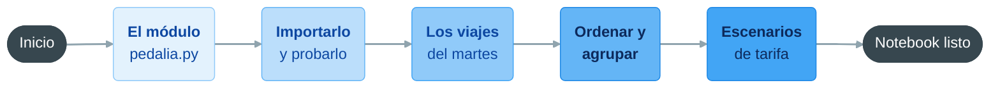

# args, kwargs, lambdas y módulos

**Bloque 3 -- Python para Data Analytics | Sesión 5 de 19**

[← Volver al índice del curso](../../README.md#bloque-3--python-para-data-analytics)

---

## 1. Introducción

En la 3.2.1 convertimos la tarifa de Pedalia en una función, `precio_viaje`, y la probamos con los casos límite. Funciona, pero tiene dos limitaciones. La primera es de **flexibilidad**: si Marta quiere saber qué pasaría con otra tarifa, solo podemos cambiar el suplemento eléctrico, que es el único precio que la función recibe como parámetro. La segunda es de **sitio**: la función vive dentro del notebook `3.2.1-tarifas.ipynb`, y para usarla en otro notebook tendríamos que copiarla, con el mismo problema de las copias que la 3.2.1 venía a resolver.

Hoy resolvemos las dos. En la primera parte veremos tres formas de dar más flexibilidad a una función: recibir **cualquier número de argumentos** (`*args`), recibir **argumentos por nombre que no conocemos de antemano** (`**kwargs`) y recibir **otra función como argumento**, que muchas veces se escribe en una sola línea con `lambda`. En la segunda parte aprenderemos a guardar nuestras funciones en un **módulo**, un archivo `.py` que cualquier notebook puede importar, igual que importa las librerías de Python.

En la práctica crearemos `pedalia.py`, el módulo con la tarifa y el lector del registro de viajes que usaremos en el resto del bloque, y lo usaremos para comparar varias tarifas posibles con los viajes de todo el martes.

### Objetivos de la sesión
- Escribir funciones que reciben un número variable de argumentos con `*args` y argumentos por nombre libres con `**kwargs`.
- Desempaquetar una lista o un diccionario al llamar a una función con `*` y `**`.
- Pasar una función como argumento, y escribir funciones de una línea con `lambda`.
- Ordenar y buscar el máximo o el mínimo según un criterio con `sorted`, `max` y `min` y su parámetro `key`.
- Importar módulos de la librería estándar y crear un módulo propio.

### Prerequisitos
- Sesión 3.2.1 completada: las funciones `precio_viaje`, `leer_viaje` y `estado_estacion`, y los viajes de la mañana y de la tarde del martes.

---

## 2. Un número variable de argumentos: *args

### Empaquetar los argumentos en una tupla

`print` acepta tantos valores como le pasemos: `print("a")`, `print("a", "b", "c")`. Nuestras funciones, en cambio, tienen un número fijo de parámetros. Para escribir una que acepte cualquier número, ponemos un asterisco delante del parámetro:

```python
def minutos_totales(*duraciones):
    """Suma de las duraciones de los viajes que se le pasen, en minutos."""
    return sum(duraciones)

print(minutos_totales(14, 9, 38))
print(minutos_totales(75))
print(minutos_totales())
```

```
61
75
0
```

El asterisco **empaqueta** todos los argumentos posicionales en una **tupla**: dentro de la función, `duraciones` vale `(14, 9, 38)` en la primera llamada, `(75,)` en la segunda y una tupla vacía en la tercera. Por eso `sum(duraciones)` funciona en los tres casos. Por convención, este parámetro se suele llamar `args` (de *arguments*), y de ahí el nombre `*args`, pero lo que importa es el asterisco: un nombre que diga qué contiene, como `duraciones`, se lee mejor.

### Desempaquetar una lista al llamar

El asterisco también funciona al revés, **en la llamada**: delante de una lista o una tupla, la **desempaqueta** y pasa cada elemento como un argumento separado. Con la lista `minutos` de los doce viajes de la mañana:

```python
minutos_totales(*minutos)
```

```
318
```

`minutos_totales(*minutos)` equivale a escribir `minutos_totales(14, 9, 38, 22, ...)` con los doce valores. Sin el asterisco, la función recibiría **un solo** argumento, la lista entera, y `sum` intentaría sumar una lista a un número:

```python
minutos_totales(minutos)
```

```
TypeError: unsupported operand type(s) for +: 'int' and 'list'
```

Lo mismo hace `print` por dentro, que también está escrita con `*args`. Por eso podemos desempaquetar una lista para imprimir sus elementos separados por espacios, o elegir otro separador con su parámetro `sep`:

```python
print(*minutos[:4])
print("Plaza Mayor", "Campus Universitario", "Parque del Río", sep=" → ")
```

```
14 9 38 22
Plaza Mayor → Campus Universitario → Parque del Río
```

### Parámetros que solo se pueden pasar por nombre

¿Y si una función con `*args` necesita también un parámetro normal, por ejemplo un límite? Todos los argumentos posicionales van a parar a la tupla, así que ese parámetro **solo se puede pasar por nombre**. Se escribe detrás de `*args`, normalmente con un valor por defecto:

```python
def viajes_largos(*duraciones, limite=30):
    """Duraciones que superan el límite, en minutos."""
    return [d for d in duraciones if d > limite]

print(viajes_largos(14, 38, 75, 22))
print(viajes_largos(14, 38, 75, 22, limite=60))
print(viajes_largos(*minutos, limite=45))
```

```
[38, 75]
[75]
[75, 64]
```

Si escribiéramos `viajes_largos(14, 38, 75, 22, 60)`, el 60 sería una duración más, no el límite. Obligar a pasar un parámetro por nombre tiene una ventaja que aprovecharemos en la práctica: la llamada se lee sola. `limite=60` no deja dudas; un 60 suelto, sí.

---

## 3. Argumentos por nombre libres: **kwargs

### Empaquetar en un diccionario

Con **dos** asteriscos, el parámetro recoge todos los argumentos **por nombre** que no correspondan a otro parámetro, y los guarda en un **diccionario**. Es útil cuando una función acepta datos opcionales que no podemos enumerar de antemano. Por ejemplo, la ficha de una estación, en la que siempre hay nombre y capacidad, y el resto depende de lo que sepamos:

```python
def ficha_estacion(nombre, capacidad, **datos):
    """Diccionario con los datos de una estación: nombre, capacidad y los que se añadan."""
    ficha = {"nombre": nombre, "capacidad": capacidad}
    ficha.update(datos)
    return ficha

print(ficha_estacion("Plaza Mayor", 24))
print(ficha_estacion("Parque del Río", 16, barrio="Ribera", bicis=12, cubierta=False))
```

```
{'nombre': 'Plaza Mayor', 'capacidad': 24}
{'nombre': 'Parque del Río', 'capacidad': 16, 'barrio': 'Ribera', 'bicis': 12, 'cubierta': False}
```

En la segunda llamada, `datos` vale `{"barrio": "Ribera", "bicis": 12, "cubierta": False}`, y el método `update` lo añade a la ficha. Por convención este parámetro se llama `kwargs` (*keyword arguments*), y de ahí `**kwargs`.

### Desempaquetar un diccionario al llamar

Igual que `*` desempaqueta una lista en argumentos posicionales, `**` desempaqueta un diccionario en **argumentos por nombre**: cada clave se convierte en el nombre de un parámetro y cada valor, en su argumento. Es muy práctico para guardar una configuración y reutilizarla. Con la función `estado_estacion` de la 3.2.1:

```python
criterio = {"umbral_vacia": 0.15, "umbral_llena": 0.7}
estado_estacion(12, 16, **criterio)
```

```
'casi llena'
```

Es lo mismo que escribir `estado_estacion(12, 16, umbral_vacia=0.15, umbral_llena=0.7)`. Las claves tienen que coincidir con los nombres de los parámetros: una clave que no corresponda a ninguno da `TypeError: ... got an unexpected keyword argument`.

### Reenviar argumentos a otra función

El uso más habitual de `**kwargs` combina las dos cosas: una función recoge los argumentos por nombre que no necesita ella y se los **pasa** tal cual a otra función. Así no tiene que repetir todos sus parámetros:

```python
def estados_red(red, **umbrales):
    """Estado de cada estación de la red: {nombre: estado}."""
    return {e["nombre"]: estado_estacion(e["bicis"], e["capacidad"], **umbrales) for e in red}

print(estados_red(red))
print(estados_red(red, umbral_llena=0.7))
```

```
{'Plaza Mayor': 'normal', 'Estación Central': 'casi vacía', 'Campus Universitario': 'casi llena', 'Parque del Río': 'normal', 'Hospital General': 'casi vacía', 'Mercado Central': 'normal'}
{'Plaza Mayor': 'normal', 'Estación Central': 'casi vacía', 'Campus Universitario': 'casi llena', 'Parque del Río': 'casi llena', 'Hospital General': 'casi vacía', 'Mercado Central': 'normal'}
```

`estados_red` no sabe qué umbrales existen: los recibe en `umbrales` y se los entrega a `estado_estacion`. Si mañana `estado_estacion` tiene un parámetro nuevo, `estados_red` lo aceptará sin cambiar una línea. Es lo que haremos en la práctica con los precios de la tarifa.

### El orden de los parámetros

Una función puede combinar todos los tipos de parámetros, pero siempre en este orden:

| Orden | Tipo | Ejemplo |
|:---:|---|---|
| 1 | Posicionales | `minutos, usuario` |
| 2 | Con valor por defecto | `bici="mecánica"` |
| 3 | `*args` | `*duraciones` |
| 4 | Solo por nombre | `limite=30` |
| 5 | `**kwargs` | `**datos` |

No hace falta usarlos todos; casi ninguna función lo hace. Lo habitual es combinar dos o tres.

### La frase clave

> Un asterisco **empaqueta** los argumentos posicionales sobrantes en una tupla; dos, los argumentos por nombre en un diccionario. En la llamada hacen lo contrario: **desempaquetan** una lista o un diccionario en argumentos.

---

## 4. Funciones como argumentos y lambda

### Ordenar con un criterio: key

En la 3.2.1 vimos que una función es un valor más: se puede guardar en una variable o pasar como argumento. `sorted`, `max` y `min` lo aprovechan con su parámetro **`key`**, que recibe una **función**: en lugar de comparar los elementos directamente, comparan lo que esa función devuelve para cada uno.

Ordenar la lista `red` directamente no tiene sentido, porque Python no sabe comparar dos diccionarios. Pero podemos decirle con qué criterio ordenar, por ejemplo la ocupación:

```python
def ocupacion_estacion(estacion):
    """Ocupación de una estación de la red (entre 0 y 1)."""
    return estacion["bicis"] / estacion["capacidad"]

for e in sorted(red, key=ocupacion_estacion):
    print(f"{e['nombre']:<22}{ocupacion_estacion(e):>7.1%}")
```

```
Hospital General        11.1%
Estación Central        13.3%
Plaza Mayor             37.5%
Mercado Central         55.0%
Parque del Río          75.0%
Campus Universitario    85.0%
```

Fijémonos en que pasamos `ocupacion_estacion` **sin paréntesis**: le damos a `sorted` la función, no su resultado. Es `sorted` quien la llama, una vez por cada estación, y ordena según los valores que obtiene. Es la misma idea que un `ORDER BY` con una expresión en SQL.

### Funciones de una línea: lambda

Escribir un `def` para un criterio que solo usamos una vez es mucho ceremonial. Para eso existe **`lambda`**, que crea una función pequeña sin nombre, en una línea:

```python
print([e["nombre"] for e in sorted(red, key=lambda e: e["capacidad"] - e["bicis"], reverse=True)])
```

```
['Estación Central', 'Hospital General', 'Plaza Mayor', 'Mercado Central', 'Parque del Río', 'Campus Universitario']
```

`lambda e: e["capacidad"] - e["bicis"]` es una función que recibe una estación `e` y devuelve sus anclajes libres. Se lee así: **`lambda` parámetros `:` expresión**. No lleva `return`: devuelve el resultado de la expresión. Con `reverse=True`, de más anclajes libres a menos: Estación Central, con 26 libres, es la que más bicis podría recibir.

`max` y `min` aceptan el mismo `key`, y devuelven el **elemento** entero, no el valor del criterio:

```python
print(max(red, key=lambda e: e["capacidad"] - e["bicis"])["nombre"])
print(min(red, key=lambda e: e["bicis"])["nombre"])
```

```
Estación Central
Hospital General
```

Es el patrón "buscar el máximo" de la 3.1.3, que allí necesitaba un bucle con dos variables, resuelto en una línea.

Para ordenar por **varios criterios**, la lambda devuelve una tupla: Python compara las tuplas elemento a elemento, como un `ORDER BY barrio, bicis DESC`. El signo menos invierte el orden del segundo criterio, porque es un número:

```python
for e in sorted(red, key=lambda e: (e["barrio"], -e["bicis"])):
    print(f"{e['barrio']:<13}{e['nombre']:<22}{e['bicis']:>3}")
```

```
Centro       Mercado Central        11
Centro       Plaza Mayor             9
Estación     Estación Central        4
Norte        Hospital General        2
Ribera       Parque del Río         12
Universidad  Campus Universitario   17
```

Una lambda solo puede tener **una expresión**: ni varias líneas, ni bucles, ni `return`. Si el criterio necesita más, se escribe con `def`. Y no se asigna a una variable (`ocupacion = lambda e: ...`): para una función con nombre, `def` es más claro y permite docstring.

### Nuestras funciones también pueden recibir funciones

No solo las funciones de Python aceptan funciones. Una función que cuente los elementos de cada grupo, recibiendo **cómo** se calcula el grupo, sirve para agrupar cualquier cosa:

```python
def agrupar(elementos, clave):
    """Número de elementos de cada grupo. `clave` es una función que devuelve el grupo."""
    grupos = {}
    for elemento in elementos:
        grupo = clave(elemento)
        grupos[grupo] = grupos.get(grupo, 0) + 1
    return grupos

print(agrupar(minutos, lambda m: "largo" if m > 30 else "corto"))
print(agrupar(red, lambda e: e["barrio"]))
print(agrupar(red, lambda e: estado_estacion(e["bicis"], e["capacidad"])))
```

```
{'corto': 8, 'largo': 4}
{'Centro': 2, 'Estación': 1, 'Universidad': 1, 'Ribera': 1, 'Norte': 1}
{'normal': 3, 'casi vacía': 2, 'casi llena': 1}
```

La misma función cuenta viajes por duración, estaciones por barrio y estaciones por estado. Lo único que cambia es la lambda. Es exactamente la idea del `groupby` de pandas, que veremos en la 3.4.1: la función de agrupar la escribe la librería, y nosotros solo decimos por qué agrupar.

### map y filter

En código ajeno veremos a menudo dos funciones clásicas que reciben una función: **`map`** aplica una función a cada elemento y **`filter`** se queda con los que la cumplen. Devuelven un objeto que se recorre de uno en uno, así que para verlo entero lo convertimos en lista:

```python
print(list(map(lambda m: m / 60, minutos[:3])))
print(list(filter(lambda m: m > 30, minutos)))
```

```
[0.23333333333333334, 0.15, 0.6333333333333333]
[38, 31, 75, 64]
```

Hacen lo mismo que las comprehensions de la 3.1.3, `[m / 60 for m in minutos[:3]]` y `[m for m in minutos if m > 30]`, que en Python se consideran más legibles. Las usaremos nosotros; `map` y `filter`, basta con reconocerlas.

### La frase clave

> Una función es un valor: se puede pasar a otra función **sin paréntesis**, para que sea ella quien la llame. `key` dice a `sorted`, `max` y `min` con qué criterio comparar, y `lambda` escribe ese criterio en una línea.

---

## 5. Módulos: código que se importa

### La librería estándar

Python trae instaladas cientos de funciones que no están disponibles hasta que las pedimos. Están organizadas en **módulos**, y para usar uno lo **importamos** con `import`. Por ejemplo, `math` tiene funciones matemáticas; `math.ceil` redondea hacia arriba, que es justo lo que hace la tarifa con los bloques de 30 minutos "o fracción":

```python
import math

print(math.ceil(17 / 30), math.ceil(30 / 30), math.floor(2.9), math.sqrt(16))
```

```
1 1 2 4.0
```

`math.ceil(17 / 30)` da 1: diecisiete minutos de exceso son un bloque. Hay tres formas de importar, y las tres son habituales:

```python
import statistics                       # el módulo entero: statistics.median(...)
from statistics import mean, median     # solo algunas funciones, sin el prefijo
import statistics as st                 # el módulo con un alias corto: st.stdev(...)

print(mean(minutos), median(minutos), round(st.stdev(minutos), 1))
```

```
26.5 18.0 22.2
```

La media y la mediana de los viajes de la mañana, las mismas que calculamos a mano en la 3.1.2, ahora en una línea. La tercera forma, con alias, es la que veremos en todas partes a partir de la 3.3: `import pandas as pd`, `import numpy as np`. Son nombres tan extendidos que conviene usar los mismos para que cualquiera entienda nuestro código.

La primera forma es la más clara cuando usamos pocas funciones de un módulo, porque el prefijo dice de dónde viene cada una: `statistics.median` no se confunde con ninguna función nuestra. La segunda es cómoda, pero si importamos un nombre que ya teníamos, **lo sustituye** sin avisar.

### Un módulo propio

Un módulo no es más que un **archivo `.py` con código de Python**. Cualquier archivo que escribamos se puede importar igual que `math`. Vamos a guardar las funciones de las estaciones de la 3.2.1 en un archivo `estaciones.py`, en la **misma carpeta** que el notebook. En VS Code: clic derecho en la carpeta → **New File...** → `estaciones.py`, y escribimos:

```python
# estaciones.py
"""Funciones para analizar las estaciones de Pedalia."""


def ocupacion(bicis, capacidad):
    """Fracción de anclajes ocupados de una estación (entre 0 y 1)."""
    if capacidad <= 0:
        raise ValueError(f"capacidad no válida: {capacidad}")
    if bicis < 0 or bicis > capacidad:
        raise ValueError(f"{bicis} bicis no caben en {capacidad} anclajes")
    return bicis / capacidad


def estado_estacion(bicis, capacidad, umbral_vacia=0.2, umbral_llena=0.8):
    """Clasifica una estación según su ocupación: casi vacía, normal o casi llena."""
    ocupacion_actual = ocupacion(bicis, capacidad)
    if ocupacion_actual < umbral_vacia:
        return "casi vacía"
    elif ocupacion_actual > umbral_llena:
        return "casi llena"
    else:
        return "normal"
```

Lo guardamos con `Ctrl + S`. No se ejecuta como un notebook: es solo un archivo de texto con definiciones. La primera línea es un comentario con el nombre del archivo, y la segunda, el **docstring del módulo**, que explica qué contiene.

Desde el notebook lo importamos por su nombre, **sin** el `.py`, y usamos sus funciones con el prefijo:

```python
import estaciones

print(estaciones.ocupacion(2, 18))
print(estaciones.estado_estacion(2, 18))
print(estaciones.__doc__)
```

```
0.1111111111111111
casi vacía
Funciones para analizar las estaciones de Pedalia.
```

Al ejecutar `import estaciones`, Python busca un archivo `estaciones.py`, lo ejecuta de arriba abajo (con lo que se definen sus funciones) y deja todo lo que contiene accesible con el prefijo `estaciones.`. A partir de ahí, cualquier notebook de la carpeta puede usar esas funciones sin copiarlas, y si corregimos una, la corrección llega a todos.

### Dónde busca Python los módulos

Cuando hacemos `import algo`, Python busca, en este orden:

1. Un archivo `algo.py` en la **carpeta del notebook** (o del programa que se está ejecutando).
2. Un módulo de la **librería estándar** con ese nombre, como `math` o `statistics`.
3. Una librería **instalada** en el entorno, como pandas en el `.venv` (sesión 0.1.5).

El primer punto tiene una trampa: si llamamos a un archivo nuestro como un módulo de Python, `statistics.py` o `math.py`, el nuestro **tapa** al de verdad, y el siguiente `import statistics` cargará nuestro archivo. Los módulos propios llevan nombres que no puedan confundirse: `estaciones.py`, `pedalia.py`.

### Si cambiamos el módulo, reiniciamos el kernel

Python importa cada módulo **una sola vez** por sesión del kernel. Si después de importarlo cambiamos `estaciones.py` y volvemos a ejecutar `import estaciones`, no pasa nada: Python ve que ya lo tiene y no lo vuelve a leer, así que seguimos usando la versión antigua. Es el error número 1 de quien empieza con módulos, y la solución es la de siempre: **Restart** y **Run All**.

### La frase clave

> Un módulo es un archivo `.py` que se importa: se escribe una vez y lo usan todos los notebooks. Las funciones de un análisis viven en el módulo; el notebook las importa, carga los datos y cuenta la historia.

---

## 6. Práctica: la caja de herramientas de Pedalia

Vamos a pasar a un módulo la tarifa y el lector del registro de la 3.2.1, haciendo la tarifa más flexible, y a usarlo para comparar varias tarifas con los viajes de todo el martes.



### Paso 1: el módulo pedalia.py

En `practicas/bloque-03/` creamos el archivo `pedalia.py`. Contiene las funciones de la 3.2.1 con tres mejoras:

- `bloques_extra` usa `math.ceil`, que redondea hacia arriba, en lugar de un `if` con tres casos.
- En `precio_viaje`, **todos los precios** de la tarifa son parámetros con los valores vigentes por defecto. Van detrás de un `*` suelto, que significa "lo que siga, solo por nombre": así nadie puede pasar un precio por posición y confundirlo con otro.
- El bucle que separaba los viajes válidos de los rechazados es ahora una función, `leer_registro`, y hay una función nueva, `resumen_por`, que agrupa los viajes con una función `clave` y reenvía los cambios de tarifa a `precio_viaje` con `**tarifa`.

```python
# pedalia.py
"""Funciones de Pedalia: la tarifa y la lectura del registro de viajes."""

import math


def bloques_extra(minutos):
    """Bloques de 30 minutos (o fracción) que pasan de los 30 primeros."""
    return max(0, math.ceil((minutos - 30) / 30))


def precio_viaje(minutos, usuario, bici="mecánica", *, suplemento=0.40,
                 base_ocasional=1.50, bloque_ocasional=1.00, bloque_abonado=0.50):
    """Precio de un viaje de Pedalia, en euros.

    Los precios de la tarifa se pasan por nombre y valen, por defecto, los
    vigentes. Sirven para simular otras tarifas:
    precio_viaje(64, "ocasional", "eléctrica", suplemento=0.60)
    """
    if minutos <= 0:
        raise ValueError(f"duración no válida: {minutos}")

    if usuario == "abonado":
        precio = bloques_extra(minutos) * bloque_abonado
    elif usuario == "ocasional":
        precio = base_ocasional + bloques_extra(minutos) * bloque_ocasional
    else:
        raise ValueError(f"tipo de usuario desconocido: {usuario!r}")

    if bici == "eléctrica":
        precio += suplemento
    return round(precio, 2)


def leer_viaje(linea):
    """Convierte una línea del registro ("id;origen;destino;minutos;usuario;bici")
    en un diccionario de viaje. Lanza ValueError si la línea no es válida."""
    id_viaje, origen, destino, minutos, usuario, bici = linea.split(";")
    viaje = {
        "id": int(id_viaje),
        "origen": origen.strip(),
        "destino": destino.strip(),
        "minutos": int(minutos),
        "usuario": usuario.strip().lower(),
        "bici": bici.strip().lower(),
    }
    precio_viaje(viaje["minutos"], viaje["usuario"], viaje["bici"])   # valida el viaje
    return viaje


def leer_registro(lineas):
    """Lee las líneas de un registro. Devuelve (válidos, rechazados), donde cada
    rechazado es una tupla (línea, motivo)."""
    validos, rechazados = [], []
    for linea in lineas:
        try:
            validos.append(leer_viaje(linea))
        except ValueError as error:
            rechazados.append((linea, str(error)))
    return validos, rechazados


def resumen_por(viajes, clave, **tarifa):
    """Viajes e ingresos de cada grupo: {grupo: {"viajes": n, "ingresos": euros}}.

    clave   función que recibe un viaje y devuelve su grupo
    tarifa  precios de la tarifa que se quieran cambiar (ver precio_viaje)
    """
    resumen = {}
    for viaje in viajes:
        grupo = clave(viaje)
        precio = precio_viaje(viaje["minutos"], viaje["usuario"], viaje["bici"], **tarifa)
        if grupo not in resumen:
            resumen[grupo] = {"viajes": 0, "ingresos": 0.0}
        resumen[grupo]["viajes"] += 1
        resumen[grupo]["ingresos"] = round(resumen[grupo]["ingresos"] + precio, 2)
    return resumen
```

Fijémonos en dos detalles. `leer_viaje` ya no guarda el precio en el viaje: el precio depende de la tarifa, y queremos poder calcularlo con varias. Solo llama a `precio_viaje` para **validar** el viaje: si la duración o el tipo de usuario no son válidos, lanza el `ValueError` y `leer_registro` lo rechaza. Y el `import math` va al principio del módulo, no dentro de la función: un módulo importa lo que necesita, y quien lo usa no tiene que saberlo.

### Paso 2: importar y probar el módulo

En la misma carpeta creamos `3.2.2-tarifas.ipynb`, con el kernel `.venv` y su cabecera en Markdown. En la primera celda de código importamos el módulo y repetimos las pruebas de la 3.2.1. Con `bloques_extra` reescrita, son más importantes que nunca: comprueban que la versión con `math.ceil` da lo mismo que la anterior en los casos límite.

```python
import pedalia

assert pedalia.bloques_extra(30) == 0
assert pedalia.bloques_extra(31) == 1
assert pedalia.bloques_extra(60) == 1
assert pedalia.bloques_extra(61) == 2
assert pedalia.precio_viaje(30, "abonado") == 0
assert pedalia.precio_viaje(31, "abonado") == 0.50
assert pedalia.precio_viaje(64, "ocasional", "eléctrica") == 3.90
assert pedalia.precio_viaje(64, "ocasional", "eléctrica", suplemento=0.60) == 4.10
print("Todas las pruebas pasan")
```

```
Todas las pruebas pasan
```

### Paso 3: los viajes del martes

Copiamos de la 3.2.1 la lista `viajes` de la mañana y el `registro_tarde`, y leemos el registro con la función del módulo:

```python
viajes = [
    {"id": 1,  "origen": "Plaza Mayor",          "destino": "Campus Universitario", "minutos": 14, "usuario": "abonado",   "bici": "mecánica"},
    {"id": 2,  "origen": "Estación Central",     "destino": "Plaza Mayor",          "minutos": 9,  "usuario": "abonado",   "bici": "eléctrica"},
    {"id": 3,  "origen": "Campus Universitario", "destino": "Parque del Río",       "minutos": 38, "usuario": "ocasional", "bici": "mecánica"},
    {"id": 4,  "origen": "Parque del Río",       "destino": "Mercado Central",      "minutos": 22, "usuario": "ocasional", "bici": "eléctrica"},
    {"id": 5,  "origen": "Hospital General",     "destino": "Estación Central",     "minutos": 31, "usuario": "abonado",   "bici": "mecánica"},
    {"id": 6,  "origen": "Mercado Central",      "destino": "Plaza Mayor",          "minutos": 6,  "usuario": "abonado",   "bici": "mecánica"},
    {"id": 7,  "origen": "Plaza Mayor",          "destino": "Parque del Río",       "minutos": 75, "usuario": "ocasional", "bici": "mecánica"},
    {"id": 8,  "origen": "Estación Central",     "destino": "Hospital General",     "minutos": 17, "usuario": "abonado",   "bici": "eléctrica"},
    {"id": 9,  "origen": "Campus Universitario", "destino": "Plaza Mayor",          "minutos": 12, "usuario": "abonado",   "bici": "mecánica"},
    {"id": 10, "origen": "Plaza Mayor",          "destino": "Estación Central",     "minutos": 11, "usuario": "abonado",   "bici": "eléctrica"},
    {"id": 11, "origen": "Parque del Río",       "destino": "Parque del Río",       "minutos": 64, "usuario": "ocasional", "bici": "eléctrica"},
    {"id": 12, "origen": "Mercado Central",      "destino": "Campus Universitario", "minutos": 19, "usuario": "abonado",   "bici": "mecánica"},
]

registro_tarde = [
    "13;Plaza Mayor;Mercado Central;8;abonado;mecánica",
    "14;Campus Universitario;Plaza Mayor;26;abonado;eléctrica",
    "15;Parque del Río;Parque del Río;95;ocasional;mecánica",
    "16;Estación Central;Hospital General;doce;abonado;mecánica",
    "17;Mercado Central;Parque del Río;41;Ocasional ;eléctrica",
    "18;Hospital General;Estación Central;-3;abonado;mecánica",
    "19;Plaza Mayor;Campus Universitario;33;abonado;eléctrica",
    "20;Parque del Río;Plaza Mayor;57;turista;mecánica",
    "21;Campus Universitario;Mercado Central;15",
]

validos, rechazados = pedalia.leer_registro(registro_tarde)
jornada = viajes + validos
print(f"Viajes del martes: {len(jornada)} válidos, {len(rechazados)} rechazados")
pedalia.resumen_por(jornada, lambda v: v["usuario"])
```

```
Viajes del martes: 17 válidos, 4 rechazados
{'abonado': {'viajes': 11, 'ingresos': 3.0},
 'ocasional': {'viajes': 6, 'ingresos': 19.2}}
```

Los 17 viajes válidos y los 22,20 € de la jornada de la 3.2.1: el módulo da las mismas cifras que el notebook anterior, que es la comprobación que necesitábamos antes de seguir. Jupyter muestra el diccionario en dos líneas porque no cabe en una.

### Paso 4: ordenar y agrupar

¿Cuáles son los viajes que más ingresan? Ordenamos la jornada con una lambda que calcula el precio de cada viaje, y nos quedamos con los cinco primeros:

```python
caros = sorted(jornada,
               key=lambda v: pedalia.precio_viaje(v["minutos"], v["usuario"], v["bici"]),
               reverse=True)

for v in caros[:5]:
    precio = pedalia.precio_viaje(v["minutos"], v["usuario"], v["bici"])
    print(f"{v['id']:>3}  {v['usuario']:<10}{v['bici']:<10}{v['minutos']:>3} min {precio:>5.2f} €")
```

```
 15  ocasional mecánica   95 min  4.50 €
 11  ocasional eléctrica  64 min  3.90 €
  7  ocasional mecánica   75 min  3.50 €
 17  ocasional eléctrica  41 min  2.90 €
  3  ocasional mecánica   38 min  2.50 €
```

Los cinco son viajes de ocasionales de más de media hora. Para comprobar si es la norma, agrupamos con `resumen_por` por tipo de bici y por duración. La función es la misma; solo cambia la lambda:

```python
print(pedalia.resumen_por(jornada, lambda v: v["bici"]))
print(pedalia.resumen_por(jornada, lambda v: "más de 30 min" if v["minutos"] > 30 else "hasta 30 min"))
```

```
{'mecánica': {'viajes': 9, 'ingresos': 11.0}, 'eléctrica': {'viajes': 8, 'ingresos': 11.2}}
{'hasta 30 min': {'viajes': 10, 'ingresos': 3.5}, 'más de 30 min': {'viajes': 7, 'ingresos': 18.7}}
```

Los 7 viajes de más de 30 minutos, el 41 % de la jornada, generan 18,70 € de los 22,20 €: el 84 % de los ingresos por viaje. En la 3.1.3 lo intuimos con los doce viajes de la mañana (77 %); con la jornada completa, la conclusión se refuerza.

### Paso 5: escenarios de tarifa

Marta quiere comparar tres cambios posibles de tarifa con los viajes del martes. Guardamos cada escenario como un **diccionario** con los precios que cambian, y los pasamos a `resumen_por` con `**`, que a su vez los reenvía a `precio_viaje`:

```python
escenarios = {
    "Tarifa actual":                 {},
    "Suplemento eléctrico a 0,60 €": {"suplemento": 0.60},
    "Bloque de ocasional a 1,50 €":  {"bloque_ocasional": 1.50},
    "Bloque de abonado a 1,00 €":    {"bloque_abonado": 1.00},
}

for nombre, cambios in escenarios.items():
    resumen = pedalia.resumen_por(jornada, lambda v: v["usuario"], **cambios)
    total = sum(grupo["ingresos"] for grupo in resumen.values())
    print(f"{nombre:<31}{total:>6.2f} € · abonados {resumen['abonado']['ingresos']:>5.2f} € · "
          f"ocasionales {resumen['ocasional']['ingresos']:>5.2f} €")
```

```
Tarifa actual                   22.20 € · abonados  3.00 € · ocasionales 19.20 €
Suplemento eléctrico a 0,60 €   23.80 € · abonados  4.00 € · ocasionales 19.80 €
Bloque de ocasional a 1,50 €    26.70 € · abonados  3.00 € · ocasionales 23.70 €
Bloque de abonado a 1,00 €      23.20 € · abonados  4.00 € · ocasionales 19.20 €
```

El escenario vacío, `{}`, no cambia nada: `**{}` no pasa ningún argumento, y `precio_viaje` usa todos sus valores por defecto. Es la tarifa actual, y sirve de referencia. Añadir un escenario nuevo es añadir una línea al diccionario: ni `resumen_por` ni `precio_viaje` cambian.

### Paso 6: conclusiones

Cerramos con la celda de Markdown y, antes de guardar, **Restart** y **Run All**:

```markdown
## Escenarios de tarifa

- La tarifa vive ahora en el módulo `pedalia.py`, con todos sus precios como
  parámetros. Da las mismas cifras que la 3.2.1: 22,20 € el martes.
- Los viajes de más de 30 minutos son el 41 % de la jornada, pero generan el
  84 % de los ingresos por viaje, y los cinco más caros son de ocasionales.
- Subir el bloque adicional de los ocasionales a 1,50 € es el cambio que más
  ingresa (+4,50 € al día, un 20 %), y no afecta a los abonados. Subir el
  suplemento a 0,60 € suma 1,60 €, de los que 1 € pagan los abonados.
- Son 17 viajes de un solo día. Antes de proponer nada hay que repetirlo con
  los viajes del año (parte 3.3) y estimar cuántos viajes largos se perderían
  con una tarifa más cara.
```

### Comparar con la solución

Cuando terminemos, comparamos nuestro notebook con la solución de referencia: [Pedalia_3.2.2_resuelto.ipynb](Pedalia_3.2.2_resuelto.ipynb). Es el notebook de esta práctica, ya ejecutado: las salidas de cada celda tienen que coincidir con las nuestras. Para que funcione por sí solo, el resuelto crea `pedalia.py` desde el propio notebook, con una celda que empieza por `%%writefile pedalia.py` (lo explicamos en "Para profundizar").

---

## 7. Ejercicios

Los ejercicios están listos para resolver en el cuaderno [3.2.2 - Ejercicios.ipynb](3.2.2%20-%20Ejercicios.ipynb): lo copiamos a `practicas/bloque-03/`, ejecutamos la celda de datos de partida y resolvemos cada ejercicio en su celda. Debajo de cada uno, plegado, está el resultado esperado. Los datos de partida son la lista `red` de la 3.1.2, la lista `viajes` de la mañana del martes y la función `ocupacion_estacion` de la sección 4. Ninguno necesita el módulo `pedalia.py`.

**Ejercicio 1: la ocupación media.** Escribe una función `ocupacion_media(*estaciones)` que reciba cualquier número de estaciones (diccionarios como los de `red`) y devuelva la ocupación media de todas ellas, calculada con el total de bicis y el total de anclajes. Pruébala con Plaza Mayor y Hospital General, y con toda la red desempaquetando la lista.

<details>
<summary>Ver la solución</summary>

```python
def ocupacion_media(*estaciones):
    """Ocupación conjunta de las estaciones: total de bicis entre total de anclajes."""
    bicis = sum(e["bicis"] for e in estaciones)
    capacidad = sum(e["capacidad"] for e in estaciones)
    return bicis / capacidad

print(f"{ocupacion_media(red[0], red[4]):.1%}")
print(f"{ocupacion_media(*red):.1%}")
```

```
26.2%
43.0%
```

`estaciones` es una tupla con las estaciones que se pasen. Hemos dividido los totales en lugar de hacer la media de las ocupaciones, por lo que vimos en la 1.1.2: la media de dos porcentajes no es el porcentaje del conjunto. Con toda la red, el 43,0 % coincide con el que calculamos con `totales_red` en la 3.2.1.

</details>

**Ejercicio 2: filtrar con condiciones libres.** Escribe una función `filtrar(viajes, **condiciones)` que devuelva los viajes que cumplen **todas** las condiciones, cada una de la forma `campo=valor`. Obtén los `id` de los viajes de ocasionales en bici eléctrica, de los que salen de Plaza Mayor y de todos los viajes, sin condiciones.

<details>
<summary>Ver la solución</summary>

```python
def filtrar(viajes, **condiciones):
    """Viajes que cumplen todas las condiciones campo=valor."""
    return [v for v in viajes
            if all(v[campo] == valor for campo, valor in condiciones.items())]

print([v["id"] for v in filtrar(viajes, usuario="ocasional", bici="eléctrica")])
print([v["id"] for v in filtrar(viajes, origen="Plaza Mayor")])
print(len(filtrar(viajes)))
```

```
[4, 11]
[1, 7, 10]
12
```

`condiciones` es un diccionario como `{"usuario": "ocasional", "bici": "eléctrica"}`. La función `all` devuelve `True` si todas las comparaciones lo son, y con un diccionario vacío también, porque no hay ninguna condición que falle: por eso, sin condiciones, devuelve los doce viajes. Es un `WHERE campo1 = valor1 AND campo2 = valor2` en el que las columnas son parámetros.

</details>

**Ejercicio 3: ordenar los viajes.** Con `sorted` y una lambda, muestra los `id` de los viajes de la mañana ordenados de más largo a más corto. Después, ordénalos por tipo de usuario y, dentro de cada tipo, de más largo a más corto.

<details>
<summary>Ver la solución</summary>

```python
print([v["id"] for v in sorted(viajes, key=lambda v: v["minutos"], reverse=True)])
print([v["id"] for v in sorted(viajes, key=lambda v: (v["usuario"], -v["minutos"]))])
```

```
[7, 11, 3, 5, 4, 12, 8, 1, 9, 10, 2, 6]
[5, 12, 8, 1, 9, 10, 2, 6, 7, 11, 3, 4]
```

En el segundo orden, la lambda devuelve una tupla: primero se compara el usuario (`"abonado"` va antes que `"ocasional"` en orden alfabético) y, en caso de empate, la duración con el signo cambiado, para que vaya de mayor a menor.

</details>

**Ejercicio 4: buscar con max y min.** Usando `max` o `min` con `key`, encuentra: el viaje más largo hecho por un abonado, la estación de `red` con más ocupación y la estación con menos bicis libres para coger, es decir, con menos bicis.

<details>
<summary>Ver la solución</summary>

```python
abonados = [v for v in viajes if v["usuario"] == "abonado"]
mas_largo = max(abonados, key=lambda v: v["minutos"])
print(f"Viaje {mas_largo['id']}: {mas_largo['minutos']} min")
print(max(red, key=ocupacion_estacion)["nombre"])
print(min(red, key=lambda e: e["bicis"])["nombre"])
```

```
Viaje 5: 31 min
Campus Universitario
Hospital General
```

`max` y `min` devuelven el elemento completo, así que podemos pedirle después cualquier campo. Para la ocupación no hace falta una lambda: ya tenemos la función `ocupacion_estacion`, y se la pasamos sin paréntesis.

</details>

**Ejercicio 5: encuentra los errores.** Cada fragmento tiene un error. Di cuál es y cómo se corrige.

```python
# a)
sorted(red, key=ocupacion_estacion())

# b)
largos = list(filter(lambda m: return m > 30, minutos))

# c)
def resumen(**opciones, *valores):
    return valores, opciones

# d)
from math import ceil
print(math.ceil(17 / 30))
```

<details>
<summary>Ver la solución</summary>

- **a)** `TypeError: ocupacion_estacion() missing 1 required positional argument: 'estacion'`. Con los paréntesis, Python **llama** a la función en ese momento, sin argumentos, en lugar de pasársela a `sorted`. Se escribe `key=ocupacion_estacion`.
- **b)** `SyntaxError: invalid syntax`. Una lambda no lleva `return`: devuelve directamente el resultado de su expresión. Se escribe `lambda m: m > 30`.
- **c)** `SyntaxError: arguments cannot follow var-keyword argument`. `**kwargs` va siempre el último. Se escribe `def resumen(*valores, **opciones):`.
- **d)** `NameError: name 'math' is not defined`. `from math import ceil` importa solo la función `ceil`, sin el nombre del módulo. O se llama `ceil(17 / 30)`, o se importa con `import math`.

</details>

**Ejercicio 6: dos versiones, el mismo resultado.** Esta es la versión de `bloques_extra` de la 3.2.1, con condiciones. Comprueba con un `assert` dentro de un bucle que da el mismo resultado que la versión con `math.ceil` del módulo para todas las duraciones de 1 a 300 minutos.

```python
def bloques_extra_condiciones(minutos):
    exceso = minutos - 30
    if exceso <= 0:
        return 0
    elif exceso % 30 == 0:
        return exceso // 30
    else:
        return exceso // 30 + 1
```

<details>
<summary>Ver la solución</summary>

```python
import math

def bloques_extra_ceil(minutos):
    return max(0, math.ceil((minutos - 30) / 30))

for m in range(1, 301):
    assert bloques_extra_condiciones(m) == bloques_extra_ceil(m), m
print("Las dos versiones coinciden de 1 a 300 minutos")
```

```
Las dos versiones coinciden de 1 a 300 minutos
```

Probar 300 casos en lugar de los cuatro casos límite da mucha más confianza al cambiar una función por otra. El `, m` después de la condición es el mensaje del `assert`: si alguno fallara, el `AssertionError` diría con qué duración. Es la idea de las pruebas automáticas que mencionamos en la 3.2.1: antes de sustituir una función, comprobar que la nueva hace lo mismo.

</details>

---

## 8. Lo que hay por debajo: qué hace Python al importar

### import ejecuta el módulo, una vez

Al ejecutar `import pedalia`, Python hace tres cosas: busca el archivo (sección 5), lo **ejecuta** de arriba abajo, como si fuera una celda enorme, y guarda el resultado en un objeto **módulo** al que pega la etiqueta `pedalia`. Todo lo que el archivo define (funciones, variables, otros módulos importados) queda dentro de ese objeto, y se accede con el punto: `pedalia.precio_viaje`, `pedalia.math`.

Python apunta además cada módulo importado en un registro interno, un diccionario llamado `sys.modules`. En el siguiente `import pedalia`, mira primero ahí: si ya está, no vuelve a leer el archivo. Por eso los cambios en `pedalia.py` no llegan al notebook hasta que reiniciamos el kernel, y por eso importar es rápido aunque lo hagamos en muchas celdas.

### La carpeta `__pycache__`

Después del primer `import` aparece, junto a `pedalia.py`, una carpeta `__pycache__` con un archivo `.pyc`. Es el módulo **traducido** a un formato intermedio que Python ejecuta más deprisa. Python la crea y la actualiza solo: no hay que tocarla ni subirla a GitHub (en el `.gitignore` de la 0.1.2 ya la excluimos).

### Un nombre, un espacio

Cada módulo tiene su propio **espacio de nombres**: el `precio_viaje` de `pedalia` y una función `precio_viaje` que definamos en el notebook son dos cosas distintas, y no se pisan mientras usemos el prefijo. Es la misma idea que el ámbito de las funciones de la 3.2.1, a escala de archivo. Lo que sí pisa es `from pedalia import precio_viaje`: trae el nombre al notebook, y si ya existía, lo sustituye.

### *args y **kwargs no son magia

Dentro de la función, `*duraciones` es una tupla normal y `**datos` un diccionario normal: se recorren, se indexan y se pasan a otras funciones como cualquier otra tupla o diccionario. Lo único especial es el momento de la llamada, en el que Python reparte los argumentos: primero los posicionales, en orden, a los parámetros normales; los que sobran, a la tupla; después los argumentos por nombre, a su parámetro, y los que no tienen parámetro, al diccionario. Si un argumento no encuentra sitio, por ejemplo uno por nombre en una función sin `**kwargs`, la llamada da `TypeError`.

---

## 9. Errores comunes y troubleshooting

**1. "He cambiado `pedalia.py` y el notebook sigue igual".** El módulo se importó antes del cambio y Python no lo vuelve a leer. **Restart** y **Run All**.

**2. "ModuleNotFoundError: No module named 'pedalia'".** El archivo no está en la misma carpeta que el notebook, o tiene otro nombre (por ejemplo, `pedalia.py.txt`, si el sistema oculta las extensiones). Comprobamos en el explorador de VS Code que `pedalia.py` está junto a `3.2.2-tarifas.ipynb`.

**3. "AttributeError: module 'pedalia' has no attribute 'resumen_por'".** La función no está en el módulo, tiene otro nombre o el archivo no se ha guardado (VS Code marca con un punto la pestaña de un archivo sin guardar). Guardamos y reiniciamos el kernel.

**4. "Mi módulo `statistics.py` rompe la librería".** Un archivo nuestro con el nombre de un módulo de Python lo tapa. Le cambiamos el nombre y borramos la carpeta `__pycache__`.

**5. "TypeError: ... missing 1 required positional argument" en un `key=`.** Hemos escrito la función con paréntesis, `key=ocupacion_estacion()`, y Python la llama sin argumentos (ejercicio 5a).

**6. "TypeError: '<' not supported between instances of 'dict' and 'dict'".** Hemos ordenado una lista de diccionarios sin `key`. Python no sabe comparar dos diccionarios: hay que decirle por qué campo ordenar.

**7. "TypeError: precio_viaje() takes from 2 to 3 positional arguments but 4 were given".** Hemos pasado un precio de la tarifa por posición, `precio_viaje(64, "ocasional", "eléctrica", 0.60)`. Los parámetros detrás del `*` solo se pasan por nombre: `suplemento=0.60`.

**8. "TypeError: ... got an unexpected keyword argument 'suplmento'".** Una clave de un diccionario desempaquetado con `**`, o un argumento por nombre, no coincide con ningún parámetro. Suele ser una errata.

**9. "SyntaxError" en una lambda.** Una lambda solo admite una expresión: ni `return`, ni asignaciones, ni varias líneas. Si el criterio no cabe en una expresión, se escribe con `def`.

---

## 10. Conclusión

En esta sesión hemos dado más flexibilidad a nuestras funciones y les hemos buscado un sitio propio. Con `*args` hemos escrito funciones que aceptan cualquier número de argumentos, con `**kwargs` funciones que aceptan argumentos por nombre que no conocen y reenvían a otras, y con `*` y `**` en la llamada hemos desempaquetado listas y diccionarios en argumentos. Hemos visto que una función se puede pasar a otra sin paréntesis, como hacen `sorted`, `max` y `min` con su parámetro `key`, y que `lambda` escribe esos criterios en una línea. En la segunda parte hemos importado módulos de la librería estándar y hemos creado los nuestros: un archivo `.py` que cualquier notebook puede importar, y que hay que volver a cargar reiniciando el kernel cuando cambia. El resultado es el módulo `practicas/bloque-03/pedalia.py`, con la tarifa de Pedalia y todos sus precios como parámetros, y el notebook `3.2.2-tarifas.ipynb`, que lo usa para comparar escenarios: con los viajes del martes, subir el bloque adicional de los ocasionales a 1,50 € ingresaría un 20 % más sin tocar a los abonados. En la 3.2.3 daremos el último paso de esta parte: juntaremos los datos y las funciones que trabajan con ellos en **clases**, y veremos cómo una estación o un tipo de usuario pueden ser objetos con sus propios métodos.

---

## 11. Para profundizar

### if __name__ == "__main__"

Un módulo puede incluir código de prueba que se ejecute solo cuando se lanza el archivo directamente (`python pedalia.py` en la terminal), y no cuando se importa:

```python
if __name__ == "__main__":
    print(precio_viaje(64, "ocasional", "eléctrica"))
```

Python da a la variable `__name__` el valor `"__main__"` cuando ejecuta el archivo como programa, y el nombre del módulo (`"pedalia"`) cuando lo importa. Es una convención muy extendida para que un archivo sea a la vez módulo y programa.

### Recargar sin reiniciar: autoreload

Reiniciar el kernel cada vez que tocamos el módulo obliga a ejecutar todo de nuevo. IPython, el motor de Jupyter, tiene una extensión que recarga los módulos automáticamente antes de cada celda:

```python
%load_ext autoreload
%autoreload 2
```

Es cómoda mientras desarrollamos el módulo, pero conviene terminar siempre con un **Restart** y **Run All** para asegurarnos de que el notebook funciona desde cero.

### Crear un archivo desde el notebook: %%writefile

Una celda que empieza por `%%writefile pedalia.py` no se ejecuta como Python: escribe su contenido en ese archivo. Es lo que usa el notebook resuelto de esta sesión para crear el módulo y funcionar por sí solo. En un proyecto real, el módulo se edita como archivo en VS Code, con su resaltado y sus avisos de errores; `%%writefile` es útil para notebooks que tienen que ser autosuficientes, como un ejemplo que se comparte.

### Paquetes

Cuando un proyecto tiene muchos módulos, se agrupan en una carpeta, que se convierte en un **paquete**: `pedalia/tarifas.py`, `pedalia/estaciones.py`, y se importan como `from pedalia import tarifas`. Así están organizadas las librerías grandes: `pandas` es una carpeta con cientos de módulos. Para empezar, un solo módulo bien nombrado es suficiente.

### functools.partial

Hay una tercera forma de fijar argumentos además de los valores por defecto y `**`: `functools.partial` crea una versión de una función con algunos argumentos ya puestos. `precio_ocasional = partial(precio_viaje, usuario="ocasional")` es una función a la que solo hay que pasarle los minutos. Se usa poco en análisis de datos, pero aparece en código ajeno.

---

## 12. Recursos

- **Tutorial oficial de Python: más sobre definir funciones** (`*args`, `**kwargs`, lambda; en español): <https://docs.python.org/es/3/tutorial/controlflow.html#more-on-defining-functions>
- **Tutorial oficial de Python: módulos** (en español): <https://docs.python.org/es/3/tutorial/modules.html>
- **Guía de ordenación de Python** (`sorted`, `key`, varios criterios): <https://docs.python.org/es/3/howto/sorting.html>
- **Índice de la librería estándar de Python**, para ver qué módulos trae: <https://docs.python.org/es/3/library/index.html>
- **Documentación de los módulos `math` y `statistics`:** <https://docs.python.org/3/library/math.html> y <https://docs.python.org/3/library/statistics.html>

---

*Guía del alumno · Sesión 5 · Bloque 3 - Python para Data Analytics · Pedalia*
